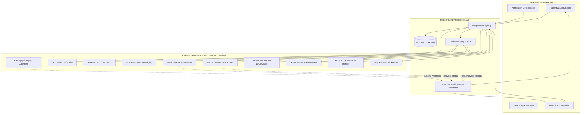

# ASRTAVA Centralized Integration Architecture

## 1. Architectural Philosophy
ASRTAVA employs a decoupled, adapter-based integration layer situated between internal hospital clinical workflows and external third-party services. The architectural mandate ensures that changing an SMS gateway, swapping a payment processor, or connecting a new laboratory analyzer does not require altering core HMS services or clinical records.

## 2. Layered Responsibilities
1. **Provider Abstraction Layer (`interfaces.ts`)**: Defines strongly typed TypeScript contracts (`ICommunicationProvider`, `IPaymentGatewayProvider`, `ILaboratoryLISProvider`, `IPACSProvider`, `ICloudStorageProvider`).
2. **Encrypted Credential Vault (`credential-vault.ts`)**: Stores API keys, client secrets, and mTLS certificates with AES-256-GCM authenticated encryption and tenant-specific key isolation.
3. **Multi-Tenant Scoping**: All tenant integrations are tied to `hospital_id` with PostgreSQL Row-Level Security (RLS) policies. Platform super-administrators configure approved catalog providers; hospital administrators configure tenant-specific credentials and sender headers.
4. **Resilience & Fallback Engine**: Configurable fallback chains (e.g. WhatsApp -> SMS -> In-App) ensure mission-critical clinical communications are delivered even during telecom carrier downtimes.
5. **Outbox Pattern & Dead-Letter Queue (DLQ)**: Guarantees at-least-once delivery for asynchronous notifications and third-party synchronizations with exponential backoff (1s, 2s, 4s, 8s...).

