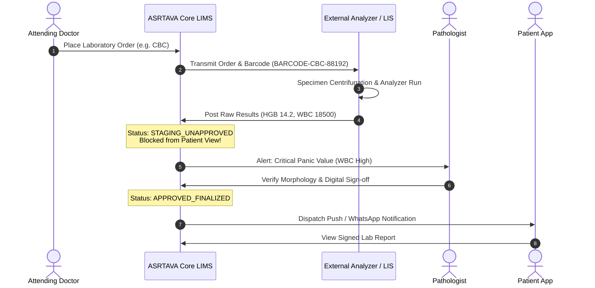

# ASRTAVA Laboratory Information Systems (LIS) Integration Guide

## 1. Overview
ASRTAVA provides a bidirectional integration framework for external laboratory information systems (LIS) and automated diagnostic instruments (e.g. Sysmex XN-series, Roche Cobas, Abbott Alinity, Beckman Coulter).

## 2. Order Transmission & Specimen Barcoding
1. Doctor requests lab test in OPD/IPD encounter.
2. Phlebotomist draws sample and scans pre-printed cryogenic barcode (e.g., `BARCODE-CBC-88192`).
3. ASRTAVA transmits order payload to external LIS via REST API or HL7 MLLP (`ORM^O01`).
4. Analyzer reads specimen barcode, performs analytical run, and posts results.

## 3. Strict Clinical Safety Gate: Pathologist Verification
> [!CRITICAL]
> **Clinical Safety Mandate**: Unvalidated raw laboratory analyzer outputs received from external machines or reference labs are placed in `laboratory_integration_results` with `is_pathologist_approved = false`. They are **strictly hidden from the patient mobile app, patient web portal, and nursing medication charts** until an authorized consulting pathologist verifies bio-reference ranges, checks delta checks, and signs off.

