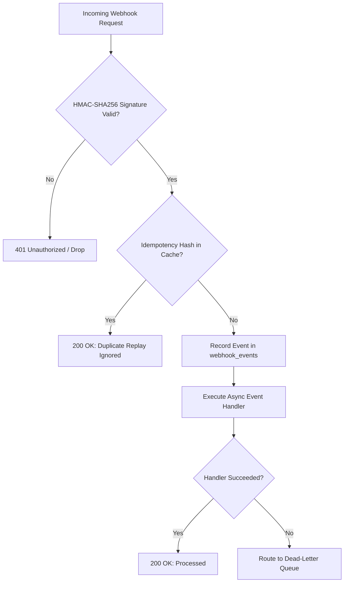

# ASRTAVA Webhook Security & Idempotency Guide

## 1. Threat Model & Ingestion Guardrails
External webhooks from payment processors, WhatsApp BSPs, and laboratory analyzers arrive from untrusted public networks. To prevent spoofing, eavesdropping, and replay attacks, ASRTAVA enforces strict security controls at the ingestion boundary:



## 2. Cryptographic Timing-Safe Signature Verification
All provider payloads are validated using constant-time buffer comparison (`crypto.timingSafeEqual`) to eliminate side-channel timing attack vulnerabilities:
```typescript
const isValid = CredentialVault.verifyHmacSignature(rawBody, headerSignature, webhookSecret);
```

## 3. Replay Protection & Idempotency Hashing
Every incoming webhook generates a deterministic SHA-256 idempotency hash:
$$\text{Hash} = \text{SHA-256}(\text{providerCode} \mid \text{rawBody})$$
If a webhook delivery attempt has already been ingested, ASRTAVA returns `200 OK` immediately with status `duplicate_ignored`, preventing double-crediting invoices or duplicate prescription updates.

