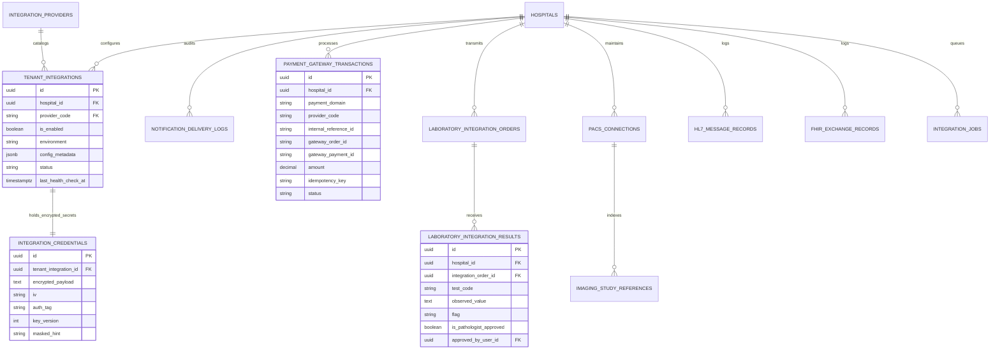

# ASRTAVA Integration Ecosystem Database Architecture & ERD

## 1. Entity Relationship Overview
The integration ecosystem extends the ASRTAVA relational core with 16 dedicated tables supporting encrypted credentials, delivery tracking, payment gateway transactions, laboratory orders, and HL7/FHIR exchanges:



## 2. PostgreSQL Row-Level Security (RLS) Policy
All tenant integration tables enforce tenant isolation:
```sql
CREATE POLICY tenant_integrations_isolation ON tenant_integrations
    FOR ALL
    USING (
        current_setting('app.is_super_admin', true) = 'true'
        OR hospital_id = current_setting('app.current_tenant_id', true)::uuid
    );
```

