# ASRTAVA Enterprise Data Warehouse & Analytics Architecture

## 1. High-Level Architectural Diagram

```mermaid
flowchart TD
    subgraph OLTP ["OLTP Operational Systems (ASRTAVA Core)"]
        OPD["OPD & EMR (Encounters)"]
        IPD["Wards & Beds (Admissions)"]
        OT["Operation Theatre & PACU"]
        ED["Emergency & Trauma Triage"]
        LAB["Laboratory (LIS & Analyzers)"]
        PHARM["Pharmacy & Inventory"]
        FIN["Billing & Double-Entry GL"]
    end

    subgraph ETL ["Extract, Transform & Load (ETL / Watermark Engine)"]
        CDC["Incremental Watermark Scanner"]
        TRANS["Transformer & De-Identifier"]
        DEDUP["Deduplication & Conformance"]
    end

    subgraph EDW ["Enterprise Data Warehouse (Star Schema Mart)"]
        DIM_D["dim_date"]
        DIM_P["dim_patient (De-identified)"]
        DIM_DOC["dim_doctor"]
        DIM_DEPT["dim_department"]
        
        FACT_ENC["fact_opd_encounters"]
        FACT_IPD["fact_ipd_admissions"]
        FACT_FIN["fact_financial_transactions"]
        FACT_SURG["fact_surgical_operations"]
        FACT_ED["fact_ed_inflow"]
    end

    subgraph BI ["Executive Intelligence & Predictive Engine"]
        KPI["Hospital Performance KPIs (ALOS, BOR, AR Days)"]
        LACE["LACE+ 30-Day Readmission Risk"]
        NOSHOW["OPD No-Show Predictor"]
        SURGE["ED Surge & Inflow Forecast"]
        BEDFC["Bed Occupancy & Shortage Predictor"]
    end

    subgraph UI ["Executive Portals & APIs"]
        EXEC_HUB["Executive Analytics Hub (Web Portal)"]
        REST_API["/api/v1/analytics/advanced"]
        REPORTS["Scheduled Automated Reports & CSV Export"]
    end

    OLTP --> CDC
    CDC --> TRANS
    TRANS --> DEDUP
    DEDUP --> EDW
    EDW --> BI
    BI --> UI
```

## 2. Key Performance Indicator (KPI) Formulations
- **Average Length of Stay (ALOS)**:
  $$\text{ALOS} = \frac{\sum \text{Total Inpatient Bed Days}}{\text{Total Discharges in Period}}$$
- **Bed Occupancy Rate (BOR)**:
  $$\text{BOR (\%)} = \frac{\text{Total Occupied Bed Days}}{\text{Available Bed Days} \times \text{Days in Period}} \times 100$$
- **Bed Turnover Rate (BTR)**:
  $$\text{BTR} = \frac{\text{Total Discharges and Deaths}}{\text{Total Operational Beds}}$$
- **Days in Accounts Receivable (AR Days)**:
  $$\text{AR Days} = \frac{\text{Total Outstanding Accounts Receivable}}{\text{Average Daily Gross Revenue}}$$
- **Clean Claim Rate**:
  $$\text{Clean Claim Rate (\%)} = \frac{\text{Claims Paid on First Submission}}{\text{Total Insurance Claims Submitted}} \times 100$$
- **LACE+ 30-Day Readmission Risk Score**:
  $$\text{Score} = \text{Length of Stay Points} + \text{Acuity (Emergency vs Elective)} + \text{Comorbidities} + \text{Prior ED Visits (6 Mo)}$$

## 3. Real-Time Predictive Models
1. **LACE+ Readmission Risk Scoring**: Flags high-risk patients ($\text{score} \ge 10$) prior to discharge for transition care management.
2. **OPD No-Show Classifier**: Evaluates appointment lead time, historical attendance rate, and specialty to flag appointments with $> 40\%$ probability of absence, allowing dynamic double-booking or automated reminder nudges.
3. **ED Inflow & Surge Forecaster**: Time-series moving window projecting hourly patient arrivals, warning triage when arrival velocity exceeds staffing capacity.
4. **Bed Shortage Predictor**: Projects ward and ICU bed capacity 24 to 48 hours in advance based on current census, scheduled elective surgeries, and expected discharges.

