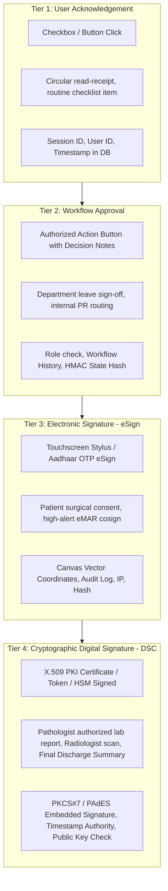
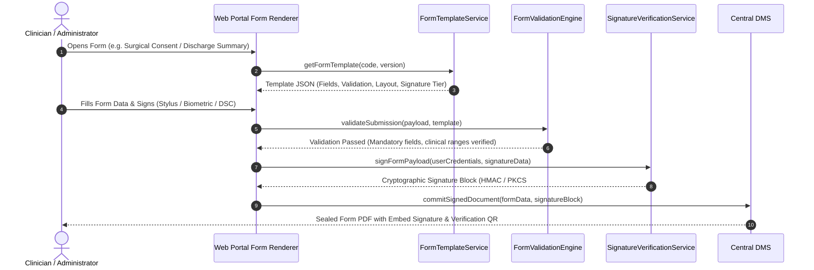

# ASRTAVA Digital Signatures, Electronic Signatures & Non-Repudiation Architecture

**Document Reference:** `DOC-ASRTAVA-SIG-ARCH-2026-V1`  
**Evaluation Standard:** Zero Unverified Production Claims · Strict Tenant Isolation · Non-Production Pre-Pilot Validation  
**Legal & Regulatory Framework:** Information Technology Act 2000 (India) · Electronic Signature Rules 2015 · DPDP Act 2023 · NMC RMP Regulations 2023  
**Auditor:** Antigravity Autonomous Clinical & Enterprise Architecture Engineering Agent  

---

## 1. Architectural Distinction & Legal Taxonomy

In healthcare operations, confusing a visual signature image, a simple checkbox, or a typed user name with a legally binding digital signature exposes the hospital to legal risk during medical malpractice litigation, financial audits, or statutory regulatory reviews.

ASRTAVA enforces an architectural taxonomy across four distinct tiers of electronic confirmation:



### Comparative Legal & Operational Matrix

| Tier | Classification | Legal Standing (India IT Act 2000) | Mechanism & Security | Clinical & Operational Use Cases |
| :--- | :--- | :--- | :--- | :--- |
| **Tier 1** | **User Acknowledgement** | Evidentiary log entry (Section 65B) | In-app checkbox + authenticated session token | Daily nursing round checklist, hospital circular read receipt |
| **Tier 2** | **Workflow Approval** | Internal organizational authorization | Multi-factor session validation + state machine HMAC | Leave approval, purchase requisition sign-off, shift handover |
| **Tier 3** | **Electronic Signature (eSign)** | Recognized electronic signature (Section 10A) | Digital stylus stroke capture + Aadhaar eSign OTP hash | Patient informed consent, admission agreement, eMAR cosign |
| **Tier 4** | **Cryptographic Digital Signature** | Full legal equivalence to physical signature (Section 3A / 5) | Asymmetric PKI (X.509v3), SHA-256 with RSA-2048/ECC, embedded PAdES | Pathologist report release, Radiologist diagnostic sign-off, Final Discharge Summary, MLC Report |

---

## 2. Digital Form Template Engine Architecture

The **ASRTAVA Form Template Engine** standardizes digital clinical and operational documentation:



### Form Template Capabilities:
1. **Dynamic Field Definition**: Text, numbers, medical dropdowns (ICD-10, SNOMED, LOINC), body maps, checkboxes, anatomical diagrams.
2. **Conditional Logic**: Dynamic display of fields based on preceding answers (e.g., if `pregnancyStatus === true`, prompt for `gestationalAgeWeeks`).
3. **Clinical Range Validation**: Warns or hard-blocks impossible or lethal inputs (e.g., Potassium $> 12\text{ mmol/L}$, Heart Rate $> 300\text{ bpm}$).
4. **Immutable PDF Generation**: Compiles the validated form data into a standards-compliant PDF/A document with embedded signer metadata and a verification QR code.

---

## 3. Cryptographic Signature Structure & Database Schema

```sql
-- 1. Digital Form Templates Master
CREATE TABLE IF NOT EXISTS digital_form_templates (
    id UUID PRIMARY KEY DEFAULT uuid_generate_v4(),
    hospital_id UUID NOT NULL REFERENCES hospitals(id) ON DELETE CASCADE,
    form_code VARCHAR(50) NOT NULL, -- e.g. 'SURGICAL_CONSENT_V2', 'DISCHARGE_SUMMARY_GENERAL'
    title VARCHAR(150) NOT NULL,
    category VARCHAR(50) NOT NULL CHECK (category IN ('CLINICAL', 'CONSENT', 'MEDICO_LEGAL', 'ADMINISTRATIVE', 'FINANCIAL')),
    schema_definition JSONB NOT NULL, -- Formly / JSON Schema field layout
    required_signature_tier VARCHAR(20) NOT NULL DEFAULT 'TIER_2' CHECK (required_signature_tier IN ('TIER_1', 'TIER_2', 'TIER_3', 'TIER_4')),
    version_number INTEGER NOT NULL DEFAULT 1,
    is_active BOOLEAN NOT NULL DEFAULT TRUE,
    created_at TIMESTAMPTZ DEFAULT NOW(),
    updated_at TIMESTAMPTZ DEFAULT NOW(),
    UNIQUE(hospital_id, form_code, version_number)
);

-- 2. Form Submissions & Cryptographic Signatures
CREATE TABLE IF NOT EXISTS digital_form_submissions (
    id UUID PRIMARY KEY DEFAULT uuid_generate_v4(),
    hospital_id UUID NOT NULL REFERENCES hospitals(id) ON DELETE CASCADE,
    template_id UUID NOT NULL REFERENCES digital_form_templates(id),
    patient_id UUID REFERENCES patients(id),
    encounter_id VARCHAR(100),
    form_data JSONB NOT NULL,
    signature_tier VARCHAR(20) NOT NULL,
    signer_user_id UUID REFERENCES users(id),
    signer_name VARCHAR(150) NOT NULL,
    signer_role VARCHAR(50) NOT NULL,
    signer_registration_number VARCHAR(100), -- Medical Council Registration No. for doctors
    signature_timestamp TIMESTAMPTZ NOT NULL DEFAULT NOW(),
    signature_data TEXT, -- Base64 vector stylus strokes OR PKCS#7 detached signature
    sha256_content_hash CHAR(64) NOT NULL,
    generated_document_id UUID REFERENCES enterprise_documents(id),
    ip_address VARCHAR(50),
    user_agent TEXT,
    created_at TIMESTAMPTZ DEFAULT NOW()
);
```

---

## 4. Verification QR Code & Public Authenticity Check

Every signed document output (PDF) contains an embedded **Cryptographic Verification QR Code** containing:
- Document UUID
- Hospital Tenant ID
- Signer Name & Medical Registration Number (NMC/State Council)
- Timestamp (UTC)
- SHA-256 Digest of the raw clinical content
- Public Verification URL: `https://verify.asrtava.health/v1/doc/<doc-id>`

Scanning the QR code performs an instant integrity check against the hospital database:
- **Valid & Unaltered**: Displays green checkmark with signer credentials and exact timestamp.
- **Modified / Tampered**: If even a single character in the document has been altered, the SHA-256 hash fails, displaying an immediate red tamper alert.
