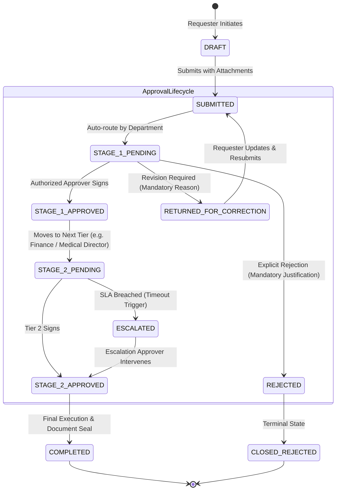
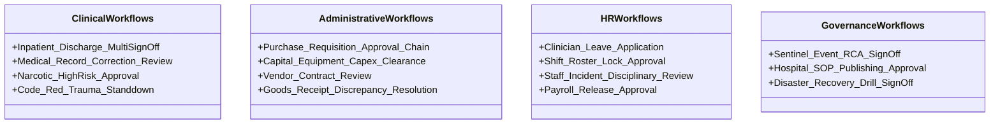

# ASRTAVA Reusable Digital Workflow & Multi-Level Approval Engine Architecture

**Document Reference:** `DOC-ASRTAVA-WORKFLOW-ARCH-2026-V1`  
**Evaluation Standard:** Zero Unverified Production Claims · Strict Tenant Isolation · Non-Production Pre-Pilot Validation  
**Scope:** Universal Workflow Execution, Approval Hierarchy & State Transition Engine  
**Auditor:** Antigravity Autonomous Clinical & Enterprise Architecture Engineering Agent  

---

## 1. Architectural Purpose & Design Philosophy

Hospital operations require multi-disciplinary approvals that cross departmental boundaries:
- A **patient discharge** requires the treating doctor's clinical sign-off, nursing medication reconciliation, pharmacy discharge medication dispensing, and accounts billing settlement before the ward bed can be vacated.
- A **purchase requisition** above $₹50,000$ requires the Department Head's approval, Biomedical Engineer technical vetting, Stores stock verification, and CFO financial clearance before a Purchase Order can be issued.
- An **employee leave request** requires the Ward Sister's duty roster coverage confirmation and the Nursing Superintendent's formal approval.

The **ASRTAVA Reusable Digital Workflow Engine** decouples workflow routing from module business logic. It provides a declarative, finite state machine (FSM) engine with configurable approval matrices, role-based assignment, escalation timers, delegation rules, and immutable event journaling.



---

## 2. Core Workflow Engine Capabilities

1. **Declarative Workflow Definition & Templating**:
   - Workflows are defined in JSON templates specifying: Name, Domain, Stages, Target Roles, Mandatory Attachments, Escalation Threshold (hours), Digital Signature Requirement, and Conditional Routing logic (e.g. `amount > 50000`).
2. **Multi-Stage Approval Hierarchy**:
   - Supports Sequential (Stage 1 $\to$ Stage 2 $\to$ Stage 3), Parallel (Stage 1 requires unanimous or majority sign-off from multiple specialists), and Conditional branching.
3. **Four Core Decision Actions**:
   - **`APPROVE`**: Signs off the stage, captures optional notes, advances the workflow to the next step.
   - **`REJECT`**: Terminally halts the workflow; requires a mandatory structured justification code and free-text rationale.
   - **`RETURN_FOR_CORRECTION`**: Sends the item back to the requester or previous tier with an auditable checklist of missing items.
   - **`DELEGATE`**: Authorizes a peer to act on behalf of the approver during scheduled leave with cryptographic provenance.
4. **Automated Escalation & SLA Enforcement**:
   - Background timers monitor pending tasks. If a stage exceeds its SLA (e.g. emergency transfer approval $> 15\text{ minutes}$, standard leave $> 48\text{ hours}$), the engine:
     - Issues high-priority in-app and push notifications.
     - Automatically escalates the task to the Department Head or Medical Director.
5. **Universal Pending-Work Task Queue**:
   - Every staff member receives a unified **"My Action Items & Pending Approvals"** queue in their portal, aggregating clinical consults, eMAR cosigns, purchase requisitions, incident reviews, and leave approvals in one centralized view.

---

## 3. Database Schema Specifications

```sql
-- 1. Declarative Workflow Template Definitions
CREATE TABLE IF NOT EXISTS workflow_templates (
    id UUID PRIMARY KEY DEFAULT uuid_generate_v4(),
    hospital_id UUID NOT NULL REFERENCES hospitals(id) ON DELETE CASCADE,
    workflow_code VARCHAR(50) NOT NULL, -- e.g. 'PROCUREMENT_PO', 'CLINICAL_DISCHARGE', 'STAFF_LEAVE'
    title VARCHAR(150) NOT NULL,
    description TEXT,
    category VARCHAR(50) NOT NULL CHECK (category IN ('CLINICAL', 'FINANCIAL', 'HRMS', 'PROCUREMENT', 'ADMINISTRATIVE', 'QUALITY')),
    definition_json JSONB NOT NULL, -- Stages, roles, SLAs, conditions
    is_active BOOLEAN NOT NULL DEFAULT TRUE,
    version_number INTEGER NOT NULL DEFAULT 1,
    created_at TIMESTAMPTZ DEFAULT NOW(),
    updated_at TIMESTAMPTZ DEFAULT NOW(),
    UNIQUE(hospital_id, workflow_code, version_number)
);

-- 2. Live Workflow Instances
CREATE TABLE IF NOT EXISTS workflow_instances (
    id UUID PRIMARY KEY DEFAULT uuid_generate_v4(),
    hospital_id UUID NOT NULL REFERENCES hospitals(id) ON DELETE CASCADE,
    template_id UUID NOT NULL REFERENCES workflow_templates(id),
    workflow_code VARCHAR(50) NOT NULL,
    entity_type VARCHAR(50) NOT NULL, -- 'purchase_order', 'admission', 'leave_request'
    entity_id VARCHAR(100) NOT NULL,
    title VARCHAR(255) NOT NULL,
    current_stage_index INTEGER NOT NULL DEFAULT 1,
    current_stage_name VARCHAR(100) NOT NULL,
    status VARCHAR(30) NOT NULL DEFAULT 'IN_PROGRESS' CHECK (status IN ('DRAFT', 'SUBMITTED', 'IN_PROGRESS', 'RETURNED_FOR_CORRECTION', 'APPROVED', 'REJECTED', 'CANCELLED')),
    requester_user_id UUID NOT NULL REFERENCES users(id),
    assigned_role VARCHAR(50),
    assigned_user_id UUID REFERENCES users(id),
    sla_due_at TIMESTAMPTZ,
    escalation_level INTEGER DEFAULT 0,
    created_at TIMESTAMPTZ DEFAULT NOW(),
    updated_at TIMESTAMPTZ DEFAULT NOW(),
    completed_at TIMESTAMPTZ
);

-- 3. Workflow Approval History & Audit Trail
CREATE TABLE IF NOT EXISTS workflow_approval_history (
    id UUID PRIMARY KEY DEFAULT uuid_generate_v4(),
    workflow_instance_id UUID NOT NULL REFERENCES workflow_instances(id) ON DELETE CASCADE,
    stage_index INTEGER NOT NULL,
    stage_name VARCHAR(100) NOT NULL,
    actor_user_id UUID NOT NULL REFERENCES users(id),
    action VARCHAR(30) NOT NULL CHECK (action IN ('SUBMIT', 'APPROVE', 'REJECT', 'RETURN_FOR_CORRECTION', 'DELEGATE', 'ESCALATE', 'CANCEL')),
    decision_notes TEXT,
    rejection_reason_code VARCHAR(50),
    delegated_to_user_id UUID REFERENCES users(id),
    digital_signature_hash CHAR(64),
    ip_address VARCHAR(50),
    created_at TIMESTAMPTZ DEFAULT NOW()
);
```

---

## 4. Operational Workflows Mapped to Standard Templates



---

## 5. Architectural Safeguards

1. **Anti-Circumvention Rule**: A user cannot approve their own submission unless explicitly defined in a self-declaration stage (e.g., initial timesheet declaration). The engine validates `actor_user_id != requester_user_id` for all approval actions.
2. **Deterministic Precedence**: Rejection by any mandatory tier halts the entire workflow immediately. No subsequent approval tier can override a prior rejection without formal re-initiation.
3. **Cryptographic Proof of Sign-Off**: Every approval state transition generates an HMAC-SHA256 signature combining the workflow instance ID, stage index, actor ID, timestamp, and decision notes, logged into the tamper-resistant audit trail.

