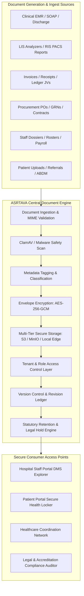
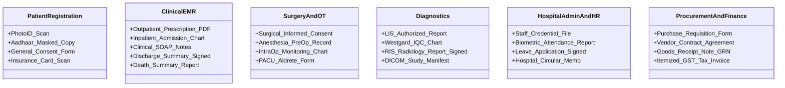

# ASRTAVA Enterprise Document Management System (DMS) Architecture

**Document Reference:** `DOC-ASRTAVA-DMS-ARCH-2026-V1`  
**Evaluation Standard:** Zero Unverified Production Claims · Strict Tenant Isolation · Non-Production Pre-Pilot Validation  
**Scope:** Unified Digital Document Management Architecture across All 19 Operational Domains  
**Auditor:** Antigravity Autonomous Clinical & Enterprise Architecture Engineering Agent  

---

## 1. Architectural Overview & System Purpose

The **ASRTAVA Central Document Management System (DMS)** provides a unified, secure, multi-tenant digital document repository and lifecycle management engine. It eliminates physical file folders, paper archives, lost paper charts, and uncoordinated local PDF files by enforcing a single, standardized document model across all four internal portals, the public portal, and the Healthcare Coordination Network.



---

## 2. Core DMS Capabilities

1. **Structured Document Ingestion & Storage**:
   - Supports both uploaded external files (scanned government IDs, prior hospital records, vendor invoices, equipment brochures) and system-generated documents (PDF discharge summaries, lab reports, e-prescriptions, purchase orders).
   - Validates MIME types (strict whitelist: `application/pdf`, `image/jpeg`, `image/png`, `application/dicom`), enforces size limits, and scans payloads before writing.
2. **Envelope Cryptographic Encryption**:
   - Every stored document is encrypted at rest using AES-256-GCM with a unique, randomly generated Document Data Key (DEK).
   - The DEK is encrypted under the Hospital Tenant Master Key (KEK) using a Key Management Service (AWS KMS, HashiCorp Vault, or offline HSM).
3. **Multi-Tier Secure Object Storage**:
   - **Cloud Deployments**: S3-compatible private object storage with server-side encryption and versioning.
   - **On-Premises / Hybrid Edge Nodes**: MinIO or local encrypted file store bound to the appliance hardware key.
   - **Ephemeral Pre-Signed URLs**: Direct download links expire within 15 minutes and require valid session credentials and purpose verification.
4. **Comprehensive Document Classification Taxonomy**:
   - Documents are categorized by Class (`CLINICAL`, `FINANCIAL`, `ADMINISTRATIVE`, `LEGAL`, `WORKFORCE`, `GOVERNANCE`).
   - Every document is indexed with structured metadata: Tenant ID, Hospital ID, Patient UHID (if clinical), Employee ID (if HR), Vendor ID (if procurement), Department, Author, Creation Date, Confidentiality Tier, and Revision Number.
5. **Version Control & Immutable Revision History**:
   - Updates to documents (e.g. radiology report addendums, updated hospital policies, corrected invoice summaries) do not overwrite the original record.
   - A new version is appended (`v1.0` $\to$ `v1.1`), linked to the previous SHA-256 checksum, creating a tamper-evident revision chain.
6. **Statutory Retention & Legal Hold Enforcement**:
   - Automated retention schedules enforcing NMC RMP Regulations 2023 (3 years minimum for inpatient charts), Indian Income Tax Act (8 years for invoices/receipts), and Clinical Establishments Act.
   - Medical legal cases (MLC) and active disputes can be flagged with `LEGAL_HOLD = true`, preventing deletion even after standard retention expires.

---

## 3. Database Schema Specifications

The DMS introduces the following unified tables expanding upon Migration 012:

```sql
-- 1. Unified Enterprise Document Master
CREATE TABLE IF NOT EXISTS enterprise_documents (
    id UUID PRIMARY KEY DEFAULT uuid_generate_v4(),
    hospital_id UUID NOT NULL REFERENCES hospitals(id) ON DELETE CASCADE,
    document_category VARCHAR(50) NOT NULL CHECK (document_category IN (
        'PATIENT_CLINICAL', 'PATIENT_CONSENT', 'DIAGNOSTIC_REPORT', 'FINANCIAL_BILLING',
        'HRMS_WORKFORCE', 'PROCUREMENT_CONTRACT', 'HOSPITAL_POLICY', 'LEGAL_REGULATORY'
    )),
    document_type VARCHAR(100) NOT NULL, -- e.g., 'discharge_summary', 'surgical_consent', 'po_contract'
    title VARCHAR(255) NOT NULL,
    description TEXT,
    entity_type VARCHAR(50), -- 'patient', 'user', 'vendor', 'department', 'equipment'
    entity_id VARCHAR(100),
    storage_engine VARCHAR(30) NOT NULL DEFAULT 's3_compatible' CHECK (storage_engine IN ('s3_compatible', 'minio', 'local_encrypted_edge')),
    storage_key TEXT NOT NULL,
    file_mime_type VARCHAR(100) NOT NULL,
    file_size_bytes BIGINT NOT NULL,
    file_sha256_hash CHAR(64) NOT NULL,
    encryption_key_id VARCHAR(100) NOT NULL,
    version_number VARCHAR(20) NOT NULL DEFAULT '1.0',
    parent_document_id UUID REFERENCES enterprise_documents(id),
    is_confidential BOOLEAN NOT NULL DEFAULT FALSE,
    confidentiality_tier VARCHAR(20) DEFAULT 'STANDARD' CHECK (confidentiality_tier IN ('PUBLIC', 'STANDARD', 'RESTRICTED', 'HIGHLY_CONFIDENTIAL')),
    legal_hold BOOLEAN NOT NULL DEFAULT FALSE,
    retention_expiration_date DATE,
    created_by_user_id UUID REFERENCES users(id),
    created_at TIMESTAMPTZ DEFAULT NOW(),
    archived_at TIMESTAMPTZ,
    deleted_at TIMESTAMPTZ
);

-- 2. Document Access & Download Audit Log
CREATE TABLE IF NOT EXISTS enterprise_document_access_logs (
    id UUID PRIMARY KEY DEFAULT uuid_generate_v4(),
    document_id UUID NOT NULL REFERENCES enterprise_documents(id) ON DELETE CASCADE,
    hospital_id UUID NOT NULL REFERENCES hospitals(id) ON DELETE CASCADE,
    actor_user_id UUID REFERENCES users(id),
    access_type VARCHAR(30) NOT NULL CHECK (access_type IN ('METADATA_READ', 'PREVIEW', 'DOWNLOAD', 'PRINT', 'EXPORT', 'REVOCATION')),
    access_purpose VARCHAR(100), -- 'clinical_treatment', 'billing_audit', 'legal_subpoena'
    ip_address VARCHAR(50),
    user_agent TEXT,
    granted_pre_signed_token_hash CHAR(64),
    token_expires_at TIMESTAMPTZ,
    accessed_at TIMESTAMPTZ DEFAULT NOW()
);
```

---

## 4. Document Types Mapped by Operational Department



---

## 5. Security Invariants & Compliance Rules

1. **Zero Cross-Tenant Leakage**: All DMS queries must include `WHERE hospital_id = ?` and pass through PostgreSQL Row-Level Security (RLS). Cross-hospital searches return empty results.
2. **Super Admin Clinical Isolation**: Platform Super Admins have zero standing access to patient clinical files. Support troubleshooting requires an approved JIT session with explicit time bounds and clinical justification.
3. **Integrity Guarantees**: Any file fetched from storage must match its stored SHA-256 checksum before presentation. A checksum mismatch aborts retrieval and triggers a critical security alert (`DATA_INTEGRITY_TAMPER_ALERT`).
