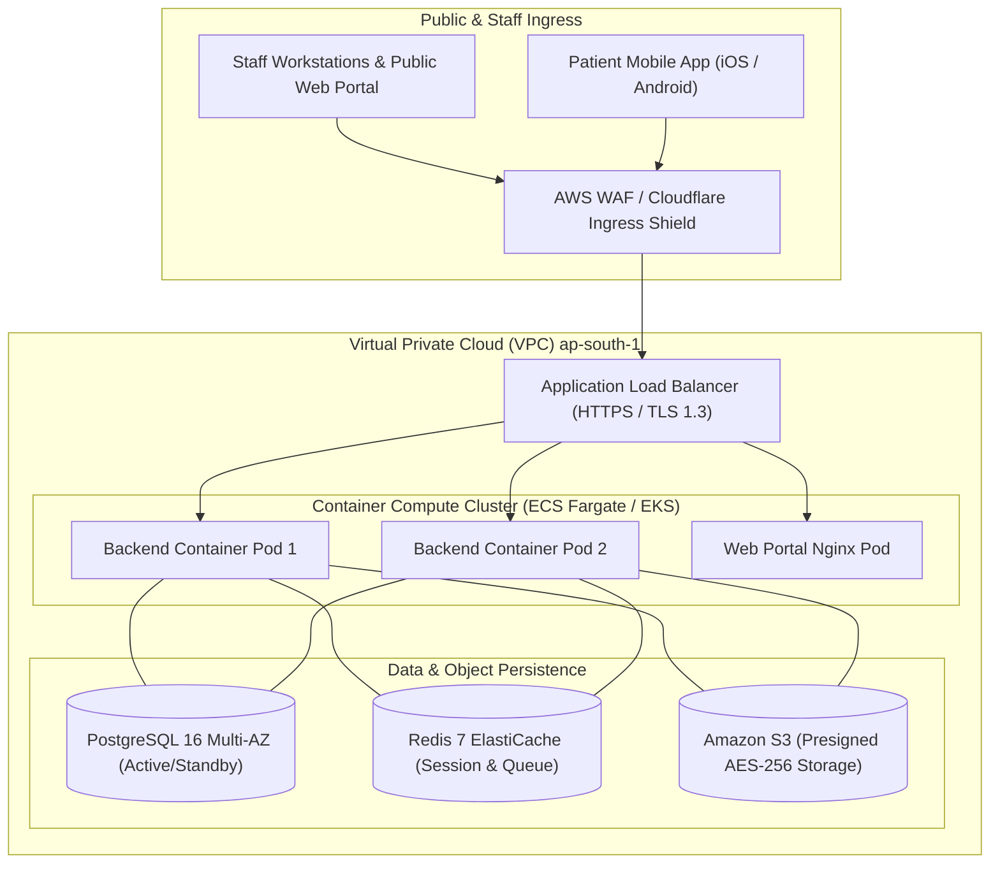

# ASRTAVA — Cloud-Hosted Deployment Architecture

## 1. Overview & Cloud-Agnostic Design

The Cloud-Hosted Deployment model provides multi-hospital scalability, zero hardware maintenance overhead for hospitals, and centralized monitoring. ASRTAVA can run on:
- **ASRTAVA-Managed Cloud**: Hosted on AWS Mumbai (`ap-south-1`) with disaster recovery in Hyderabad (`ap-south-2`).
- **Customer-Managed Cloud**: Deployed within a hospital chain's dedicated Azure, AWS, GCP, or private sovereign cloud VPC.



---

## 2. Infrastructure Specifications

### 1. Compute Tier (Containerized & Auto-Scaling)
- **Container Engine**: Docker multi-stage images running non-root users (`asrtava` UID 10001).
- **Orchestration**: AWS ECS Fargate or Kubernetes (EKS).
- **Auto-Scaling Targets**: CPU utilization $> 70\%$ or memory utilization $> 75\%$ triggers horizontal scale-out from 2 pods up to 20 pods.

### 2. Database Tier (PostgreSQL 16 Multi-AZ)
- **High Availability**: Multi-AZ synchronous replication across two availability zones with sub-60-second automated failover.
- **Tenant Isolation**: PostgreSQL Row-Level Security (`FORCE ROW LEVEL SECURITY`) enforces strict physical and logical boundaries on every database transaction.
- **Connection Pooling**: Knex connection pool configured with min 5 and max 50 pooled connections per backend container node.

### 3. Object & Document Storage Tier
- **Engine**: Amazon S3 or MinIO S3-compatible API.
- **Encryption**: Server-side encryption with AWS KMS customer-managed keys (`aws:kms`).
- **Presigned URLs**: Web and mobile clients receive short-lived (15-minute) presigned URLs for downloading medical imaging studies and laboratory PDF reports. Direct bucket access is blocked by S3 Block Public Access policies.

---

## 3. Configuration & Startup Profile

When deploying in Cloud mode, the backend initializes with the following configuration profile:

```ini
DEPLOYMENT_MODEL=cloud
STORAGE_DRIVER=s3
NOTIFICATION_DRIVER=gateway
DATABASE_TOPOLOGY=shared_multitenant
S3_BUCKET=asrtava-prod-medical-documents
AWS_REGION=ap-south-1
ENFORCE_ROW_LEVEL_SECURITY=true
```

