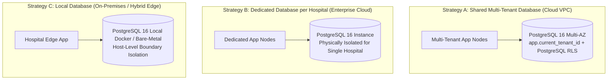

# ASRTAVA — Database Deployment Strategy & Multi-Tenant Topologies

## 1. Supported Database Topologies

ASRTAVA supports three distinct database deployment arrangements to match the customer's regulatory, performance, and infrastructure requirements:

---

## 2. Comparison Matrix

| Criteria | Shared Multi-Tenant (Strategy A) | Dedicated Instance (Strategy B) | Local On-Premises (Strategy C) |
|:---|:---|:---|:---|
| **Target Customers** | Small/Mid Clinics, Standard Hospitals | Large Healthcare Chains, Government | Rural Hospitals, Defense Facilities |
| **Isolation Mechanism** | PostgreSQL `FORCE ROW LEVEL SECURITY` | Physical VPC / Database Instance Isolation | Host-Level LAN & Physical Server Isolation |
| **Operational Overhead** | Low (Single DB cluster to patch/backup) | Medium (Per-tenant DB management) | Customer / Local Hospital IT Team |
| **Storage Scaling** | Shared Amazon RDS storage auto-expand | Dedicated EBS volume per tenant | Local NVMe SSD / Hospital SAN |
| **Backup & Restore** | Tenant-filtered logical export (`pg_dump`) | Physical snapshot restore (`pg_restore`) | Local disk / tape backup script |
| **Tenant Migration** | Logical extraction to standalone schema | Full database detachment & transfer | Standard database dump import |

---

## 3. Database Migration Compatibility

All 19 database migrations (`database/migrations/001_extensions.sql` through `019_software_licensing.sql`) are 100% compatible across all three database topologies. Migration scripts:
- Use idempotent `CREATE TABLE IF NOT EXISTS` and `ALTER TABLE ADD COLUMN IF NOT EXISTS` statements.
- Support both tenant-isolated tables with `hospital_id` columns and dedicated single-tenant configurations.
- Require zero manual schema divergence between Cloud, On-Premises, and Hybrid installations.

