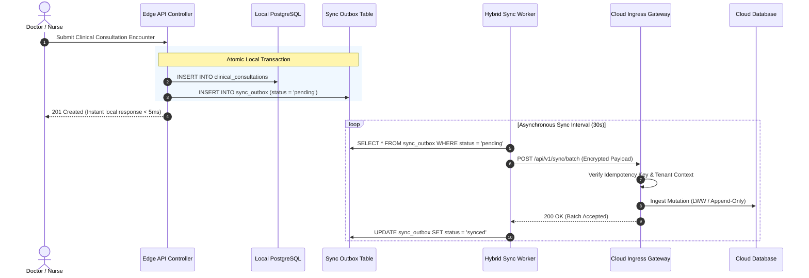

# ASRTAVA — Data Flow, Synchronization & Conflict Resolution Specification

## 1. Outbox Pattern Architecture

To guarantee atomicity between local database transactions and external cloud synchronization, ASRTAVA implements the **Transactional Outbox Pattern**:



---

## 2. Deterministic Conflict Resolution Rules

In hybrid synchronization, distributed updates to the same entity are resolved using two strict deterministic rules:

### Rule 1: Append-Only Medical History (Clinical Invariance)
- **Applies to**: `consultation`, `emergency_triage`, `nursing_vitals`, `lab_results`.
- **Logic**: Clinical records are **never overwritten**. If an amended consultation note arrives with a higher version number, the synchronization engine appends it as a child amendment record preserving author identity, amendment timestamp, and justification:
  ```json
  {
    "encounterId": "enc-5001",
    "_version": 2,
    "_amendments": [
      { "version": 1, "diagnosis": "Acute Bronchitis (J20.9)", "doctor": "Dr. Patel" },
      { "version": 2, "diagnosis": "Acute Bronchitis with secondary wheeze", "doctor": "Dr. Patel", "reason": "Bronchospasm noted" }
    ]
  }
  ```

### Rule 2: Deterministic Last-Write-Wins (LWW) by Monotonic Version
- **Applies to**: Administrative entities (`bed_allocation`, `staff_roster`, `tariff_rates`).
- **Logic**: If incoming payload version $> \text{existing version}$, the update is accepted. If incoming version $\le \text{existing version}$, the update is safely ignored as a stale or duplicate transmission.

---

## 3. DPDP Act 2023 Compliant PII Masking Policy

Under the Digital Personal Data Protection Act 2023, personal data synchronized outside hospital premises must be protected:
- **Phone Numbers**: Formatted to mask the middle 6 digits (e.g. `+919876543210` $\to$ `+919******10`).
- **Email Addresses**: Local part masked preserving first character and domain (e.g. `rohan.verma@example.com` $\to$ `r***@example.com`).
- **National Government IDs (Aadhaar / ABHA)**: Preserves only the last 4 digits (e.g. `1234-5678-9012` $\to$ `XXXX-XXXX-9012`).

---

## 4. Idempotency & Deduplication Engine

Every synchronization payload carries a deterministic SHA-256 hash:
$$\text{IdempotencyKey} = \text{SHA-256}\Big(\text{HospitalID} \parallel \text{EntityType} \parallel \text{EntityID} \parallel \text{Version} \parallel \text{Operation}\Big)$$

The cloud ingress receiver stores processed idempotency keys in a high-speed Redis filter (24-hour sliding TTL). If a network timeout causes the edge worker to retry a batch that was already processed by the cloud, the receiver returns `200 OK (isDuplicate: true)` without re-executing database writes.

