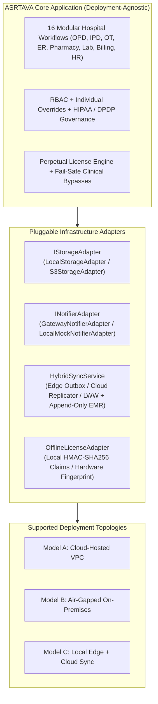

# ASRTAVA — Multi-Deployment System Architecture

## 1. Executive Summary & Architectural Philosophy

ASRTAVA is built on a **Single Codebase, Deployment-Agnostic Core Architecture**. Rather than maintaining three disconnected codebases or fragmenting into multiple products, ASRTAVA abstracts infrastructure-specific concerns (storage, message delivery, database clustering, and cloud synchronization) behind clean software interfaces and pluggable adapters.

Every hospital that procures an ASRTAVA **One-Time Perpetual Software License** can freely choose where and how its system runs without losing core hospital workflows:
1. **Cloud-Hosted Deployment**: ASRTAVA-managed or customer-managed cloud VPC (AWS, Azure, GCP, or sovereign national cloud).
2. **Customer-Managed On-Premises Deployment**: Operating inside the hospital's private server room, bare-metal infrastructure, or local hypervisor without permanent internet connectivity.
3. **Hybrid Deployment**: Local edge appliances handle zero-latency clinical care (ER, ICU, OT, Ward, Pharmacy) with background encrypted synchronization to central cloud services.

---

## 2. Shared Core Technology Stack

- **Application Programming Language**: TypeScript 5.5+ on Node.js 22 LTS
- **Web Portal Framework**: React 19, Vite 6, Tailwind CSS 3.4
- **Mobile Client Framework**: React Native 0.76+ with TypeScript
- **Relational Database Engine**: PostgreSQL 16 with Row-Level Security (`FORCE ROW LEVEL SECURITY`)
- **In-Memory Cache & Message Queue**: Redis 7
- **Document & Media Storage**: Pluggable (`local_disk_nas` on-premises or `cloud_s3_object_storage` in cloud)
- **Licensing & Identity Integrity**: Cryptographic HMAC-SHA256 claims certificates (`.asrtalic`)

---

## 3. High-Level Comparison of Deployment Models

| Architectural Dimension | Model A: Cloud-Hosted | Model B: On-Premises | Model C: Hybrid |
|:---|:---|:---|:---|
| **Hosting Environment** | AWS / Azure / GCP VPC | Hospital Server Room / Bare Metal | Local Edge Server + Cloud VPC |
| **Internet Requirement** | High-availability broadband | **Zero (100% Air-Gapped Capable)** | Internet for sync; **Zero for local clinical care** |
| **Database Topology** | Shared Multi-Tenant or Dedicated Multi-AZ | Local Dedicated PostgreSQL Instance | Local Master (Clinical) + Cloud Aggregate Replica |
| **Document Storage** | S3 / MinIO Object Storage | Local Encrypted Disk / Hospital NAS | Local NAS with Cloud S3 Encrypted Backup |
| **Notification Delivery** | SMS Gateway, WhatsApp API, FCM Push | Local Outbox Queue / Internal SMTP | Edge generates alerts; Cloud dispatches SMS/WhatsApp |
| **License Validation** | Online verification against Central DB | Offline HMAC-SHA256 Token (`.asrtalic`) | Local offline cache with periodic background refresh |
| **Clinical Outage Risk** | Mitigated by Cloud Multi-AZ | **Zero external internet outage risk** | **Zero local clinical downtime risk** |
| **Patient Mobile Access** | Direct via Cloud Gateway | Hospital LAN Wi-Fi / Reverse Proxy | Cloud Gateway synced from edge |
| **Backup Responsibility** | Automated Cloud Snapshots & S3 | Automated Local Scripts & External Tape/NAS | Automated Local Backup + Encrypted Cloud Mirror |
| **Commercial Model** | One-Time Perpetual License | One-Time Perpetual License | One-Time Perpetual License |

---

## 4. Architectural Decoupling Rules

To preserve architectural consistency and prevent vendor lock-in:
1. **Zero Provider-Specific Code in Business Modules**: Domain modules (`patients`, `clinical`, `billing`, `pharmacy`, etc.) must never import AWS SDK, Google Cloud SDK, or Twilio directly. They must interact strictly through pluggable interfaces.
2. **Explicit Data-Flow Boundaries**: Patient clinical records cannot be uploaded to external cloud aggregators without an explicitly configured, legally authorized data flow policy under the DPDP Act 2023.
3. **No Split-Brain Database Writes**: In hybrid setups, the local hospital edge node is the single undisputed source of truth for clinical encounters. Cloud systems cannot overwrite active clinical notes.

