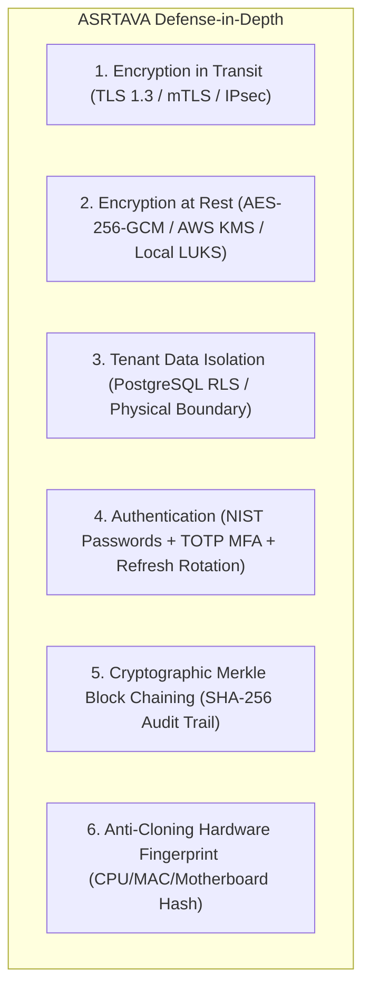

# ASRTAVA — Deployment Security, Encryption & Perimeter Governance

## 1. Security Architecture Across All Topologies

Security controls in ASRTAVA adapt to the deployment model while maintaining strict compliance with the Digital Personal Data Protection (DPDP) Act 2023, HIPAA Security Rules, and National Medical Commission (NMC) regulations.

---

## 2. Threat Matrix by Deployment Model

| Security Dimension | Model A: Cloud-Hosted | Model B: On-Premises | Model C: Hybrid |
|:---|:---|:---|:---|
| **Data in Transit** | HTTPS (TLS 1.3) via Cloudflare & AWS ALB | Local HTTPS with Hospital Internal CA / Self-Signed | Mutual TLS (mTLS 1.3) with pinned certificates |
| **Data at Rest** | AWS RDS AES-256 + S3 SSE-KMS | Local LUKS volume encryption + AES-256 file encryption | Local LUKS + Cloud S3 SSE-KMS |
| **Tenant Isolation** | PostgreSQL Row-Level Security (`FORCE RLS`) | Physical server & LAN isolation | Physical edge isolation + Cloud RLS |
| **Secret Management** | AWS Secrets Manager / HashiCorp Vault | Encrypted `.env.vault` / Docker Secrets / Local Keyring | Local Keyring (Edge) + AWS Secrets Manager (Cloud) |
| **Database Exposure** | Private Subnets only (Zero public ingress) | Localhost / Private VLAN only (No public IP) | Private VLAN (Edge) + Private Subnet (Cloud) |
| **Anti-Cloning Defense** | Multi-tenant tenant ID binding | Server Hardware Fingerprint binding | Server Hardware Fingerprint + Token Lineage |
| **Support Access** | 60-minute JIT access token approved by hospital | On-site access or hospital-managed SSH bastion | 60-minute JIT token for cloud; hospital control for edge |

---

## 3. Hardware Fingerprint Binding Specification (On-Premises Anti-Cloning)

To prevent illicit cloning of on-premises virtual machines into unauthorized data centers, the license certificate can bind to the physical server hardware signature:

$$\text{HardwareFingerprintHash} = \text{SHA-256}\Big(\text{CPUID} \parallel \text{PrimaryMACAddress} \parallel \text{MotherboardUUID}\Big)$$

Upon boot in on-premises mode:
1. The backend interrogates local host hardware identifiers.
2. Computes the SHA-256 digest.
3. Compares against `claims.hardwareFingerprintHash`.
4. If a discrepancy is detected (e.g. image copied to another machine), the node rejects activation and alerts the administrator.

