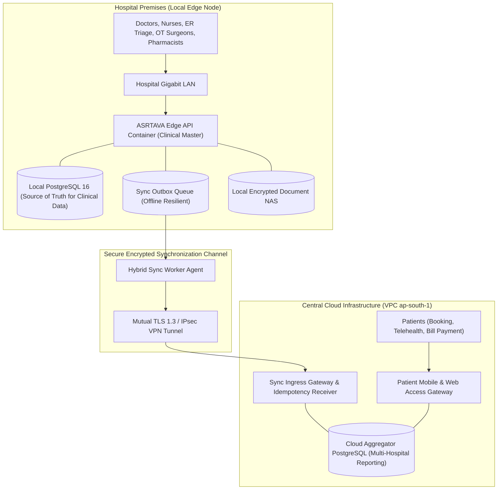

# ASRTAVA — Hybrid Deployment Architecture

## 1. Overview & Dual-Node Topology

The Hybrid Deployment model combines the high-speed, zero-latency reliability of local hospital edge servers with the patient reach and enterprise analytics of cloud infrastructure.



---

## 2. Source of Truth Matrix

To prevent split-brain conflicts and clinical record corruption, ASRTAVA establishes strict domain ownership:

| Domain Subsystem | Primary Source of Truth | Secondary / Replica | Synchronization Direction | Conflict Resolution Strategy |
|:---|:---:|:---:|:---:|:---:|
| **Outpatient Encounters (OPD)** | **Hospital Local Edge** | Cloud Aggregate | Edge $\to$ Cloud | **Strictly Append-Only (EMR Versioning)** |
| **Inpatient Admissions & Beds** | **Hospital Local Edge** | Cloud Aggregate | Edge $\to$ Cloud | Last-Write-Wins (LWW) by Lamport Clock |
| **Pharmacy Inventory & FEFO** | **Hospital Local Edge** | Cloud Aggregate | Edge $\to$ Cloud | Edge Master (Atomic Stock Decrement) |
| **Emergency Triage Vitals** | **Hospital Local Edge** | Cloud Aggregate | Edge $\to$ Cloud | **Strictly Append-Only (Emergency Record)** |
| **Hospital Tenancy & Editions** | **Central Cloud VPC** | Hospital Local Edge | Cloud $\to$ Edge | Cloud Master (Signed License Claim) |
| **Patient Mobile Self-Registration**| **Central Cloud VPC** | Hospital Local Edge | Cloud $\to$ Edge | Cloud Ingress $\to$ Edge Verification |
| **Centralized Telecom (SMS/WA)** | **Central Cloud VPC** | N/A | Edge $\to$ Cloud | Cloud Dispatches Telecom Alerts |

---

## 3. Network Outage & Failover Behavior

1. **Broadband Disconnection Scenario**:
   - When the hospital's external internet connection drops:
     - Local clinical operations continue with **0% latency impact** and **zero interruption**. Doctors can write SOAP notes, allocate beds, and dispense medications against the local PostgreSQL database.
     - The `HybridSyncService` detects network offline status and automatically holds transactions in the local outbox queue (`hybrid_outbox_queue`).
2. **Reconnection & Automatic Resumption Scenario**:
   - When connectivity is restored, the background sync worker drains the outbox queue in FIFO sequence using idempotency deduplication keys.
   - Any replayed network transmissions are safely deduplicated without creating duplicate bills or clinical entries.

---

## 4. Configuration & Startup Profile

When deploying an edge node in Hybrid mode, the backend initializes with:

```ini
DEPLOYMENT_MODEL=hybrid
STORAGE_DRIVER=local
NOTIFICATION_DRIVER=gateway
DATABASE_TOPOLOGY=local_instance
HYBRID_SYNC_ROLE=edge_node
HYBRID_CLOUD_SYNC_URL=https://sync.asrtava.health/api/v1/sync
HYBRID_SYNC_INTERVAL=30
MASK_PII_CLOUD_SYNC=true
```

Deployable via:
```bash
docker compose -f docker-compose.hybrid.yml up -d
```

