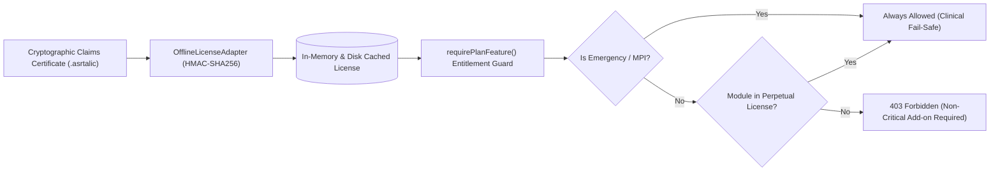

# ASRTAVA — Perpetual License Deployment Compatibility & Resilience

## 1. Multi-Deployment Licensing Principles

ASRTAVA's **One-Time Perpetual Software Licensing Model** applies identically across Cloud, On-Premises, and Hybrid deployments:

1. **Perpetual Software Ownership**: A one-time purchase grants an indefinite legal and technical right to operate the purchased version and modules.
2. **Independence from Maintenance Agreements (AMC)**:
   - Expiration of an optional Annual Maintenance & Support Agreement (AMC) limits access to official SLA support tickets and major version upgrades.
   - It **strictly never terminates the core license**, locks out clinical care, or deletes patient data.
3. **Resilience During Internet Outages**:
   - Temporary or prolonged network outages must never block doctor consultations, emergency triage, inpatient admissions, nursing medications, or pharmacy dispensing.

---

## 2. Validation Mechanism by Deployment Model

| Feature | Model A: Cloud-Hosted | Model B: On-Premises | Model C: Hybrid |
|:---|:---|:---|:---|
| **Validation Source** | Central PostgreSQL Database | Local File (`license.asrtalic`) | Local Cached Token + Background Sync |
| **Outage Behavior** | In-memory cache permits continuous operation | **100% immune to internet outages** | **100% immune to internet outages** |
| **Offline Grace Period** | 30 days cached credentials | **Indefinite (Perpetual Token)** | **Indefinite (Perpetual Token)** |
| **Anti-Cloning Mechanism**| Multi-tenant tenant ID verification | Server Hardware Fingerprint binding | Server Hardware Fingerprint binding |
| **Modular Add-On Update**| Dynamic database update | Upload updated `.asrtalic` claims file | Automatic sync or local claims upload |
| **Emergency Fail-Safe** | Hardcoded fail-open bypass | Hardcoded fail-open bypass | Hardcoded fail-open bypass |

