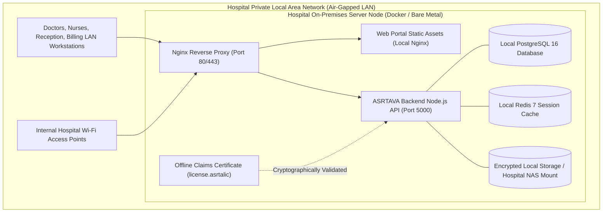

# ASRTAVA — On-Premises Air-Gapped Deployment Architecture

## 1. Overview & Operating Paradigm

The On-Premises Deployment model is designed for healthcare facilities that operate within their own physical premises—including rural community hospitals, military medical centers, and sovereign institutions.

In this model:
- **100% Air-Gapped Capable**: Operates with **zero dependence on external internet connectivity**.
- **Local Data Autonomy**: Patient health records, medical imaging studies, pharmacy inventories, and billing transactions never leave the hospital's private local area network (LAN).
- **One-Time Perpetual License**: Software runs under a perpetual license validated through an offline cryptographic claims certificate (`license.asrtalic`).
- **Standard Hardware Requirements**: Runs on standard x86-64 servers, virtualized hypervisors (VMware ESXi, Proxmox, Hyper-V), or containerized Docker Compose / Kubernetes setups.



---

## 2. On-Premises Core Components

### 1. Local Document & Media Storage (`LocalStorageAdapter`)
- Prescriptions, laboratory reports, patient identity documents, and radiology DICOM files are written directly to a designated local directory or hospital Network Attached Storage (NAS) share:
  ```
  /var/asrtava/storage/documents/
  /var/asrtava/storage/prescriptions/
  /var/asrtava/storage/dicom/
  ```
- Files are protected by server-side AES-256 encryption-at-rest and indexed by SHA-256 cryptographic checksums.
- Path traversal defense automatically strips relative path escapes (`../`).

### 2. Air-Gapped Offline License Validation (`OfflineLicenseAdapter`)
- An offline claims certificate (`license.asrtalic`) generated by Super Admin is loaded on startup from `/etc/asrtava/license.asrtalic` or the `OFFLINE_LICENSE_TOKEN` environment variable.
- The token is signed using HMAC-SHA256 (or RSA-2048 private key).
- Verifies the license number, hospital ID, modular entitlements, capacity limits, and hardware fingerprint binding.
- Operates indefinitely without requiring internet phone-home connections.

### 3. Local Outbox Notification Dispatcher (`LocalMockNotifierAdapter`)
- In air-gapped environments without external telecom links, notifications do not attempt internet egress.
- Messages are safely enqueued in a local database outbox table, allowing local workstations to query in-app notifications and critical audio chimes over LAN.

---

## 3. Configuration & Startup Profile

When deploying in On-Premises mode, the backend initializes with the following configuration profile:

```ini
DEPLOYMENT_MODEL=on_premises
STORAGE_DRIVER=local
NOTIFICATION_DRIVER=local_queue
DATABASE_TOPOLOGY=local_instance
LOCAL_STORAGE_PATH=/var/asrtava/storage
OFFLINE_LICENSE_FILE_PATH=/etc/asrtava/license.asrtalic
ENFORCE_ROW_LEVEL_SECURITY=false
```

Deployable via:
```bash
docker compose -f docker-compose.onprem.yml up -d
```

