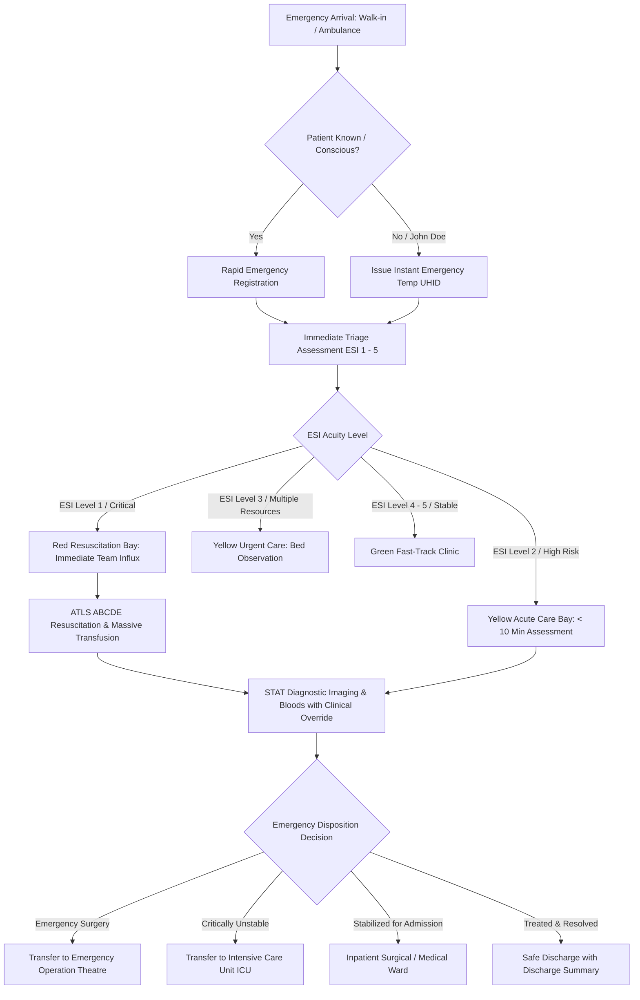

# ASRTAVA Complete Emergency Patient Workflow Map

## 1. Acute Emergency Care Pathway

## 2. Emergency Operational Exemption
- All diagnostic orders (CT Angio, USG FAST, crossmatched PRBCs, IV inotropes) are flagged with `is_stat_override: true`, allowing instantaneous processing without cashier invoice payment verification.

