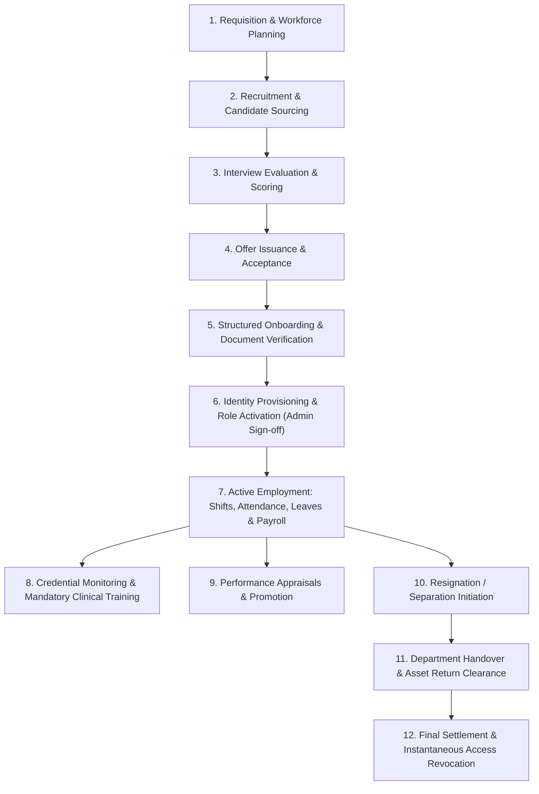

# ASRTAVA — Employee Lifecycle Workflow

## 1. Overview
The ASRTAVA Employee Lifecycle orchestrates every stage of a healthcare professional or hospital worker's tenure, from workforce planning and recruitment to daily duty, compensation, continuous professional education, and separation.

---

## 2. Detailed Lifecycle Stages

### Stage 1: Job Requisition & Approvals
- Department Head submits a requisition detailing required designation, specialty, required experience, vacancy type (Replacement vs New Headcount), and proposed CTC range.
- HR Manager and Finance Admin review budget allocation and approve requisition.

### Stage 2: Recruitment & Candidate Sourcing
- Job description published internally or across recruitment channels.
- Resumes ingested into candidate pool. Preliminary screening filters candidates against required degree/qualification and active registration numbers.

### Stage 3: Interview & Clinical Evaluation
- Medical Board or Clinical Director conducts structured interview (Clinical Competency, Surgical Logbook Review, Patient Communication, Critical Care Judgment).
- Interviewers enter ratings on a 1–5 scale with recommendation: `SELECT`, `HOLD`, or `REJECT`.

### Stage 4: Offer & Acceptance
- HR issues formal Offer Letter specifying Designation, Department, Base Salary, Allowance Breakdown, Probation Period (typically 3–6 months), and Joining Date.
- Candidate accepts offer digitally.

### Stage 5: Onboarding & Document Verification
- Pre-joining documentation submitted: Government ID (Aadhaar / PAN / Passport), Degree Certificates, State Medical Council Registration, BLS/ACLS certifications, Immunization record (Hepatitis B, MMR, COVID-19, TB skin test).
- HR verifies document authenticity and creates Employee Master record.

### Stage 6: Centralized Identity Provisioning
- HR submits an account provisioning request.
- Hospital Admin reviews requested portal role (e.g. `doctor`, `nurse`, `pharmacist`, `billing_executive`) and approves account creation.
- System creates linked `users` entry, binds `hr_employees.user_id = users.id`, and provisions temporary credentials requiring MFA on initial login.

### Stage 7: Active Duty & Workforce Management
- Employee assigned to shift rosters in their respective department.
- Attendance recorded via biometric devices, mobile punch with geo-fencing, or web clock-in.
- Leave applications submitted and approved based on earned balances.
- Monthly payroll processed, statutory deductions applied, payslips issued, and general ledger journal vouchers posted.

### Stage 8: Credentials & Mandatory Training
- System continuously tracks license validity dates.
- Automated reminders trigger at 60, 30, and 7 days prior to expiry.
- Clinical staff complete mandatory annual certifications: Infection Control Protocols, Fire Safety & Evacuation, Patient Rights & Confidentiality, Cardiopulmonary Resuscitation.

### Stage 9: Performance Appraisals
- Annual or semi-annual appraisal cycles with self-assessment, peer feedback, and manager evaluation.
- Goals and KPIs tracked (e.g. Patient satisfaction rating, average consultation time, compliance with clinical documentation).

### Stage 10–12: Separation, Clearance & Access Termination
- Resignation submitted; notice period calculated according to contract terms.
- Departmental clearance checklist:
  - Clinical: Patient handover complete, outstanding medical records signed off.
  - Pharmacy / OT: Controlled narcotic keys returned, surgical lockers vacated.
  - IT & Admin: Laptop, ID badge, access fobs, and parking transponders returned.
  - Finance: Travel advances cleared, employee loan reconciliations completed.
- Full & Final (F&F) settlement calculated.
- **Access Revocation**: On the effective separation date, the account is marked `deactivated`, linked user record set to `is_active = FALSE`, all active JWT sessions terminated immediately, and an audit log recorded.

