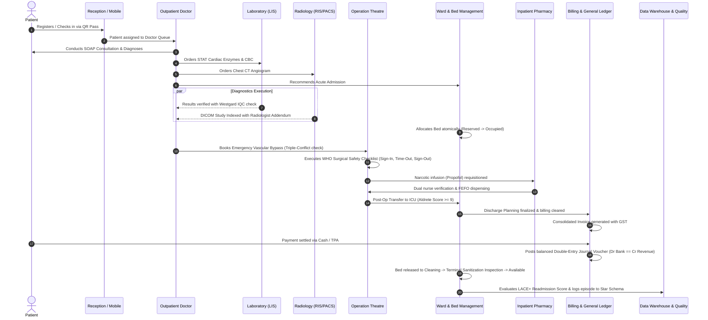

# Cross-Module End-to-End Workflow Mapping

## 1. Master Clinical & Financial Lifecycle Flow

## 2. Cross-Subsystem Handshakes
1. **Reception $\to$ OPD**: Concurrency-locked token issuing; zero appointment time collision.
2. **Clinical $\to$ LIS/RIS**: Diagnostic orders automatically spawn barcoded lab accession tokens and DICOM Modality Worklist items.
3. **Clinical $\to$ Pharmacy**: Electronic prescriptions carry Tall Man lettering, allergy check gates, and drug-drug interaction warnings.
4. **Clinical $\to$ IPD $\to$ OT**: PAC clearance with ASA physical score required prior to theatre induction.
5. **Clinical $\to$ RCM**: Automatic itemized tariff billing for bed occupancy days, nursing procedures, OT minutes, lab tests, and dispensed medications.
6. **Clinical $\to$ Quality/EDW**: Automatic detection of sentinel events, HAI infection surveillance denominator tracking, and LACE+ predictive risk scoring.

