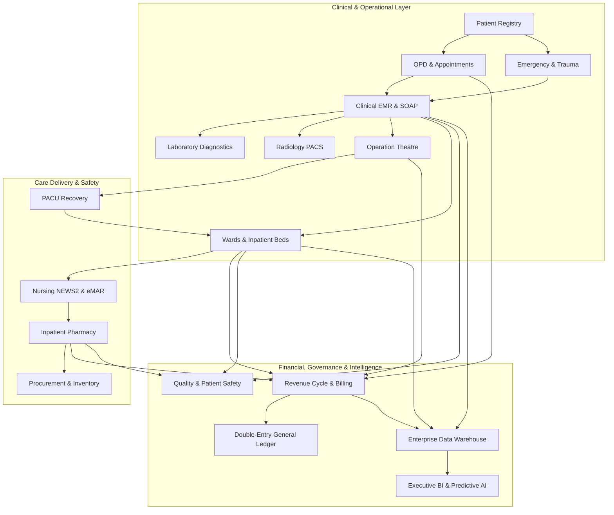

# Enterprise Data Flow & Integration Architecture

## 1. Architectural Principles
ASRTAVA operates as an enterprise modular monolith where all clinical, diagnostic, pharmaceutical, surgical, operational, financial, and analytical subsystems communicate through strongly typed internal domain services, transactional database boundaries, and standard REST APIs.

## 2. Cross-Subsystem Integration Schema

## 3. Strict Cross-Domain Invariants
1. **Single Source of Truth**: All clinical episodes link to the immutable patient record via UHID.
2. **Immediate Financial Encumbrance**: Every medical procedure or drug dispensation writes an itemized tariff entry to the unbilled staging ledger.
3. **Double-Entry Mathematical Balance**: All cash, TPA, or card payments generate balancing debit and credit entries ($\sum Dr == \sum Cr$).
4. **Physical Inventory Integrity**: Stock deductions occur at the exact batch number level using First-Expiry-First-Out (FEFO) logic.

