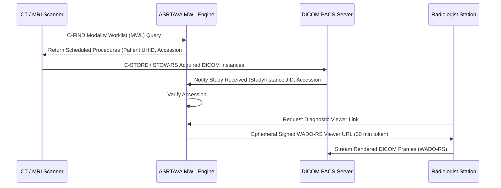

# ASRTAVA DICOM Medical Imaging Architecture

**Document Reference:** `docs/integrations/DICOM_ARCHITECTURE.md`  
**Standards Conformance:** DICOM PS3.0 (Digital Imaging and Communications in Medicine) & DICOMweb  
**Last Verified:** 2026-11-09

---

## 1. Medical Imaging Data Flow

---

## 2. Storage Strategy

- Large DICOM binary files (multi-slice CT / MRI pixel data) are **never** stored directly in relational PostgreSQL tables.
- Binary blobs reside in configured storage adapters (`LocalStorageAdapter` for local hospital NAS; `S3StorageAdapter` with Compliance Object Lock for Cloud).
- PostgreSQL indexes only lightweight metadata (`imaging_study_references`): `study_instance_uid`, `series_count`, `instance_count`, `modality`, `accession_number`, and `patient_id`.

---

## 3. Ephemeral Time-Bound Viewer Security

- Radiologists and clinicians do not access direct persistent URLs to PACS storage.
- ASRTAVA issues high-entropy, 30-minute time-bound HMAC tokens for the integrated zero-footprint DICOM viewer (`Cornerstone.js` / `OHIF Viewer Bridge`).
- Expired tokens return HTTP 401 Unauthorized.

