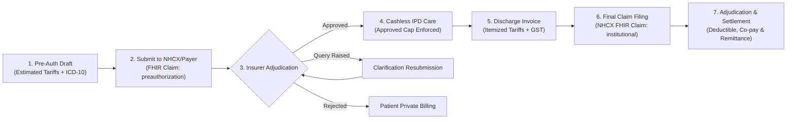

# ASRTAVA Insurance, Pre-Authorization & NHCX Integration

**Document Reference:** `docs/integrations/INSURANCE_INTEGRATION.md`  
**Standard Profiles:** National Health Claims Exchange (NHCX), IRDAI Cashless Everywhere, FHIR Claim / Coverage  
**Last Verified:** 2026-11-09

---

## 1. Cashless Health Insurance Lifecycle

---

## 2. Pre-Authorization Architecture

- Hospital desk enters patient policy details, estimated length of stay, procedure tariff codes, and primary ICD-10 diagnosis.
- ASRTAVA constructs an electronic pre-auth bundle and dispatches it to the insurer's endpoint via NHCX / IRDAI APIs.
- The approved cashless amount creates a financial credit limit on the patient's admission account, preventing premature private billing.

---

## 3. Claim Settlement & Remittance Reconciliation

- Upon inpatient discharge, the billing module packages itemized tariffs (bed charges, doctor consultation, surgery, medications, lab diagnostics).
- Insurer responses return adjudicated amount, statutory deductions (TDS), contractual discounts, and co-payment obligations.
- Double-entry ledger entries balance patient co-pay against insurer receivable accounts, providing transparent reconciliation.

