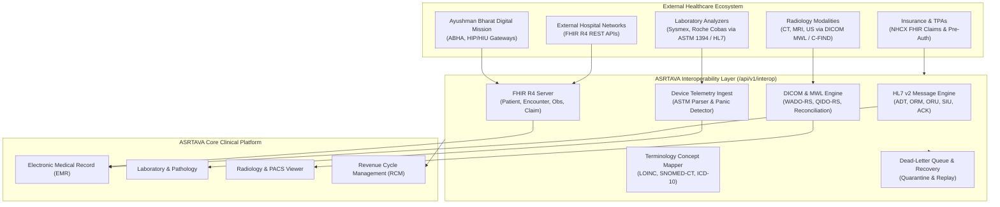

# ASRTAVA Healthcare Interoperability Architecture

**Document Reference:** `docs/integrations/INTEROPERABILITY_ARCHITECTURE.md`  
**Execution Authority:** ASRTAVA Chief Interoperability & Integration Architect  
**Standards Conformance:** HL7 v2.5.1, FHIR R4.0.1, DICOM PS3.0, ASTM 1394-97, ABDM, NHCX  
**Last Verified:** 2026-11-09

---

## 1. Architectural Philosophy

The ASRTAVA Healthcare Interoperability Platform bridges internal clinical workflows (OPD, IPD, OT, Laboratory, Radiology, Pharmacy, Billing) with external healthcare ecosystems. Rather than designing separate, disconnected gateway appliances, ASRTAVA embeds standards-based protocol adapters into its core modular monolith architecture.

---

## 2. Supported Healthcare Standards Matrix

| Standard / Protocol | Version | Subsystem / Role | Directionality | ASRTAVA Implementation |
|---|---|---|---|---|
| **HL7 v2** | 2.5.1 | ADT, ORM, ORU, SIU, MDM, ACK | Bi-directional | Ingest parser, ACK generator, sliding-window deduplication |
| **HL7 FHIR** | R4 (4.0.1) | 20+ Core Clinical & Financial Resources | Server & Client | Full RESTful API, CapabilityStatement, Bundle searchset |
| **DICOM** | PS3.0 | Metadata, MWL (Modality Worklist), PACS | Server & Client | C-FIND MWL, QIDO-RS, WADO-RS viewer tokens, quarantine |
| **ASTM** | 1394-97 / LIS2-A2 | Hematology & Biochemistry Analyzers | Inbound Ingest | Multi-frame parser (`H`, `P`, `O`, `R`), panic value flag |
| **ABDM** | M1, M2, M3 | Ayushman Bharat Health Ecosystem | Bi-directional | ABHA creation, HIP record sharing, HIU viewer simulator |
| **NHCX** | v1.0 | National Health Claims Exchange | Outbound Claims | Pre-auth request, itemized claim filing, IRDAI adjudication |
| **Terminology** | 2026 Editions | LOINC, SNOMED-CT, ICD-10, UCUM, ATC | Internal Translation | Cross-concept mapping, synonym lookup, fallback matching |

---

## 3. Data Flow & Clinical Safety Guardrails

1. **Unapproved Reading Quarantine**: Ingested analyzer telemetry containing abnormal or panic values (`HH`, `LL`, `CRITICAL`) is **strictly quarantined** in `pending_approval` status. It is **never** presented to the patient portal or finalized in clinical charts without verified pathologist or lab technician sign-off.
2. **Ambiguous DICOM Reconciliation Gate**: If a CT or MRI study arrives with ambiguous accession numbers or UHID mismatches, it is quarantined in the Modality Worklist. Linking requires an authorized radiologist or administrator with mandatory clinical justification notes.
3. **Idempotency & Duplicate Defense**: Inbound HL7 messages are tracked in a 15-minute sliding control window (`hospital_id:message_control_id`). Duplicate retransmissions are acknowledged with Application Reject (`AR`) without mutating clinical charts.
4. **Dead-Letter Queue (DLQ)**: Any packet failing schema validation, experiencing network timeouts, or encountering unknown patients is routed to the DLQ for auditing and one-click administrative replay.

