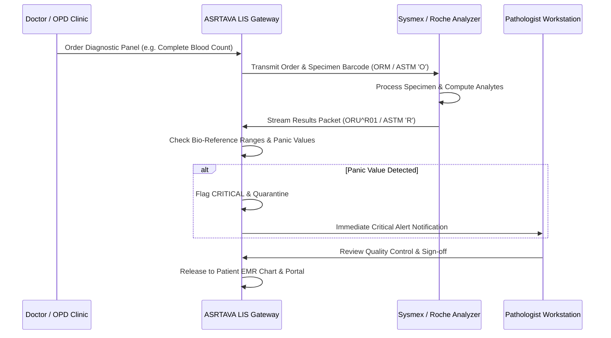

# ASRTAVA Laboratory Information System (LIS) Integration

**Document Reference:** `docs/integrations/LIS_INTEGRATION.md`  
**Standard Protocols:** HL7 v2.5.1 (ORM^O01 / ORU^R01), ASTM 1394-97, JSON Webhooks  
**Last Verified:** 2026-11-09

---

## 1. Laboratory Workflow & Bi-Directional Exchange

---

## 2. Bio-Reference Ranges & Abnormal Flagging

Incoming laboratory analytes are automatically categorized according to age and gender specific reference intervals:
- **`NORMAL`**: Value falls within expected biological reference interval.
- **`LOW` (`L`)**: Value falls below reference low threshold.
- **`HIGH` (`H`)**: Value exceeds reference high threshold.
- **`CRITICAL` (`HH` / `LL` / `PANIC`)**: Extreme value indicating life-threatening physiological distress (e.g., Potassium > 6.5 mmol/L, Platelets < 20,000 /uL, Troponin I positive).

---

## 3. Pathologist Sign-Off Safety Gate

Under National Medical Commission (NMC) and NABL guidelines:
- Unverified raw analyzer readings **cannot** be auto-released to patient-facing mobile apps or discharge summaries.
- Results remain in `pending_approval` state until a qualified medical biochemist, microbiologist, or pathologist verifies calibration and quality controls.
- Any amendment or correction to previously approved laboratory reports creates a new immutable audit version, preserving original values for legal compliance.

