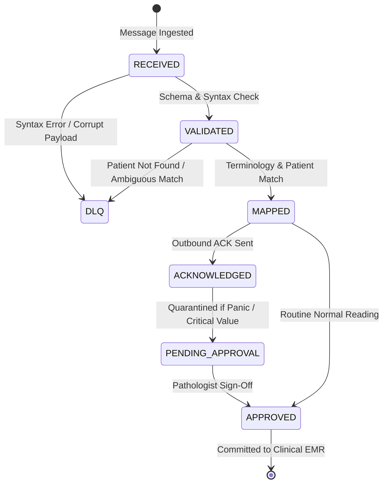

# ASRTAVA Integration Message Processing, Queues & Failure Recovery

**Document Reference:** `docs/integrations/MESSAGE_PROCESSING_AND_RECOVERY.md`  
**Patterns:** Transactional Outbox, Sliding Idempotency Filter, Dead-Letter Queue (DLQ), Exponential Backoff  
**Last Verified:** 2026-11-09

---

## 1. Message Lifecycle State Machine

---

## 2. Sliding Window Idempotency Filter

- Healthcare networks frequently retry messages during transient packet loss.
- Inbound HL7 `MSH-9` control IDs and external transaction IDs are tracked in a 15-minute sliding memory cache.
- Duplicate transmissions are acknowledged immediately with `AR` (Application Reject) or identical cached ACK responses, preventing duplicate laboratory orders, double pharmacy deductions, or duplicated billing charges.

---

## 3. Dead-Letter Queue (DLQ) Architecture

Failed integration messages are stored in `integration_dead_letter_queue` with:
- `payload`: Exact raw text or JSON of the failed message.
- `error_category`: `SYNTAX_ERROR`, `VALIDATION_FAILED`, `PATIENT_NOT_FOUND`, `TIMEOUT`, `AUTH_FAILURE`.
- `error_message`: Stack trace and diagnostic error text.
- `retry_count` & `max_retries`: Configurable retry attempts with exponential backoff ($2^n \times 1000\text{ ms}$).
- `replayed_by_user_id`: Audit tracking for administrator who initiated manual replay.

