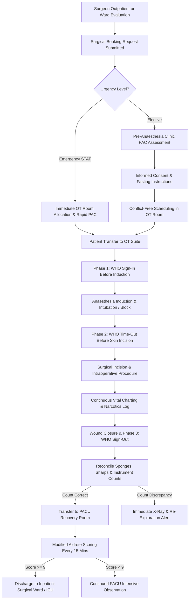

# ASRTAVA Complete Perioperative Workflow Map

## 1. End-to-End Surgical Care Pathway

## 2. Key Safeguards & Governance
- **Mandatory Surgical Count**: Both Scrub Nurse and Circulating Nurse must verify counts before skin closure.
- **Antibiotic Prophylaxis**: Time-Out phase enforces documented administration of surgical antibiotic prophylaxis within 60 minutes prior to incision.
- **Controlled Narcotics Ledger**: Full dosage accounting (milligrams/micrograms) with nurse cosignature for all intraoperative opioids and sedatives.

