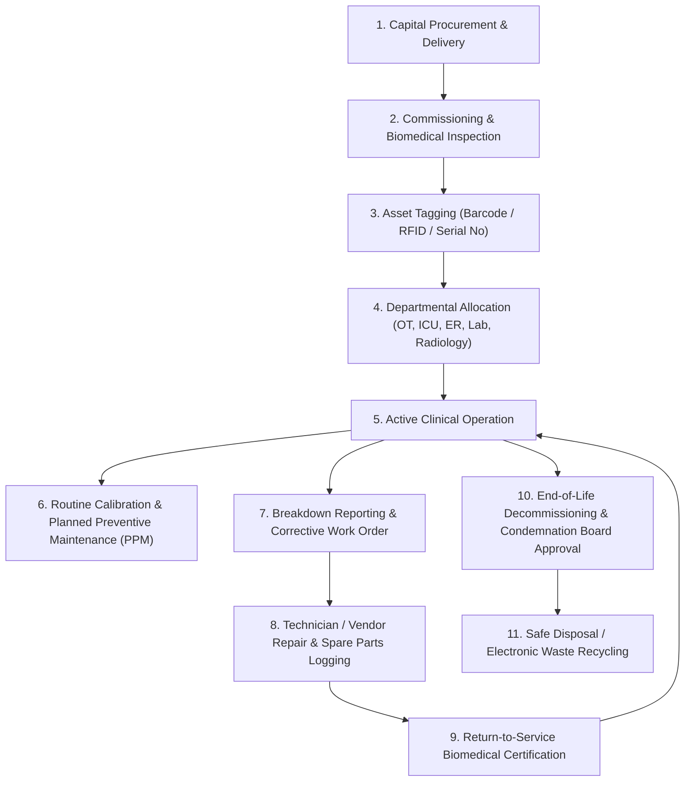

# ASRTAVA — Asset & Biomedical Equipment Lifecycle Map

## 1. Overview
Hospital assets—especially critical life-support medical devices—require rigorous tracking from procurement to decommissioning.

---

## 2. Biomedical Maintenance & Safety Invariants
1. **Calibration Status**: Equipment past its statutory calibration date is automatically flagged `CALIBRATION_OVERDUE` and alerts are routed to the Nursing Supervisor and Biomedical Lead.
2. **Post-Repair Certification**: After a breakdown repair, equipment cannot be returned to active patient care until a certified biomedical engineer or clinical supervisor records the `RETURN_TO_SERVICE` safety check.
3. **Downtime Auditing**: Every breakdown calculates exact downtime (from ticket creation to service restoration) for NABH/JCI hospital accreditation reporting.

