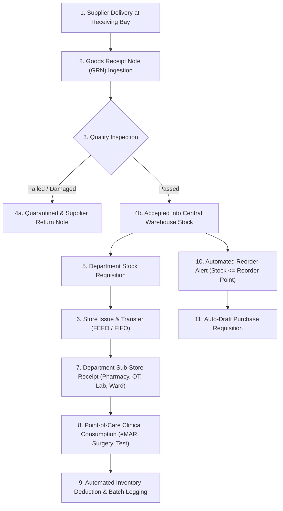

# ASRTAVA — Inventory & Stock Movement Workflow Map

## 1. Overview
This map details how inventory flows from initial supplier delivery to central stores, department distribution, clinical consumption, and waste disposal.

---

## 2. Invariants & Rules
1. **Quarantine Isolation**: Damaged or uninspected goods are placed in `QUARANTINED` status and **cannot** be allocated or issued to any clinical department.
2. **First-Expiry-First-Out (FEFO)**: When fulfilling departmental requests, items with the earliest expiration date are systematically prioritized for dispatch.
3. **No Duplicate Deductions**: Stock issued to an OT sub-store is deducted from the Central Warehouse and added to the OT Sub-Store. Clinical consumption during surgery deducts from the OT Sub-Store only, preventing double deductions.
4. **Physical Stock Reconciliation**: Discrepancies identified during cycle counts require authorized adjustment notes with audit explanations; system stock is never silently overwritten.

