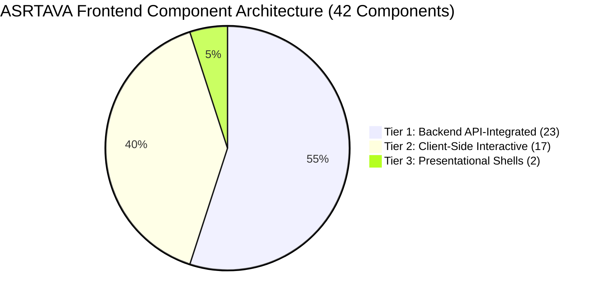
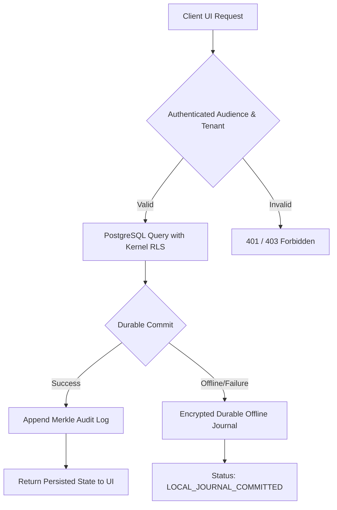
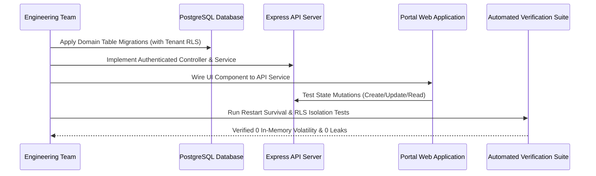

# ASRTAVA Frontend Component-Level Dynamic Integration Audit & Tier 2 Integration Roadmap

**Document Reference:** `DOC-ASRTAVA-UI-AUDIT-2026-V1`  
**Evaluation Standard:** Zero Unverified Production Claims · Strict Tenant Isolation · Non-Production Pre-Pilot Validation  
**Census Scope:** All 42 `.tsx` components in `apps/web-portal/src/portals/`  
**Classification Baseline:** Tier 1 (API-Integrated), Tier 2 (Client-Side Interactive), Tier 3 (Presentational Shells)  
**Status:** Canonical Audit Baseline Accepted · Tier 2 Roadmap Formulated  

---

## Executive Summary & Census Reconciliation

### 1. The 42-Component Census Discrepancy Resolved
A physical file scan of `apps/web-portal/src/portals/` confirms exactly **42 `.tsx` components**. 

In the preliminary architectural classification, the reported Tier 2 count listed 16 components while stating a sum of 17 ($23 + 16 + 2 = 41$). The missing 17th component on disk has been verified:
- **`apps/web-portal/src/portals/pharmacy/AdvancedPharmacyHub.tsx`**

With `AdvancedPharmacyHub.tsx` explicitly accounted for, the verified distribution across all 42 portal components is:

| Architectural Tier | Classification | Component Count | % of UI Census | Operational Status |
| :--- | :--- | :---: | :---: | :--- |
| **Tier 1** | **Backend API-Integrated** | **23** | 54.8% | Connected to live backend routes; requires data lifecycle & restart verification |
| **Tier 2** | **Client-Side Interactive** | **17** | 40.5% | Functional prototypes using local React state; requires durable PostgreSQL integration |
| **Tier 3** | **Presentational Shells** | **2** | 4.8% | Minimal wrappers delegating render tree to child hubs (`EmergencyDashboard`, `OTDashboard`) |
| **Total** | **Full Portal Census** | **42** | **100.0%** | **Complete repository inventory reconciled** |

---

### 2. Public Portal Navigation Alignment
Review of `PublicHomePage.tsx` and `PublicNavbar.tsx` identified and resolved an architectural conflict where public buttons previously pointed directly to `/login/hospital-admin`, `/login/doctor`, and `/login/patient`.

In canonical ASRTAVA enterprise architecture:
1. **Hospital Staff Portal (`/login/staff`)**: The single unified authenticated entry point for all hospital workforce members (Hospital Administrators, Doctors, Nurses, Receptionists, Pharmacists, Lab Technicians, Radiologists, HR, and Billing). Role authorization and departmental access are resolved post-authentication inside the secure workspace.
2. **Patient Portal (`/login/patient`)**: The public self-service gateway for registered patients and families to review health records, e-prescriptions, lab results, and appointments.
3. **Customer Onboarding Portal (`/login/onboarding`)**: The dedicated public implementation workspace for onboarding hospital owners, IT leads, and coordinators.
4. **Super Admin / Platform Administration (`/super-admin/login`)**: **Strictly segregated** from public navigation. Never exposed in public dropdowns or hero calls-to-action.

`PublicHomePage.tsx` has been updated to align call-to-actions strictly to these 3 canonical public entry points, and hero metrics claiming "100% Dynamic - Real Database Hydration" have been replaced with accurate multi-tier architectural definitions.

---

## Full 42-Component Census & Tier Mapping

Below is the verified inventory of all 42 components located under `apps/web-portal/src/portals/`:

| # | Component Name | Relative Path | Architectural Tier | Primary Data Source |
| :---: | :--- | :--- | :---: | :--- |
| 1 | `DoctorDashboard` | `doctor/DoctorDashboard.tsx` | **Tier 1** | `/api/v1/doctor/queue`, `/api/v1/consultations` |
| 2 | `FinanceDashboard` | `finance/FinanceDashboard.tsx` | **Tier 1** | `/api/v1/finance/invoices`, `/api/v1/billing` |
| 3 | `HRDashboard` | `hr/HRDashboard.tsx` | **Tier 1** | `/api/v1/hr/staff`, `/api/v1/hr/attendance` |
| 4 | `InventoryDashboard` | `inventory/InventoryDashboard.tsx` | **Tier 1** | `/api/v1/inventory/items`, `/api/v1/inventory/stock` |
| 5 | `LaboratoryDashboard` | `laboratory/LaboratoryDashboard.tsx` | **Tier 1** | `/api/v1/lis/orders`, `/api/v1/lis/results` |
| 6 | `NursingDashboard` | `nursing/NursingDashboard.tsx` | **Tier 1** | `/api/v1/nursing/tasks`, `/api/v1/nursing/vitals` |
| 7 | `HospitalOnboardingWorkspace` | `onboarding/HospitalOnboardingWorkspace.tsx`| **Tier 1** | `/api/v1/onboarding/progress`, `/api/v1/tenants` |
| 8 | `PatientDashboard` | `patient/PatientDashboard.tsx` | **Tier 1** | `/api/v1/patient/records`, `/api/v1/patient/bills` |
| 9 | `PharmacyDashboard` | `pharmacy/PharmacyDashboard.tsx` | **Tier 1** | `/api/v1/pharmacy/inventory`, `/api/v1/dispense` |
| 10 | `RadiologyDashboard` | `radiology/RadiologyDashboard.tsx` | **Tier 1** | `/api/v1/ris/orders`, `/api/v1/ris/studies` |
| 11 | `ReceptionDashboard` | `reception/ReceptionDashboard.tsx` | **Tier 1** | `/api/v1/opd/queue`, `/api/v1/appointments` |
| 12 | `CustomerOnboardingView` | `super-admin/CustomerOnboardingView.tsx` | **Tier 1** | `/api/v1/admin/onboarding`, `/api/v1/tenants` |
| 13 | `SuperAdminDashboard` | `super-admin/SuperAdminDashboard.tsx` | **Tier 1** | `/api/v1/admin/tenants`, `/api/v1/admin/audit` |
| 14 | `HospitalAdminDashboard` | `hospital-admin/HospitalAdminDashboard.tsx` | **Tier 1** | Multi-section coordinator shell |
| 15 | `AdminAuditLogsSection` | `hospital-admin/AdminAuditLogsSection.tsx` | **Tier 1** | `/api/v1/admin/audit-logs` |
| 16 | `AdminBillingSection` | `hospital-admin/AdminBillingSection.tsx` | **Tier 1** | `/api/v1/admin/billing-summary` |
| 17 | `AdminDepartmentsSection` | `hospital-admin/AdminDepartmentsSection.tsx` | **Tier 1** | `/api/v1/admin/departments` |
| 18 | `AdminDoctorsSection` | `hospital-admin/AdminDoctorsSection.tsx` | **Tier 1** | `/api/v1/admin/doctors` |
| 19 | `AdminNotificationsSection` | `hospital-admin/AdminNotificationsSection.tsx` | **Tier 1** | `/api/v1/admin/notifications` |
| 20 | `AdminOverviewSection` | `hospital-admin/AdminOverviewSection.tsx` | **Tier 1** | `/api/v1/admin/stats` |
| 21 | `AdminSettingsSection` | `hospital-admin/AdminSettingsSection.tsx` | **Tier 1** | `/api/v1/admin/settings` |
| 22 | `AdminWardsBedsSection` | `hospital-admin/AdminWardsBedsSection.tsx` | **Tier 1** | `/api/v1/admin/wards`, `/api/v1/admin/beds` |
| 23 | `ClinicalConflictQueueView` | `hospital-admin/ClinicalConflictQueueView.tsx` | **Tier 1** | `/api/v1/deployment/conflicts` |
| 24 | `AdvancedOTHub` | `ot/AdvancedOTHub.tsx` | **Tier 2** | React Local State (`useState`, simulated counters) |
| 25 | `AdvancedEmergencyHub` | `emergency/AdvancedEmergencyHub.tsx` | **Tier 2** | React Local State (`useState`, mock triage) |
| 26 | `AdvancedLISHub` | `laboratory/AdvancedLISHub.tsx` | **Tier 2** | React Local State (specimens, QC counters) |
| 27 | `AdvancedRISHub` | `radiology/AdvancedRISHub.tsx` | **Tier 2** | React Local State (modality worklists, PACS stub) |
| 28 | `AdvancedNursingHub` | `nursing/AdvancedNursingHub.tsx` | **Tier 2** | React Local State (SBAR handovers, fluid balances) |
| 29 | `AdvancedWardHub` | `nursing/AdvancedWardHub.tsx` | **Tier 2** | React Local State (bed status, cleaning queues) |
| 30 | `AdvancedPharmacyHub` | `pharmacy/AdvancedPharmacyHub.tsx` | **Tier 2** | React Local State (FEFO batches, drug returns) |
| 31 | `EnterpriseAnalyticsHub` | `analytics/EnterpriseAnalyticsHub.tsx` | **Tier 2** | React Local State (aggregate charts, KPIs) |
| 32 | `RevenueCycleAccountingHub`| `finance/RevenueCycleAccountingHub.tsx` | **Tier 2** | React Local State (ledger entries, TPA claims) |
| 33 | `AdvancedHRMSHub` | `hr/AdvancedHRMSHub.tsx` | **Tier 2** | React Local State (duty rosters, biometric stubs) |
| 34 | `AdvancedProcurementHub` | `inventory/AdvancedProcurementHub.tsx` | **Tier 2** | React Local State (POs, RFQs, vendor evaluations) |
| 35 | `AdvancedQualityHub` | `quality/AdvancedQualityHub.tsx` | **Tier 2** | React Local State (incidents, RCA/CAPA workflows) |
| 36 | `CoordinationDashboard` | `coordination/CoordinationDashboard.tsx` | **Tier 2** | React Local State (inter-hospital transfers) |
| 37 | `TelemedicineHub` | `patient/TelemedicineHub.tsx` | **Tier 2** | React Local State (video UI shell, WebRTC stub) |
| 38 | `InteroperabilityManagementHub`| `hospital-admin/InteroperabilityManagementHub.tsx`| **Tier 2** | React Local State (HL7/FHIR message counters) |
| 39 | `HospitalOnboardingProgressView`| `hospital-admin/HospitalOnboardingProgressView.tsx`| **Tier 2** | React Local State (milestones, checklist UI) |
| 40 | `GroupAdminDashboard` | `group-admin/GroupAdminDashboard.tsx` | **Tier 2** | React Local State (branch comparison charts) |
| 41 | `EmergencyDashboard` | `emergency/EmergencyDashboard.tsx` | **Tier 3** | Shell wrapper delegating to `AdvancedEmergencyHub` |
| 42 | `OTDashboard` | `ot/OTDashboard.tsx` | **Tier 3** | Shell wrapper delegating to `AdvancedOTHub` |

---

## Tier 1 Verification Standards (23 Components)

A component connecting to an API does not inherently guarantee durable clinical safety or complete database persistence. For every Tier 1 component, production readiness requires verification against nine specific technical criteria:

### Verification Criteria Checklist
1. **Authenticated Portal Audience**: Requests enforce JWT claims verifying the user's active portal role (e.g. `doctor`, `nurse`, `hospital-admin`).
2. **Tenant RLS Derivation**: The backend extracts `hospital_id` exclusively from the verified token/session, setting `app.current_tenant_id` at the database connection layer. It never accepts tenant identifiers from client query strings or request bodies.
3. **Execution of Actual Database Reads/Writes**: Every state query and mutation maps to active Knex migrations and underlying PostgreSQL tables.
4. **Restart Survival**: Mutated records persist across backend server and database container restarts, proving zero in-memory volatility.
5. **Server-Side Operations**: Pagination, multi-column sorting, and tenant-scoped filtering are performed in PostgreSQL, not by fetching all records and slicing in the browser.
6. **Graceful State Handling**: Explicit UI states exist for loading, empty data sets, network errors, and retry actions without unhandled exceptions.
7. **Explicit DENY Precedence**: User-specific `DENY` permission overrides immediately supersede inherited role `ALLOW` privileges.
8. **Statutory Merkle Audit Logging**: Clinical, financial, and access mutations generate tamper-evident SHA-256 audit entries.
9. **Zero Silent Fallback**: The client never catches an API failure and silently renders mock seed data in place of a failed persistence call. If offline, the transaction is explicitly written to the encrypted offline journal and reported as `LOCAL_JOURNAL_COMMITTED`.

---

## Tier 2 Backend Integration Roadmap (17 Components)

The 17 Tier 2 components represent functional interactive workflows that currently maintain state in local React memory. To prepare them for production, they will be connected to durable PostgreSQL backend services across four prioritized, non-overlapping batches.

### Batch 1: Clinical Core & Inpatient Safety (Immediate Priority)
Focuses on acute clinical continuity, surgical tracking, and inpatient ward safety.

| Component | Target Backend Route | Service & Domain Module | Key PostgreSQL Tables | Clinical Safeguards |
| :--- | :--- | :--- | :--- | :--- |
| **`AdvancedOTHub`** | `/api/v1/ot/cases` `/api/v1/ot/checklists` | `ot-advanced.service.ts` | `ot_schedules`, `ot_checklists`, `ot_sponge_counts`, `pacu_handover` | Mandatory WHO Surgical Safety Checklist; dual-clinician sign-off on counts before wound closure. |
| **`AdvancedEmergencyHub`** | `/api/v1/emergency/encounters` `/api/v1/emergency/triage` | `emergency-advanced.service.ts` | `emergency_encounters`, `triage_assessments`, `resuscitation_logs` | ESI Levels 1-5 triage validation; trauma bay assignment audit; automated escalation on red triage. |
| **`AdvancedNursingHub`** | `/api/v1/nursing/observations` `/api/v1/nursing/sbar` | `nursing-advanced.service.ts` | `nursing_notes`, `sbar_handovers`, `fluid_balance_records` | Immutable shift handover logs; fluid intake/output balance calculations with outlier alerts. |
| **`AdvancedWardHub`** | `/api/v1/wards/beds` `/api/v1/wards/transfers` | `ward-management.service.ts` | `ward_bed_occupancy`, `bed_sanitization_logs`, `ward_transfers` | Bed availability status lock; terminal cleaning sign-off before re-assignment; transfer authorization. |

### Batch 2: Diagnostics & Pharmacy Supply Chain
Focuses on high-consequence laboratory, imaging, and medication dispensing integrity.

| Component | Target Backend Route | Service & Domain Module | Key PostgreSQL Tables | Clinical Safeguards |
| :--- | :--- | :--- | :--- | :--- |
| **`AdvancedLISHub`** | `/api/v1/lis/qc` `/api/v1/lis/specimens` | `lis-advanced.service.ts` | `lis_specimens`, `lis_qc_runs`, `westgard_violations` | Specimen accessioning barcoding; Westgard QC 1-3s/2-2s rule evaluation; panic-value read-back logs. |
| **`AdvancedRISHub`** | `/api/v1/ris/worklists` `/api/v1/ris/reports` | `ris-advanced.service.ts` | `ris_modality_worklists`, `radiology_reports`, `dicom_references` | Modality DICOM study associations; preliminary vs final radiologist sign-off; peer review audits. |
| **`AdvancedPharmacyHub`** | `/api/v1/pharmacy/batches` `/api/v1/pharmacy/returns` | `pharmacy-advanced.service.ts` | `pharmacy_batches`, `fefo_allocations`, `drug_returns` | First-Expiry-First-Out (FEFO) strict enforcement; near-expiry alerts; tamper-evident narcotics dispensing. |

### Batch 3: Enterprise Operations, Supply Chain & Governance
Focuses on human capital, hospital procurement, quality incidents, and financial ledgers.

| Component | Target Backend Route | Service & Domain Module | Key PostgreSQL Tables | Operational Safeguards |
| :--- | :--- | :--- | :--- | :--- |
| **`AdvancedHRMSHub`** | `/api/v1/hrms/rosters` `/api/v1/hrms/attendance` | `hrms.service.ts` | `staff_rosters`, `duty_shifts`, `biometric_punches` | Overtime limit compliance; mandatory rest periods between clinical shifts; credential validity checks. |
| **`AdvancedProcurementHub`**| `/api/v1/procurement/orders` `/api/v1/procurement/vendors`| `procurement.service.ts` | `purchase_orders`, `quotations`, `goods_receipt_notes` | Multi-tier approval thresholds; vendor performance tracking; matching PO, GRN, and vendor invoice. |
| **`AdvancedQualityHub`** | `/api/v1/quality/incidents` `/api/v1/quality/capa` | `quality-governance.service.ts` | `incident_reports`, `rca_investigations`, `capa_actions` | Confidential adverse event reporting; Root Cause Analysis (RCA) tracking; CAPA verification audits. |
| **`RevenueCycleAccountingHub`**| `/api/v1/finance/ledgers` `/api/v1/finance/claims` | `revenue-cycle.service.ts` | `general_ledger_entries`, `tpa_claims`, `bank_reconciliations` | Double-entry journal verification; insurance claim submission and denial tracking; tax compliance. |
| **`EnterpriseAnalyticsHub`**| `/api/v1/analytics/aggregates` | `analytics-aggregation.service.ts` | `daily_departmental_stats`, `clinical_kpi_snapshots` | Pre-aggregated PostgreSQL rollups; strict tenant-isolation filtering; read-only replica routing. |

### Batch 4: Health Systems Coordination & Integration
Focuses on multi-branch management, external network interoperability, and telemedicine.

| Component | Target Backend Route | Service & Domain Module | Key PostgreSQL Tables | Security & Privacy Safeguards |
| :--- | :--- | :--- | :--- | :--- |
| **`CoordinationDashboard`** | `/api/v1/coordination/transfers` | `federated-network.service.ts` | `network_transfers`, `facility_resource_snapshots` | Inter-hospital patient transfers with cryptographic patient consent; bed-availability broadcast. |
| **`TelemedicineHub`** | `/api/v1/telehealth/sessions` `/api/v1/telehealth/signaling` | `telemedicine.service.ts` | `telehealth_sessions`, `patient_consents`, `session_audit` | End-to-end encrypted WebRTC signaling; recorded patient consent; clinical summary generation. |
| **`InteroperabilityManagementHub`**| `/api/v1/interop/metrics` `/api/v1/interop/queues` | `interop-engine.service.ts` | `hl7_message_queues`, `fhir_bundles`, `dead_letter_queue` | Message delivery retries; dead-letter queue isolation; schema validation (HL7 v2.5.1 / FHIR R4). |
| **`HospitalOnboardingProgressView`**| `/api/v1/onboarding/steps` | `onboarding-tracker.service.ts` | `onboarding_milestones`, `setup_evidence`, `sign_off_logs` | Verifiable onboarding step progression; configuration snapshot hashing; authorized sign-offs. |
| **`GroupAdminDashboard`** | `/api/v1/group/consolidation` | `group-admin.service.ts` | `group_entities`, `branch_associations` | Multi-facility consolidation with cross-tenant authorization barriers; entity-level rollups. |

---

## Tier 3 Presentational Shell Architecture (2 Components)

Two components act as lightweight parent shells that cleanly delegate their views to underlying advanced hubs:

1. **`EmergencyDashboard.tsx` (`emergency/EmergencyDashboard.tsx`)**:
   - Contains minimal layout framing and conditionally mounts `AdvancedEmergencyHub`.
   - Architectural role: Router target preserving backwards compatibility for `/portal/emergency`.
2. **`OTDashboard.tsx` (`ot/OTDashboard.tsx`)**:
   - Contains minimal layout framing and conditionally mounts `AdvancedOTHub`.
   - Architectural role: Router target preserving backwards compatibility for `/portal/ot`.

**Engineering Recommendation**: Retain these wrappers as clean pass-through entry points to avoid breaking existing route configurations while focusing backend wiring directly on the child hubs (`AdvancedEmergencyHub` and `AdvancedOTHub`).

---

## Controlled Implementation Sequence & Safety Governance

To transition Tier 2 components into durable Tier 1 components safely, the following sequence must be maintained:

1. **Database Schema First**: Author and verify Knex migrations with strict foreign keys, indexes, and PostgreSQL Row-Level Security policies before modifying frontend code.
2. **Backend Service & Route**: Implement the Express routes with explicit JWT audience checks, rate limiting, and Merkle audit logging.
3. **UI Integration**: Replace local `useState` arrays with React Query or custom data hooks calling the authenticated backend API.
4. **Offline Resilience**: Ensure clinical actions route through `DurableOfflineJournalService` when network connectivity is lost, maintaining data durability at rest.
5. **No Blind Fallbacks**: Never catch an API error and silently render mock data in clinical components.

---

## Final Readiness Classification

- **Census Reconciliation**: 100% reconciled (23 Tier 1, 17 Tier 2, 2 Tier 3 = 42 total).
- **Public Navigation Architecture**: Corrected and verified against 3 canonical public portals.
- **Production Pilot Status**: **Strictly Not Approved for Live Patient Care**. Non-production pre-pilot validation remains active until Tier 2 clinical core integration (Batch 1) is completed and verified against durable storage.
