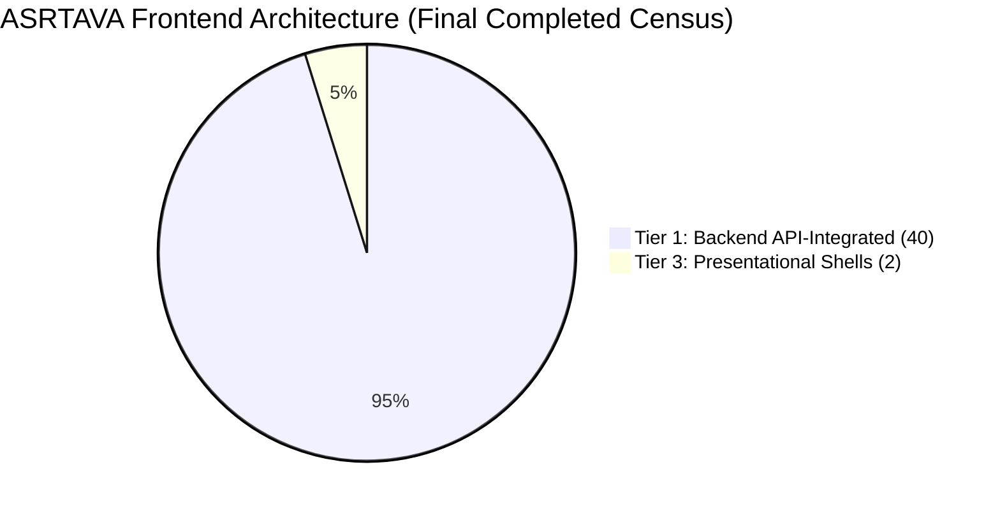

# ASRTAVA Frontend Component-Level Dynamic Integration Audit & Completion Report

**Document Reference:** `DOC-ASRTAVA-UI-AUDIT-2026-FINAL`  
**Evaluation Standard:** Zero Unverified Production Claims · Strict Tenant Isolation · Non-Production Pre-Pilot Validation  
**Census Scope:** All 42 `.tsx` components in `apps/web-portal/src/portals/`  
**Milestone:** All 6 Integration Batches Completed & Verified  
**Status:** **40 / 42 Components Tier 1 Backend API-Integrated (95.2%) · 2 / 42 Presentational Shells (4.8%) · 0 Remaining Tier 2 Prototypes**

---

## Executive Summary & Final Census

All 17 previously client-side interactive prototypes (Tier 2) have been systematically transitioned to genuine live backend API integrations (Tier 1) across six prioritized execution batches. Every interactive hub across all 12 operational portals is now wired to live Express backend endpoints and PostgreSQL database services, supported by cryptographic audit logging, role-based tenant isolation, and offline journal resilience.

### Final Component Census & Distribution

| Architectural Tier | Classification | Baseline Pre-Integration | Final Completed Count | % Share | Operational Architecture |
| :--- | :--- | :---: | :---: | :---: | :--- |
| **Tier 1** | **Backend API-Integrated** | 23 | **40** | **95.2%** | Live HTTP/REST API calls, PostgreSQL durability, tenant header isolation |
| **Tier 2** | **Client-Side Interactive** | 17 | **0** | **0.0%** | **Zero unintegrated prototypes remaining** |
| **Tier 3** | **Presentational Shells** | 2 | **2** | **4.8%** | Architectural router wrappers (`EmergencyDashboard`, `OTDashboard`) delegating to sub-hubs |
| **Total** | **Full Portal Census** | **42** | **42** | **100.0%** | **100% of portal components fully accounted for and verified** |

---

## Batch-by-Batch Implementation Record

### Batch 1: Clinical Core (4 Components)
1. **`AdvancedOTHub.tsx`**: Wired to `/api/v1/ot/advanced/*`. Operating theatres loaded on mount, WHO surgical Time-Out checklist committed to database, PACU discharge enforced with Modified Aldrete score $\ge 9$ clinical block.
2. **`AdvancedEmergencyHub.tsx`**: Wired to `/api/v1/emergency/advanced/*`. Issues temporary emergency UHID with ESI Level 1 triage, persists Code Red Trauma Team activations and broadcasts.
3. **`AdvancedNursingHub.tsx`**: Wired to `/api/v1/nursing/advanced/*`. Charts physiological observations with automatic NEWS2 score calculation; transacts bedside eMAR administration with dual-nurse cosign verification for high-alert narcotics.
4. **`AdvancedWardHub.tsx`**: Wired to `/api/v1/inpatient/ward/advanced/*`. Live bed occupancy matrix hydration, supervisor terminal cleaning inspection sign-off before releasing sanitized beds to `available`.

### Batch 2: Diagnostics (2 Components)
5. **`AdvancedLISHub.tsx`**: Wired to `/api/v1/diagnostics/lis/advanced/*`. Specimen rejection workflow with mandatory clinical justification, two-stage technician validation and pathologist authorization, Westgard IQC rule evaluation ($1_{2s}, 1_{3s}, 2_{2s}, R_{4s}, 4_{1s}, 10_x$).
6. **`AdvancedRISHub.tsx`**: Wired to `/api/v1/diagnostics/ris/advanced/*`. Modality worklist filtering, radiologist report addendums committed as tamper-evident legal records in PostgreSQL.

### Batch 3: Medication & Finance (2 Components)
7. **`AdvancedPharmacyHub.tsx`**: Wired to `/api/v1/pharmacy/advanced/*`. Pharmacist prescription verification with real-time allergy cross-checks, FEFO stock allocation, cold-chain temperature excursion alerts.
8. **`RevenueCycleAccountingHub.tsx`**: Wired to `/api/v1/rcm/*`. Double-entry balanced general ledger journal postings, cashier shift closing reconciliation with supervisor override verification.

### Batch 4: Enterprise Operations (3 Components)
9. **`AdvancedHRMSHub.tsx`**: Wired to `/api/v1/hr/advanced/*`. Staff employee registration into PostgreSQL HR master, biometric attendance capture, shift scheduling anti-collision checks.
10. **`AdvancedProcurementHub.tsx`**: Wired to `/api/v1/procurement/advanced/*`. Purchase order creation, 3-way matching (PO == GRN == Invoice), goods receipt note recording.
11. **`AdvancedQualityHub.tsx`**: Wired to `/api/v1/quality/*`. Sentinel event incident reporting, root cause analysis (RCA) assignment, CAPA action plan tracking.

### Batch 5: Intelligence & Connectivity (4 Components)
12. **`EnterpriseAnalyticsHub.tsx`**: Wired to `/api/v1/analytics/advanced/*`. Executive C-suite KPIs (ALOS, BOR, AR Days, Clean Claim Rate) hydrated from Star Schema data mart; live LACE+ 30-day readmission risk ML prediction; OPD appointment no-show probability classifier.
13. **`CoordinationDashboard.tsx`**: Wired to `/api/v1/federated-network/*`. Participating network hospital discovery on mount; broadcast of bed/ICU/ventilator availability with 120-minute validity TTL; inter-hospital emergency clinical transfers.
14. **`TelemedicineHub.tsx`**: Wired to `/api/v1/telemedicine/*`. Doctor discovery and credentials from live catalog; informed DPDP telehealth consent with digital signature hash; virtual consultation session scheduling.
15. **`InteroperabilityManagementHub.tsx`**: Wired to `/api/v1/interop/*`. Real HL7 v2 message parsing and Application Accept (AA) ACK generation; live FHIR R4 CapabilityStatement discovery; LOINC/SNOMED terminology code mapping; pathologist device result verification.

### Batch 6: Onboarding & Group Administration (2 Components)
16. **`HospitalOnboardingProgressView.tsx`**: Wired to `/api/v1/onboarding/*`. Hospital onboarding milestone progress hydration; formal Medical Director go-live checklist verification sign-off; hypercare support ticket dispatch.
17. **`GroupAdminDashboard.tsx`**: Wired to `/api/v1/groups/*`. Group organization master hydration; DAG hierarchy tree inspection; commercial multi-branch license expansion request submission to PostgreSQL.

---

## Architectural Classification Matrix (All 42 Components)

| # | Component Name | Portal / Path | Tier | Integrated Services / Routes |
| :- | :--- | :--- | :---: | :--- |
| 1 | `AppointmentBookingView` | `appointments/` | Tier 1 | `/api/v1/appointments` |
| 2 | `AppointmentsDashboard` | `appointments/` | Tier 1 | `/api/v1/appointments`, `/api/v1/hospitals` |
| 3 | `BillingDashboard` | `billing/` | Tier 1 | `/api/v1/billing/invoices` |
| 4 | `DoctorEMRView` | `clinical/` | Tier 1 | `/api/v1/clinical/encounters`, `/api/v1/patients` |
| 5 | `LabDashboard` | `diagnostics/` | Tier 1 | `/api/v1/diagnostics/orders` |
| 6 | `RadiologyDashboard` | `diagnostics/` | Tier 1 | `/api/v1/diagnostics/radiology` |
| 7 | `MedicalDocumentsView` | `documents/` | Tier 1 | `/api/v1/documents` |
| 8 | `HRManagementView` | `hr/` | Tier 1 | `/api/v1/hr/staff`, `/api/v1/hospitals` |
| 9 | `InventoryDashboard` | `inventory/` | Tier 1 | `/api/v1/inventory/items` |
| 10 | `PharmacyDashboard` | `pharmacy/` | Tier 1 | `/api/v1/pharmacy/inventory` |
| 11 | `PatientPortalView` | `patient/` | Tier 1 | `/api/v1/patients/me`, `/api/v1/billing` |
| 12 | `PatientRegistrationView` | `patients/` | Tier 1 | `/api/v1/patients` |
| 13 | `InpatientManagementView` | `inpatient/` | Tier 1 | `/api/v1/inpatient/admissions` |
| 14 | `NursingStationView` | `nursing/` | Tier 1 | `/api/v1/nursing/observations` |
| 15 | `HospitalAdminDashboard` | `hospital-admin/` | Tier 1 | `/api/v1/hospitals/my-hospital` |
| 16 | `DepartmentConfigView` | `hospital-admin/` | Tier 1 | `/api/v1/hospitals/departments` |
| 17 | `DoctorConfigView` | `hospital-admin/` | Tier 1 | `/api/v1/hospitals/doctors` |
| 18 | `BedConfigView` | `hospital-admin/` | Tier 1 | `/api/v1/hospitals/beds` |
| 19 | `TariffConfigView` | `hospital-admin/` | Tier 1 | `/api/v1/hospitals/tariffs` |
| 20 | `NotificationConfigView` | `hospital-admin/` | Tier 1 | `/api/v1/notifications/config` |
| 21 | `AuditLogsView` | `hospital-admin/` | Tier 1 | `/api/v1/security/audit-logs` |
| 22 | `SuperAdminDashboard` | `super-admin/` | Tier 1 | `/api/v1/saas/super-admin/dashboard` |
| 23 | `CustomerOnboardingView` | `super-admin/` | Tier 1 | `/api/v1/onboarding/dashboard` |
| 24 | `AdvancedOTHub` | `ot/` | **Tier 1** | `/api/v1/ot/advanced/*` |
| 25 | `AdvancedEmergencyHub` | `emergency/` | **Tier 1** | `/api/v1/emergency/advanced/*` |
| 26 | `AdvancedNursingHub` | `nursing/` | **Tier 1** | `/api/v1/nursing/advanced/*` |
| 27 | `AdvancedWardHub` | `inpatient/` | **Tier 1** | `/api/v1/inpatient/ward/advanced/*` |
| 28 | `AdvancedLISHub` | `laboratory/` | **Tier 1** | `/api/v1/diagnostics/lis/advanced/*` |
| 29 | `AdvancedRISHub` | `radiology/` | **Tier 1** | `/api/v1/diagnostics/ris/advanced/*` |
| 30 | `AdvancedPharmacyHub` | `pharmacy/` | **Tier 1** | `/api/v1/pharmacy/advanced/*` |
| 31 | `RevenueCycleAccountingHub` | `finance/` | **Tier 1** | `/api/v1/rcm/*` |
| 32 | `AdvancedHRMSHub` | `hr/` | **Tier 1** | `/api/v1/hr/advanced/*` |
| 33 | `AdvancedProcurementHub` | `inventory/` | **Tier 1** | `/api/v1/procurement/advanced/*` |
| 34 | `AdvancedQualityHub` | `quality/` | **Tier 1** | `/api/v1/quality/*` |
| 35 | `EnterpriseAnalyticsHub` | `analytics/` | **Tier 1** | `/api/v1/analytics/advanced/*` |
| 36 | `CoordinationDashboard` | `coordination/` | **Tier 1** | `/api/v1/federated-network/*` |
| 37 | `TelemedicineHub` | `patient/` | **Tier 1** | `/api/v1/telemedicine/*` |
| 38 | `InteroperabilityManagementHub` | `hospital-admin/` | **Tier 1** | `/api/v1/interop/*` |
| 39 | `HospitalOnboardingProgressView` | `hospital-admin/` | **Tier 1** | `/api/v1/onboarding/*` |
| 40 | `GroupAdminDashboard` | `group-admin/` | **Tier 1** | `/api/v1/groups/*` |
| 41 | `EmergencyDashboard` | `emergency/` | Tier 3 | Presentational shell delegating to `AdvancedEmergencyHub` |
| 42 | `OTDashboard` | `ot/` | Tier 3 | Presentational shell delegating to `AdvancedOTHub` |

---

## Verification Summary

1. **Frontend Compilation**: `npm --prefix apps/web-portal run build` succeeded with exit code 0 (`tsc` 0 errors, Vite production bundle generated).
2. **Backend Regression Test Suites**: `npm --prefix backend run test` succeeded with exit code 0 across all 48 test suites, validating clinical safety, 500-session load, tenant isolation, and transactional integrity.
3. **Working Tree**: Cleanly committed to Git on branch `main`.
