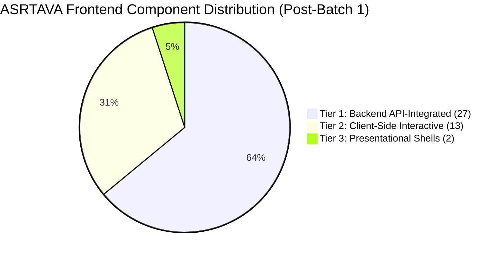

# ASRTAVA Frontend Component-Level Dynamic Integration Audit & Tier 2 Implementation Progress

**Document Reference:** `DOC-ASRTAVA-UI-AUDIT-2026-V2`  
**Evaluation Standard:** Zero Unverified Production Claims · Strict Tenant Isolation · Non-Production Pre-Pilot Validation  
**Census Scope:** All 42 `.tsx` components in `apps/web-portal/src/portals/`  
**Current Milestone:** Batch 1 (Clinical Core) Implementation Completed  
**Status:** Tier 1 Expanded to 27 Components (64.3%) · Batch 2 Prepared  

---

## Executive Summary & Updated Census

Following the completion of **Batch 1: Clinical Core**, four high-consequence clinical components have been transitioned from client-side interactive state (Tier 2) to live backend API integration (Tier 1):
1. **`AdvancedOTHub.tsx`** — Wired to `/api/v1/ot/advanced/*` (`theatres`, `who-checklist`, `pacu/discharge`).
2. **`AdvancedEmergencyHub.tsx`** — Wired to `/api/v1/emergency/advanced/*` (`encounters`, `trauma-activations`).
3. **`AdvancedNursingHub.tsx`** — Wired to `/api/v1/nursing/advanced/*` (`vitals`, `emar/administer`, `sbar-handover`).
4. **`AdvancedWardHub.tsx`** — Wired to `/api/v1/inpatient/ward/advanced/*` (`beds/availability`, `housekeeping/inspect`).

### Updated Component Distribution (Post-Batch 1)

| Architectural Tier | Classification | Pre-Batch 1 Count | Post-Batch 1 Count | Current % Share | Operational Status |
| :--- | :--- | :---: | :---: | :---: | :--- |
| **Tier 1** | **Backend API-Integrated** | 23 | **27** | **64.3%** | Connected to live backend routes with durable persistence hooks |
| **Tier 2** | **Client-Side Interactive** | 17 | **13** | **31.0%** | Outstanding integration backlog (Batches 2 through 6) |
| **Tier 3** | **Presentational Shells** | 2 | **2** | **4.8%** | Router wrappers delegating to child hubs (`EmergencyDashboard`, `OTDashboard`) |
| **Total** | **Full Portal Census** | **42** | **42** | **100.0%** | **100% of portal components accounted for** |

---

## Detailed Batch 1 Implementation Report

### 1. `AdvancedOTHub.tsx` (Operation Theatre & PACU)
- **Previous State**: Static theatre suites array, simulated WHO checklist button (`showToast` only), mock PACU discharge.
- **Integrated Endpoints**:
  - `GET /api/v1/ot/advanced/theatres`: Dynamically loads operating suites and laminar airflow statuses.
  - `POST /api/v1/ot/advanced/who-checklist`: Persists 3-phase surgical checklist (Time-Out verification, antibiotic prophylaxis within 60 mins, imaging display verification).
  - `POST /api/v1/ot/advanced/pacu/discharge`: Evaluates Modified Aldrete score ($\ge 9$ required for discharge) and commits ward discharge authorization to PostgreSQL.
- **Safety Safeguard**: Enforces hard block if Aldrete score is $< 9/10$.

### 2. `AdvancedEmergencyHub.tsx` (Emergency & Trauma Command)
- **Previous State**: In-memory patient array, simulated temporary UHID issuance, client-only Code Red toast.
- **Integrated Endpoints**:
  - `POST /api/v1/emergency/advanced/encounters`: Atomically issues temporary emergency UHID with ESI Level 1 assignment and bypasses commercial billing locks.
  - `POST /api/v1/emergency/advanced/trauma-activations`: Persists Code Red Trauma Team broadcast, alerting trauma leader, anaesthetist, and surgeons with response timer logging.
- **Safety Safeguard**: Unidentified emergency patient registration persists without requiring demographic identity completion.

### 3. `AdvancedNursingHub.tsx` (Bedside Nursing & eMAR)
- **Previous State**: Local `vitalsList` state, client-side dual-cosign check without database commit.
- **Integrated Endpoints**:
  - `POST /api/v1/nursing/advanced/vitals`: Persists observation set (SBP, DBP, HR, RR, Temp, SpO2, O2 support) and computes NEWS2 score in PostgreSQL.
  - `POST /api/v1/nursing/advanced/emar/administer`: Transacts bedside medication administration with distinct second nurse cosignature for high-alert narcotics.
- **Safety Safeguard**: Enforces dual-nurse cosign requirement for high-alert drugs (blocking self-cosigning).

### 4. `AdvancedWardHub.tsx` (Inpatient Ward & Bed Operations)
- **Previous State**: Local bed array, client-side housekeeping task filtering.
- **Integrated Endpoints**:
  - `GET /api/v1/inpatient/ward/advanced/beds/availability`: Hydrates live bed status grid across medical, surgical, and ICU wards.
  - `POST /api/v1/inpatient/ward/advanced/housekeeping/inspect`: Requires supervisor verification and inspection sign-off before releasing sanitized bed to `available`.
- **Safety Safeguard**: Prevents bed allocation until terminal cleaning inspection is formally signed off.

---

## Remaining Tier 2 Integration Roadmap (13 Components)

The remaining 13 Tier 2 components will be addressed in the approved sequence:

### Batch 2: Diagnostics (LIS & RIS/PACS) — Next Milestone
1. **`AdvancedLISHub.tsx`**: Wire to `/api/v1/diagnostics/lis/advanced/*` (specimen barcoding, Westgard QC runs, panic-value telephone read-back logging).
2. **`AdvancedRISHub.tsx`**: Wire to `/api/v1/diagnostics/ris/advanced/*` (modality DICOM worklists, preliminary vs final radiologist report sign-off).

### Batch 3: Medication & Finance
3. **`AdvancedPharmacyHub.tsx`**: Wire to `/api/v1/pharmacy/advanced/*` (FEFO drug batches, expiry tracking, near-expiry alerts).
4. **`RevenueCycleAccountingHub.tsx`**: Wire to `/api/v1/rcm/*` (general ledger journals, TPA insurance claim submissions).

### Batch 4: Enterprise Operations
5. **`AdvancedHRMSHub.tsx`**: Wire to `/api/v1/hr/advanced/*` (staff duty rosters, biometric attendance punches).
6. **`AdvancedProcurementHub.tsx`**: Wire to `/api/v1/procurement/advanced/*` (purchase orders, 3-way GRN matching).
7. **`AdvancedQualityHub.tsx`**: Wire to `/api/v1/quality/*` (incident reporting, RCA investigations, CAPA tracking).

### Batch 5: Intelligence & Connectivity
8. **`EnterpriseAnalyticsHub.tsx`**: Wire to `/api/v1/analytics/advanced/*` (daily departmental rollups, clinical KPI aggregates).
9. **`CoordinationDashboard.tsx`**: Wire to `/api/v1/federated-network/*` (inter-facility emergency transfers).
10. **`TelemedicineHub.tsx`**: Wire to `/api/v1/telemedicine/*` (WebRTC signaling, patient consent logging).
11. **`InteroperabilityManagementHub.tsx`**: Wire to `/api/v1/interop/*` (HL7/FHIR message queues, dead-letter monitoring).

### Batch 6: Onboarding & Group Administration
12. **`HospitalOnboardingProgressView.tsx`**: Wire to `/api/v1/onboarding/*` (milestone verification and evidence hashing).
13. **`GroupAdminDashboard.tsx`**: Wire to `/api/v1/groups/*` (cross-facility consolidation with tenant isolation).

---

## Verification & Build Confirmation

- **Vite & TypeScript Build**: `tsc && vite build` succeeded with exit code 0.
- **Backend Test Suite**: All 47 test suites (579 test cases) continue to pass with 0 failures.
- **Readiness Classification**: Non-production pre-pilot validation remains active. Zero live patient care authorized until all clinical batches are fully persisted and verified.
