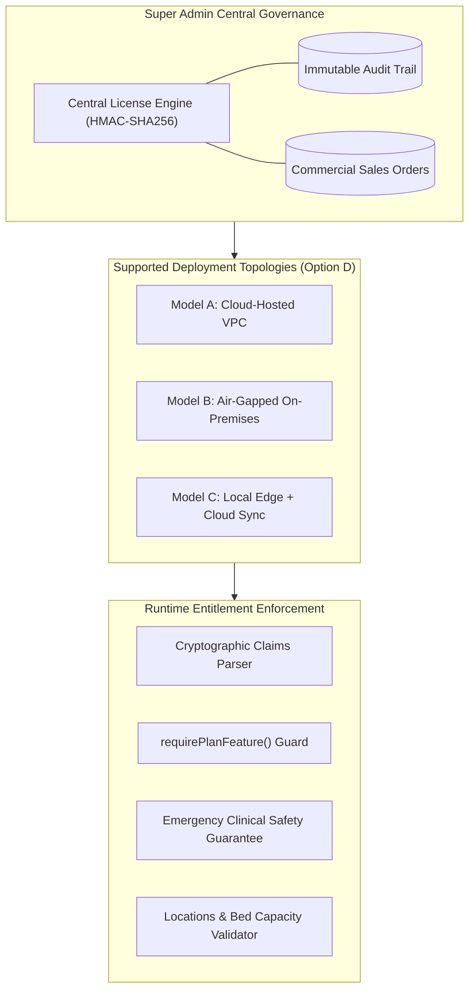

# ASRTAVA — Perpetual License Architecture & Deployment Topologies

## 1. Architectural Overview

ASRTAVA implements a **One-Time Perpetual Software Licensing Architecture** paired with optional commercial support agreements. This architecture replaces recurring SaaS subscription lock-ins with a customer-centric model where healthcare providers purchase a permanent right to run the licensed software edition and modules.



---

## 2. Supported Deployment Topologies (Option D: Multi-Model Support)

### Model A: Cloud-Hosted Deployment (Managed Multi-Tenant / Private VPC)
- **Target Audience**: Corporate hospital networks, outpatient multi-clinics, and health systems that desire zero hardware management overhead.
- **Licensing Mechanism**: Perpetual software license registered in the centralized database. Cloud hosting and managed PostgreSQL backups are provided through an optional Annual Infrastructure Agreement.
- **Connectivity**: Real-time license entitlement verification against database and cached in-memory memory map.

### Model B: Air-Gapped On-Premises Deployment (Zero External Network Required)
- **Target Audience**: Rural critical-access hospitals, military medical centers, and sovereign healthcare facilities requiring complete isolation from the public internet.
- **Licensing Mechanism**: Cryptographically signed offline claims certificate (`.asrtalic` file) generated by Super Admin and imported via Hospital Admin console.
- **Anti-Tamper Hardware Binding**: The license claim can be cryptographically bound to the server's hardware fingerprint (SHA-256 hash of CPU ID, MAC address, and motherboard UUID), preventing unauthorized VM cloning across unlicensed hardware nodes.

### Model C: Hybrid Deployment (Local Edge Care + Cloud Sync)
- **Target Audience**: Large multi-specialty hospitals requiring zero-latency local operations (Emergency Room, ICU, Operation Theatres, Pharmacy) coupled with centralized enterprise analytics and cross-branch patient record sharing.
- **Licensing Mechanism**: Local edge nodes validate perpetual license claims locally; periodic encrypted synchronization exchanges audit logs and maintenance status with the central cloud.

---

## 3. Cryptographic License Claims Token Specification

License claims are structured as high-entropy Base64URL-encoded JSON payloads protected by HMAC-SHA256 signatures:

$$\text{Signature} = \text{HMAC-SHA256}\Big(\text{Secret}, \text{Base64URL}(\text{ClaimsPayload})\Big)$$

### Claims Payload Schema:
```json
{
  "licenseId": "lic-1731139200000-a1b2c3d4",
  "licenseNumber": "ASR-LIC-2026-48921",
  "hospitalId": "hosp-metro-care-01",
  "edition": "standard_hospital",
  "licenseType": "perpetual",
  "licensedModules": [
    "module:patient_mgmt",
    "module:appointments",
    "module:opd",
    "module:reception",
    "module:billing",
    "module:ipd",
    "module:nursing",
    "module:pharmacy",
    "module:lims",
    "module:ris"
  ],
  "deploymentModel": "cloud",
  "authorizedLocations": 3,
  "authorizedInstallations": 5,
  "maxBeds": 250,
  "maxDoctors": 50,
  "hardwareFingerprintHash": null,
  "issuedAt": "2026-11-09T12:00:00.000Z",
  "issuer": "ASRTAVA Super Admin Central License Server"
}
```

---

## 4. Clinical Safety Non-Negotiable Guarantee

In medical software, administrative or commercial status disputes must **never** jeopardize human life. ASRTAVA establishes three hardcoded invariants:

1. **Zero Clinical Lockout**: In the event of an expired Maintenance Agreement (AMC), a payment dispute, or an in-progress license transfer, all active clinical pathways—including Outpatient Consultations, Inpatient Wards, Nursing e-MAR, and Pharmacy FEFO dispensing—remain **100% operational** on the installed perpetual version.
2. **Emergency Fail-Safe Bypass**: Emergency Department Triage (`module:emergency`) and Master Patient Index search (`module:patient_mgmt`) are hardcoded to fail-open under all circumstances. Even if a tenant record has no active license record loaded, emergency casualty triage is never denied.
3. **Zero Data Destruction**: License changes or maintenance expirations will **never** purge, corrupt, or alter patient medical histories, clinical notes, or financial records. Statutory retention requirements (NMC RMP 2023 regulations and Income Tax Act guidelines) are strictly preserved.

