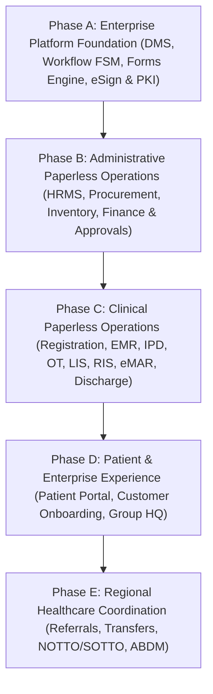

# ASRTAVA Paperless Hospital Transformation: Master Implementation Roadmap

**Document Reference:** `DOC-ASRTAVA-PAPERLESS-ROADMAP-2026-V1`  
**Evaluation Standard:** Zero Unverified Production Claims · Strict Tenant Isolation · Non-Production Pre-Pilot Validation  
**Scope:** Phased Implementation Strategy across All 19 Operational Domains  
**Auditor:** Antigravity Autonomous Clinical & Enterprise Architecture Engineering Agent  

---

## 1. Master Phased Implementation Strategy

Transitioning a hospital to a paperless operations platform cannot be achieved through a high-risk, single-day "big bang" cutover. ASRTAVA employs a **phased foundational migration strategy** organized into five sequential implementation phases with verified exit gates:

---

## 2. Phase-by-Phase Execution Plan

### Phase A: Enterprise Platform Foundation
**Objective**: Build the shared enterprise platform capabilities required by all operational departments before touching existing workflows.

- **Work Packages**:
  1. **Enterprise Document Management System (DMS)**: Multi-tier object storage (S3/MinIO/Edge), AES-256 envelope encryption, metadata taxonomy, and pre-signed download tokens.
  2. **Configurable Digital Forms Engine**: JSON Schema form renderer, dynamic validation, clinical range guards, and PDF/A compiler.
  3. **Universal Workflow & Approval Engine**: Finite state machine (FSM), sequential/parallel approval chains, SLA escalation timers, and unified task queue.
  4. **Cryptographic Signature & Verification Service**: Four-tier signature engine (Acknowledgement, Approval, eSign, PKI Digital Signature) with verification QR codes.
  5. **Unified Audit Ledger & Storage Engine**: Expansion of PostgreSQL audit tables with SHA-256 Merkle chain linkages.
- **Verification Gate (Gate A)**: S3/MinIO upload/download throughput tests, form rendering validation, workflow state transition tests, and signature verification with 100% test pass rate.

---

### Phase B: Administrative Paperless Operations
**Objective**: Eliminate paper requisition slips, printed purchase orders, physical leave cards, and paper invoices in back-office departments.

- **Work Packages**:
  1. **HRMS & Workforce**: Employee digital personal file, self-service leave workflow with substitute coverage confirmation, digital shift roster lock.
  2. **Procurement & Stores**: Digital purchase requisition workflow, multi-tier budget clearance, automated vendor PO PDF generation, 3-way GRN matching.
  3. **Inventory & Biomedical Assets**: Electronic stock transfer vouchers (ward indents), physical cycle-count adjustment workflows, digital equipment breakdown work orders.
  4. **Finance & Cashier Management**: Digital receipts via SMS/Email, cashier shift closing dual-verification, automated General Ledger postings.
  5. **Hospital Administration**: Digital hospital circulars with staff read-acknowledgement tracking.
- **Verification Gate (Gate B)**: 100% paperless procurement cycle test (Requisition $\to$ Approval $\to$ PO $\to$ GRN $\to$ Invoice $\to$ Payment $\to$ GL JV) with zero paper vouchers.

---

### Phase C: Clinical Paperless Operations (Highest Consequence)
**Objective**: Eliminate paper clinical records, physical bedside clipboards, handwritten prescription slips, paper lab reports, and printed discharge folders.

- **Work Packages**:
  1. **Patient Registration & Reception**: Scanned photo ID upload to DMS, digital DPDP consent signature pad, digital UHID badge.
  2. **Outpatient Department (OPD)**: Structured clinical SOAP EMR, digital e-prescription with QR code verification, electronic internal lab/radiology orders.
  3. **Inpatient Department (IPD) & Nursing**: Bedside tablet vital charting, digital SBAR shift handovers with incoming nurse cosign, electronic intake/output balance sheets.
  4. **Bedside eMAR**: Barcode scanning of patient wristband (PPID) and medication DataMatrix, mandatory dual-nurse cosign for high-alert narcotics.
  5. **Operation Theatre & PACU**: Digital 3-phase WHO surgical safety checklist, digital instrument/sponge count reconciliation, PACU Aldrete $\ge 9$ clinical block.
  6. **Laboratory Information System (LIS)**: Specimen barcode accessioning, Westgard IQC rule validation, pathologist cryptographic digital signature report release.
  7. **Radiology & PACS**: Zero-footprint web DICOM viewer, signed radiologist report addendums, electronic modality worklist.
  8. **Pharmacy**: Electronic ward indent dispensing, FEFO batch allocation, digital narcotic vault double-sign register.
  9. **Clinical Discharge Package**: Multi-department discharge workflow (Doctor approval $\to$ Nursing eMAR reconciliation $\to$ Pharmacy dispensing $\to$ Billing clearance $\to$ Bed sanitization).
- **Verification Gate (Gate C)**: Simulated end-to-end patient inpatient stay (Admission $\to$ Surgery $\to$ ICU $\to$ Ward $\to$ Discharge) conducted entirely electronically with zero paper printouts.

---

### Phase D: Patient & Enterprise Experience
**Objective**: Connect patients, customer onboarding teams, and multi-hospital group executives to the paperless ecosystem.

- **Work Packages**:
  1. **Patient Portal Health Locker**: Self-service access to digitally signed PDF reports, prescriptions, discharge summaries, and itemized billing receipts.
  2. **Customer Onboarding Portal**: Electronic implementation project tracker, digital data migration sign-off, electronic UAT test case execution.
  3. **Group Admin HQ Console**: Consolidated multi-branch financial reports, cross-branch doctor schedule anti-collision engine, inter-branch stock transfers.
  4. **Enterprise BI & Data Mart**: Real-time executive dashboards, LACE+ readmission forecasting, bed surge predictive models.
- **Verification Gate (Gate D)**: Patient report download verification via public QR code, onboarding milestone cryptographic verification.

---

### Phase E: Regional Healthcare Coordination & Interoperability
**Objective**: Enable secure, paperless inter-hospital coordination while strictly maintaining independent tenant boundaries.

- **Work Packages**:
  1. **Federated Coordination Network**: Digital emergency inter-hospital transfer requests, regional bed/ICU matrix broadcasting with 120-minute validity TTL.
  2. **Organ Transplant Coordination**: NOTTO/SOTTO cadaveric organ donor allocation workflow with statutory apnea certification and Form 8 upload.
  3. **Blood Bank Exchange**: Inter-facility blood component requisition and release without donor PII leakage.
  4. **ABDM Ecosystem**: ABHA creation (M1), health record linking (M2), FHIR R4 push/pull (M3).
- **Verification Gate (Gate E)**: Inter-hospital transfer simulation between Hospital Alpha and Beta with encrypted payload transfer and zero tenant leakage.

---

## 3. Migration Safety, Rollback Procedures & Contingency

1. **Non-Destructive Parallel Run**: During initial departmental rollout, legacy paper records may be maintained concurrently for 7 days until the Medical Board certifies digital workflow stability.
2. **Emergency Paper Fallback Contingency**: In the event of catastrophic power or physical hardware failure, approved physical paper emergency forms may be utilized. When system availability is restored, authorized personnel must back-enter the physical records with timestamped provenance (`PAPER_CONTINGENCY_BACK_ENTRY`).
3. **Database Migration Rollback Plan**: Every new schema migration (`039_...`) must include an exact, tested `down.sql` script to undo changes without corrupting historical tables.

