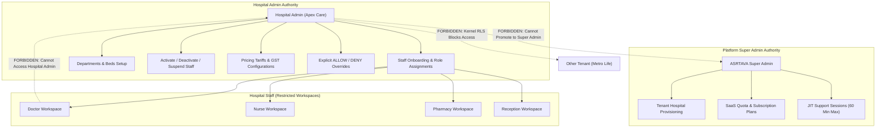

# ASRTAVA Hospital Admin Controlled Access & Staff Governance

**Document Reference:** `docs/project/HOSPITAL_ADMIN_ACCESS_CONTROL.md`  
**Execution Authority:** ASRTAVA Master Execution Controller  
**Status:** Implemented & Verified in Release Candidate (v1.0.0-RC1)  

---

## 1. Governance Principle: Hospital Admin Exclusive Control

In the ASRTAVA multi-tenant architecture, the authorized Hospital Administrator is the sole authority for creating, provisioning, activating, deactivating, and governing staff accounts within their hospital tenant.

Staff members cannot self-register privileged hospital accounts. All staff accounts must be provisioned through the hospital's approved administrative onboarding process.

---

## 2. Hospital Admin Staff Management Capabilities

| Administrative Control | Backend API Endpoint | Mechanism & Security Effect |
| :--- | :--- | :--- |
| **Staff Registration** | `POST /api/v1/hospitals/staff` | Creates staff user, profile, employee code (`EMP-XXXX`), and assigns department & initial roles. |
| **Account Activation** | `PATCH /api/v1/hospitals/staff/:id/status` | Sets `is_active: true`, `employment_status: 'active'`. Audited in `audit_logs`. |
| **Account Deactivation** | `PATCH /api/v1/hospitals/staff/:id/status` | Sets `is_active: false`. Invalidates active sessions and rejects login attempts with 403 Forbidden. |
| **Account Suspension** | `PATCH /api/v1/hospitals/staff/:id/status` | Sets `employment_status: 'suspended'`, `is_active: false`. Enforces immediate lockout. |
| **Access / Password Reset**| `POST /api/v1/hospitals/staff/:id/reset-access` | Issues temporary password hash, resets failed login counter, and invalidates all prior sessions. |
| **Session Revocation** | `POST /api/v1/hospitals/staff/:id/revoke-sessions` | Atomically deletes user records from `user_sessions`, terminating active JWT refresh tokens across all devices. |
| **Multi-Role Assignment** | `PUT /api/v1/hospitals/staff/:id/roles` | Replaces `user_roles` entries for that tenant. Rejects any attempt to assign `super_admin`. |
| **Permission Overrides** | `POST /api/v1/permissions/user-overrides` | Sets individual explicit `ALLOW` or explicit `DENY` records in `user_permissions`. |

---

## 3. Strict Precedence of the Authorization Engine

ASRTAVA enforces an authoritative four-tier authorization hierarchy:

$$\text{Decision} = \text{Explicit DENY} \succ \text{Explicit ALLOW} \succ \text{Role RBAC} \succ \text{Default DENY}$$

1. **Explicit DENY Wins:** If an individual `is_granted: false` override exists for a user and action, access is **DENIED** even if their assigned role permits it.
2. **Explicit ALLOW Exception:** If an individual `is_granted: true` override exists, access is **GRANTED** even if the base role does not have it.
3. **Role-Based Access Control (RBAC):** In the absence of an individual override, the user inherits the permissions granted to their assigned hospital roles.
4. **Default DENY:** If neither role nor individual override grants access, the request is **DENIED**.

---

## 4. Tenant Isolation & Separation of Powers

### Security Boundary Guarantees:
- **No Self-Promotion:** A Hospital Admin cannot assign `super_admin` roles or promote themselves to platform administrator.
- **Cross-Tenant Barrier:** PostgreSQL Kernel Row-Level Security (`RLS`) ensures a Hospital Admin from Hospital A cannot query or modify staff in Hospital B.
- **Audit Logging:** Every administrative action generates an immutable audit record with cryptographic timestamps and actor attribution.

