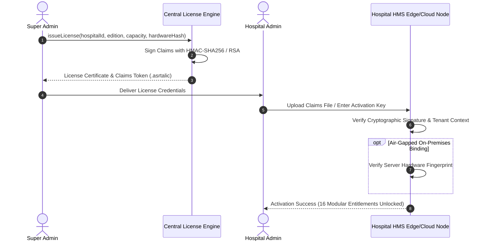

# ASRTAVA — License Activation Security, Digital Tokens & Anti-Tamper Specification

## 1. Security Architecture & Threat Model

The ASRTAVA licensing framework protects healthcare software integrity across cloud, edge, and air-gapped on-premises installations without compromising patient care availability.



---

## 2. Threat Analysis & Mitigations

| Threat Vector | Attack Scenario | ASRTAVA Mitigation |
|:---|:---|:---|
| **Signature Forgery / Tampering** | Adversary alters `licensed_modules` or `max_beds` in claims file | Any single bit modification breaks HMAC-SHA256 cryptographic signature; verification rejects token with 400 error. |
| **Tenant Impersonation** | Hospital B copies Hospital A's valid license claims file | Engine validates `claims.hospitalId === req.hospitalId`; tenant mismatch aborts activation immediately. |
| **Air-Gapped VM Cloning** | Hospital clones on-premises VM to run in unauthorized branch | Hardware fingerprint hash binds the license to CPU ID, MAC address, and motherboard UUID; cloned nodes fail binding check. |
| **Replay Attacks** | Re-uploading expired evaluation licenses | Claims token encodes issuance timestamp and expiration parameters; replay triggers validation failure. |
| **Service Outage Lockout** | Network connection to Super Admin license server drops | Perpetual license claims are stored locally in the tenant database and memory cache; local node continues running indefinitely. |

---

## 3. Cryptographic Token Format (.asrtalic)

The offline license file uses the standard dot-delimited format:
$$\text{TOKEN} = \text{Payload}_{\text{Base64URL}} \;.\; \text{Signature}_{\text{Base64URL}}$$

### Signature Verification Algorithm:
```typescript
public static verifyClaimsToken(token: string): { valid: boolean; claims?: LicenseClaimsPayload; error?: string } {
  if (!token || !token.includes('.')) {
    return { valid: false, error: 'Malformed license claims token' };
  }

  const [encodedPayload, providedSignature] = token.split('.');
  const expectedSignature = crypto
    .createHmac('sha256', LICENSING_SECRET)
    .update(encodedPayload)
    .digest('base64url');

  if (!crypto.timingSafeEqual(Buffer.from(providedSignature), Buffer.from(expectedSignature))) {
    return { valid: false, error: 'Invalid cryptographic signature. License claims have been tampered with.' };
  }

  const claims = JSON.parse(Buffer.from(encodedPayload, 'base64url').toString('utf-8'));
  return { valid: true, claims };
}
```

Timing-safe string comparison (`crypto.timingSafeEqual`) prevents side-channel timing analysis attacks against cryptographic verification.

