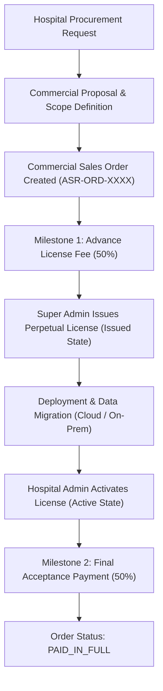

# ASRTAVA — Commercial Sales Orders, Invoicing & Lifecycle Workflows

## 1. Commercial Sales Workflow

The commercial lifecycle tracks the procurement of perpetual licenses, deployment services, data migration, and optional maintenance contracts:

---

## 2. Order Structure & Financial Isolation

Commercial sales orders (`license_sales_orders`) are strictly separated from hospital patient billing (`billing_invoices`). Platform license revenues are tracked under dedicated General Ledger accounts:

$$\text{Total Commercial Order} = \text{One-Time License Fee} + \text{Implementation Fee} + \text{Year 1 AMC Fee}$$

### Example Order Breakdown:
- **Perpetual Standard Hospital License**: ₹12,00,000
- **Implementation & Data Migration**: ₹2,50,000
- **Year 1 Gold AMC Support**: ₹1,50,000
- **Total Commercial Order**: **₹16,00,000**

---

## 3. License Expansion & Relocation Workflows

1. **Modular Expansion**:
   - A hospital purchasing the `clinic_basic` edition can dynamically upgrade by purchasing individual modules (e.g. adding `module:pharmacy` and `module:lims`).
   - Super Admin triggers `POST /api/v1/licensing/:id/add-modules`.
   - The claims token is cryptographically re-signed and delivered without interrupting existing active users.
2. **Bed & Location Capacity Expansion**:
   - As hospital bed capacity increases, Hospital Admin requests a capacity expansion.
   - Super Admin updates `max_beds` or `authorized_locations` with automated audit logging.
3. **License Relocation / Corporate Transfer**:
   - In the event of hospital acquisition or change of legal entity, the original license transitions to `transferred` with target hospital binding and transfer reason recorded.
   - A new active perpetual license is automatically issued to the acquiring organization.

