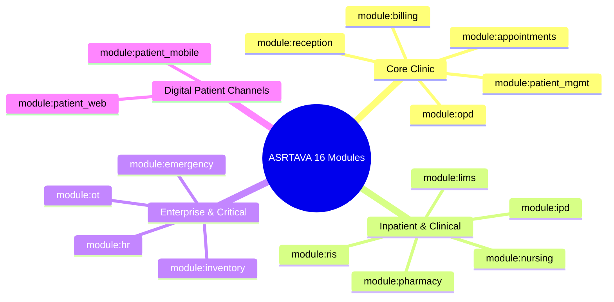

# ASRTAVA — Modular Entitlement Matrix & Capacity Governance

## 1. Modular Entitlement Catalog

ASRTAVA decomposes hospital management into **16 discrete functional modules**. In the Perpetual Licensing model, modules can be purchased as standard editions or custom modular add-ons.

---

## 2. Standard Edition Entitlement Matrix

| Functional Module | Code Identifier | Clinic Basic | Standard Hospital | Enterprise Multi-Specialty | Custom Procurement |
|:---|:---|:---:|:---:|:---:|:---:|
| **Master Patient Index** | `module:patient_mgmt` | ✅ Yes | ✅ Yes | ✅ Yes | Configurable |
| **Appointments & Rosters** | `module:appointments` | ✅ Yes | ✅ Yes | ✅ Yes | Configurable |
| **Outpatient Encounters (OPD)** | `module:opd` | ✅ Yes | ✅ Yes | ✅ Yes | Configurable |
| **Front Desk & Reception** | `module:reception` | ✅ Yes | ✅ Yes | ✅ Yes | Configurable |
| **Billing & Invoicing** | `module:billing` | ✅ Yes | ✅ Yes | ✅ Yes | Configurable |
| **Inpatient Ward (IPD)** | `module:ipd` | ❌ No | ✅ Yes | ✅ Yes | Configurable |
| **Nursing Station & e-MAR** | `module:nursing` | ❌ No | ✅ Yes | ✅ Yes | Configurable |
| **Pharmacy & Formulary** | `module:pharmacy` | ❌ No | ✅ Yes | ✅ Yes | Configurable |
| **Laboratory (LIMS)** | `module:lims` | ❌ No | ✅ Yes | ✅ Yes | Configurable |
| **Radiology (RIS)** | `module:ris` | ❌ No | ✅ Yes | ✅ Yes | Configurable |
| **Emergency & Casualty** | `module:emergency` | ⚠️ Fail-Safe | ⚠️ Fail-Safe | ✅ Yes | Configurable |
| **Operation Theatres (OT)** | `module:ot` | ❌ No | ❌ No | ✅ Yes | Configurable |
| **HR & Staff Management** | `module:hr` | ❌ No | ❌ No | ✅ Yes | Configurable |
| **Central Inventory & Supply** | `module:inventory` | ❌ No | ❌ No | ✅ Yes | Configurable |
| **Patient Web Portal** | `module:patient_web` | ❌ No | ❌ No | ✅ Yes | Configurable |
| **Patient Mobile Apps** | `module:patient_mobile` | ❌ No | ❌ No | ✅ Yes | Configurable |

*Note: Emergency care (`module:emergency`) and Master Patient Index (`module:patient_mgmt`) feature hardcoded clinical fail-safe bypasses to guarantee emergency access in all scenarios.*

---

## 3. Capacity Governance & Expansion Sizing

Perpetual licenses include configurable capacity bounds to match hospital physical facilities:

1. **Authorized Locations (`authorized_locations`)**:
   - Number of physical clinic branches or hospital campuses licensed under this entity.
   - Default: `1` for Clinic Basic, `3` for Standard Hospital, `Unlimited` for Enterprise.
2. **Authorized Installations (`authorized_installations`)**:
   - Number of active database/server node instances authorized to run concurrently.
3. **Bed Capacity Limit (`max_beds`)**:
   - Total inpatient bed inventory licensed in the IPD module.
   - Evaluated at bed provisioning time. Exceeding capacity prompts Hospital Admin to purchase a Bed Expansion Add-on without stopping existing admitted patients.
4. **Active Doctor Staffing (`max_doctors`)**:
   - Maximum active registered consulting physician accounts authorized in the directory.

