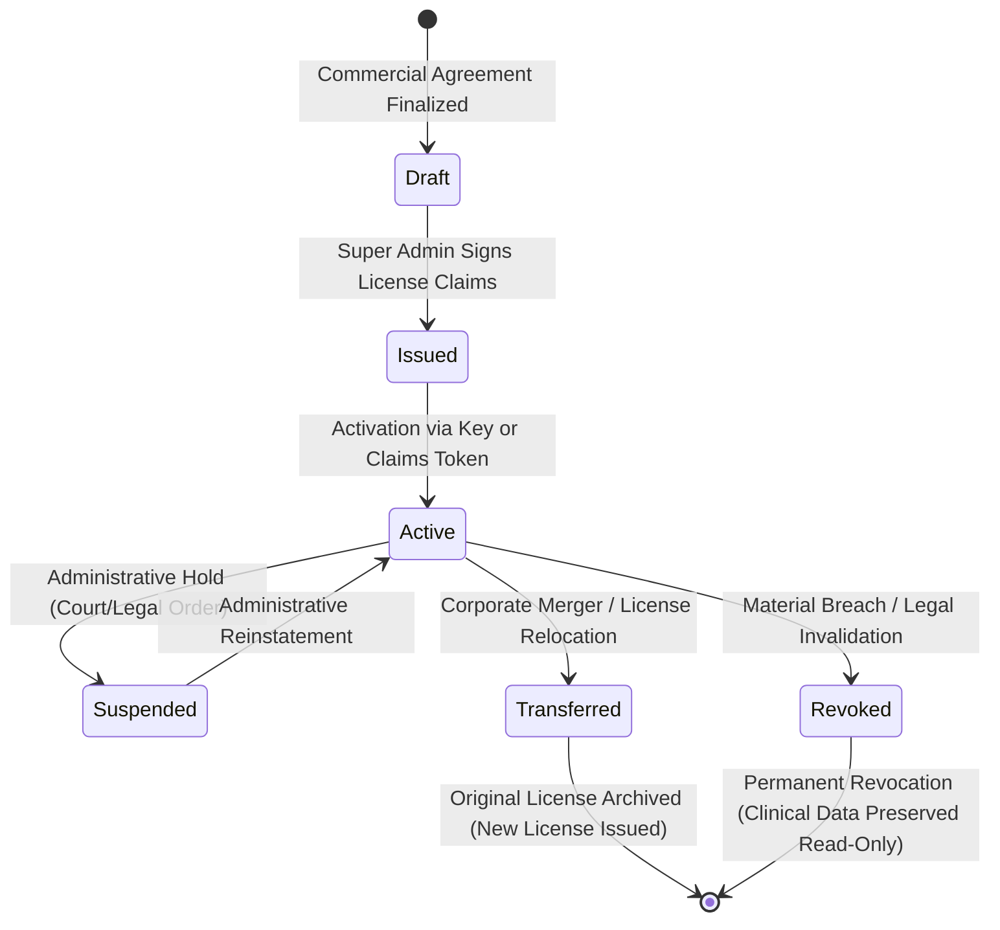

# ASRTAVA — Perpetual License Lifecycle State Machine

## 1. State Transition Diagram

The lifecycle of an ASRTAVA Perpetual Software License is governed by a deterministic finite state machine ensuring complete traceability, tamper resistance, and audit compliance.

---

## 2. State Definitions and Permissions Matrix

| License State | Description | Clinical Operations | New Patient Entry | Admin Changes | Major Upgrades |
|:---|:---|:---:|:---:|:---:|:---:|
| `draft` | Commercial proposal created; license pending cryptographic signing | ❌ Disabled | ❌ Disabled | Super Admin Only | ❌ Disabled |
| `issued` | Cryptographically signed; activation key provided to Hospital Admin | ❌ Disabled (Pending Activation) | ❌ Disabled | Super Admin Only | ❌ Disabled |
| `pending_activation` | Claims file uploaded; awaiting local hardware fingerprint verification | ❌ Disabled | ❌ Disabled | Hospital Admin | ❌ Disabled |
| `active` | Fully bound and operational; perpetual usage enabled | ✅ Full Access | ✅ Full Access | Full Access | Subject to Active AMC |
| `suspended` | Administrative temporary hold (explicit justification required) | ⚠️ Emergency Care Only | ❌ Denied | Super Admin Only | ❌ Disabled |
| `revoked` | Legally invalidated due to confirmed fraudulent breach | 🔒 Read-Only History | ❌ Denied | Read-Only Audit | ❌ Disabled |
| `transferred` | License transferred to an acquiring hospital entity | Replaced by New License | Bound to New Tenant | Audit Log Preserved | Transferred |

---

## 3. Detailed State Transitions & Business Logic

### 1. `draft` $\to$ `issued`
- **Trigger**: Super Admin issues license upon receiving contract execution or advance commercial payment.
- **Actions**:
  - Generates immutable license number (`ASR-LIC-YYYY-XXXXX`).
  - Generates high-entropy activation key (`ASRT-XXXX-XXXX-XXXX-XXXX`).
  - Computes modular entitlement set from edition (`clinic_basic`, `standard_hospital`, `enterprise_multispecialty`, or `custom`).
  - Calculates HMAC-SHA256 signature and encapsulates claims token.
  - Inserts event `license_issued` into `license_audit_logs`.

### 2. `issued` $\to$ `active`
- **Trigger**: Hospital Admin inputs activation key or uploads offline claims certificate (`.asrtalic`) in the portal.
- **Validation**:
  - Validates tenant ID match (`license.hospital_id === req.hospitalId`).
  - Validates cryptographic digital signature.
  - If deployment is on-premises with hardware binding, verifies SHA-256 hardware hash against local host node.
- **Actions**:
  - Sets `status = 'active'`, `activated_at = NOW()`, `activated_by = user.id`.
  - Enables modular middleware routing.
  - Inserts event `license_activated` into `license_audit_logs`.

### 3. `active` $\to$ `suspended` $\to$ `active`
- **Trigger**: Administrative emergency hold ordered by platform compliance or judiciary.
- **Guarantees**:
  - Suspension requires an explicit reason string and authenticated Super Admin user ID.
  - Non-critical modules (e.g. billing, new appointments, HR) return 403.
  - **Emergency Care Fail-Safe**: Emergency room triage and patient lookup remain operational.
  - Super Admin can reinstate the license at any time, returning it immediately to `active`.

### 4. `active` $\to$ `transferred`
- **Trigger**: Corporate acquisition, hospital restructuring, or relocation.
- **Actions**:
  - Marks original license as `transferred`, recording `transferred_to_hospital_id`, timestamp, and transfer reason.
  - Automatically provisions a new active perpetual license bound to the acquiring hospital entity with identical entitlements and capacity.
  - Preserves immutable cryptographic lineage linking original and child licenses.

