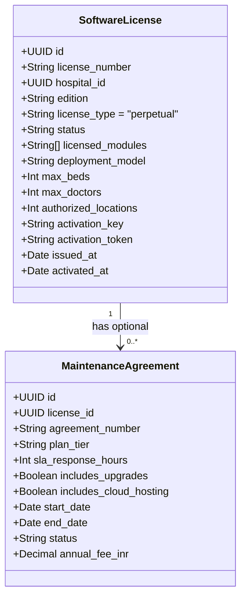

# ASRTAVA — Perpetual License Management & Commercial Architecture Audit

## 1. Executive Summary & Paradigm Shift
This document defines the architectural transition of the ASRTAVA Healthcare Technology Platform from a recurring subscription-based SaaS model to a **One-Time Perpetual Software Licensing & Commercial Management Model**.

In this model:
- Hospitals purchase a **one-time perpetual software license** for the agreed edition and module scope.
- The hospital retains the perpetual legal and technical right to operate the purchased version indefinitely without mandatory monthly or annual software renewal fees.
- Multi-tenancy, Super Admin governance, Hospital Admin autonomy, tenant data isolation, and centralized license validation remain fully intact.
- Additional operational and technical services—such as Annual Maintenance & Support (AMC), software version upgrades, managed cloud hosting, on-premises deployment assistance, and custom integrations—are offered as **separate, optional commercial agreements**.
- **Clinical Safety Non-Negotiable**: The expiration of an optional maintenance agreement (AMC) or a commercial dispute **must NEVER terminate the perpetual core software license, lock out clinical care, impede emergency casualty triage, or purge patient records**.

---

## 2. Supported Deployment Topologies (Option D: All Three Models)

To support diverse healthcare environments—ranging from urban corporate hospital networks to rural air-gapped critical access facilities—ASRTAVA supports three deployment models:

```mermaid
flowchart TD
    subgraph Model1["Model A: Cloud-Hosted Deployment"]
        CloudServer["ASRTAVA Managed Cloud VPC"]
        CloudDB[("Multi-Tenant Cloud DB")]
        CloudClient["Web Portals & Mobile Apps"]
        CloudServer --- CloudDB
        CloudClient --> CloudServer
    end

    subgraph Model2["Model B: Air-Gapped On-Premises Deployment"]
        LocalServer["Hospital Local Server / Edge Node"]
        LocalDB[("Local PostgreSQL Instance")]
        LocalClients["Hospital LAN Workstations"]
        OfflineCert["Cryptographic Offline License File (.asrtalic)"]
        OfflineCert --> LocalServer
        LocalServer --- LocalDB
        LocalClients --> LocalServer
    end

    subgraph Model3["Model C: Hybrid Deployment"]
        EdgeServer["Local Edge Server (OPD/IPD/ER)"]
        SyncEngine["Encrypted Background Sync"]
        CentralCloud["Cloud Aggregator & Analytics"]
        EdgeServer <--> SyncEngine <--> CentralCloud
    end
```

1. **Cloud-Hosted Deployment**: Hospital accesses ASRTAVA hosted on a secure cloud VPC with optional managed database, backups, and infrastructure maintenance agreements. License validated against central license service.
2. **On-Premises Deployment**: Hospital installs ASRTAVA on local physical servers or local virtualization hypervisors within their private LAN. Operates completely air-gapped without internet access using a cryptographically signed offline activation claims file (`.asrtalic`).
3. **Hybrid Deployment**: High-speed local edge server handles zero-latency clinical care (Operation Theatres, Emergency, Nursing) with background encrypted synchronization to central cloud for patient records and analytics.

---

## 3. Perpetual Software Editions & 16 Modular Entitlements

The core software is licensed under four standard commercial editions or as a custom modular procurement:

| Module Code | Module Description | Clinic Basic | Standard Hospital | Enterprise Multi-Specialty | Custom |
|:---|:---|:---:|:---:|:---:|:---:|
| `module:patient_mgmt` | Master Patient Index, Demographics, KYC | ✅ Included | ✅ Included | ✅ Included | Optional |
| `module:appointments` | OPD Appointments, Doctor Rosters, Queues | ✅ Included | ✅ Included | ✅ Included | Optional |
| `module:opd` | Outpatient Clinical Encounters & SOAP Notes | ✅ Included | ✅ Included | ✅ Included | Optional |
| `module:reception` | Front Desk, Token Dispenser, Visitor Check-in | ✅ Included | ✅ Included | ✅ Included | Optional |
| `module:billing` | Consolidated Billing, Cashier, GST Invoicing | ✅ Included | ✅ Included | ✅ Included | Optional |
| `module:ipd` | Inpatient Admissions, Bed Transfers, Discharge | ❌ | ✅ Included | ✅ Included | Optional |
| `module:nursing` | Vital Signs, MAR, Ward Census, Shift Handovers | ❌ | ✅ Included | ✅ Included | Optional |
| `module:pharmacy` | Drug Formulary, Inventory, Dispensing Lock | ❌ | ✅ Included | ✅ Included | Optional |
| `module:lims` | Laboratory Information Management & Analyzers | ❌ | ✅ Included | ✅ Included | Optional |
| `module:ris` | Radiology Information System & Imaging Orders | ❌ | ✅ Included | ✅ Included | Optional |
| `module:emergency` | ER Triage, Red/Yellow/Green Beds, Medico-Legal | ❌ | ❌ | ✅ Included | Optional |
| `module:ot` | Operation Theatre Scheduling, Surgical Notes | ❌ | ❌ | ✅ Included | Optional |
| `module:hr` | Staff Directory, Duty Rosters, Attendance, Leaves | ❌ | ❌ | ✅ Included | Optional |
| `module:inventory` | Central Supply, Purchase Orders, Batch Tracking | ❌ | ❌ | ✅ Included | Optional |
| `module:patient_web` | Patient Web Portal (Appointments, Lab Results) | ❌ | ❌ | ✅ Included | Optional |
| `module:patient_mobile` | Patient Android & iOS Apps (Telehealth, Prescriptions) | ❌ | ❌ | ✅ Included | Optional |

---

## 4. Separation of Core License vs. Maintenance & Support (AMC)

### Core License Invariants:
1. **Perpetual Duration**: The license has no `expires_at` date. Once activated, it remains perpetually valid for the licensed version and capacity.
2. **Capacity Scope**: Defined by `authorized_locations` (branches), `authorized_installations` (nodes), `max_beds`, and `max_doctors`. Expanding these requires a one-time license amendment or add-on.
3. **AMC Independence**: Expiry of a `MaintenanceAgreement` changes AMC status to `expired`, which limits access to official technical support tickets and major version software upgrades. It **never** alters the `SoftwareLicense.status` or restricts clinical data access.

---

## 5. Security & Cryptographic Validation

1. **Digital License Claims Token**: Encoded JSON payload containing hospital tenant ID, license number, edition, licensed modules, capacity limits, and issuance timestamp.
2. **Signature & Integrity**: Signed using HMAC-SHA256 with platform licensing secrets (or RSA-2048 private key for air-gapped on-premises deployments).
3. **Hardware Fingerprint Binding (Optional)**: For on-premises installations, the license can be cryptographically bound to the server's CPU ID, MAC address, and motherboard UUID to prevent illicit cloning across unauthorized data centers.
4. **Offline Activation File (`.asrtalic`)**: For air-gapped hospitals, Super Admin generates a signed activation claims file that the Hospital Admin uploads locally through the Hospital Admin portal to unlock licensed modules.

---

## 6. Audit Summary & Implementation Roadmap
- **Data Model Migration**: Migration `019_software_licensing.sql` to introduce `software_licenses`, `maintenance_agreements`, `license_sales_orders`, and `license_audit_logs`.
- **Backend Service**: `backend/src/modules/licensing/license.service.ts` implementing complete lifecycle, token issuance, cryptographic verification, entitlement validation, AMC management, and license transfers.
- **Entitlement Middleware**: Update `backend/src/middleware/entitlement.middleware.ts` to seamlessly validate perpetual license claims.
- **REST API Routes**: `backend/src/modules/licensing/licensing.routes.ts` mounted at `/api/v1/licensing`.
- **Automated Test Suite**: `backend/tests/licensing_management.test.ts` executing 12 comprehensive end-to-end scenarios.

