# ASRTAVA — Maintenance, Support & Upgrade Commercial Model (AMC)

## 1. Separation of Core License vs. Optional Services

The core tenet of the ASRTAVA commercial model is the **strict independence of Software Ownership from Ongoing Support Services**.

```mermaid
flowchart LR
    subgraph CoreLicense["Core Perpetual Software License (One-Time)"]
        Modules["Agreed Hospital Modules"]
        Portals["Hospital Admin & Staff Workspaces"]
        Patients["Patient Web & Mobile Apps"]
        Indefinite["Perpetual Operating Right (Indefinite)"]
    end

    subgraph OptionalAMC["Annual Maintenance & Support - AMC (Optional Annual)"]
        SLA["Priority SLA Technical Support"]
        Upgrades["Access to Major New Versions"]
        Hosting["Managed Cloud Hosting & Backups"]
        CustomDev["Custom Development Hours"]
    end

    CoreLicense -.->|Completely Functional Without| OptionalAMC
```

---

## 2. Maintenance & Support SLA Tiers

| Benefit / SLA Metric | Bronze Tier | Silver Tier | Gold Tier | Platinum Tier |
|:---|:---:|:---:|:---:|:---:|
| **Target Hospital Size** | Small Outpatient Clinics | Community Hospitals | Multi-Specialty Centers | Large Tertiary Teaching Hospitals |
| **SLA Response Time (Urgent)** | $\le 24$ hours | $\le 8$ hours | $\le 4$ hours | $\le 1$ hour (24/7/365 Dedicated) |
| **Patch & Security Fixes** | ✅ Included | ✅ Included | ✅ Included | ✅ Included |
| **Major Software Upgrades** | ❌ (Version Locked) | ✅ Included | ✅ Included | ✅ Included |
| **Managed Cloud Hosting** | Optional Add-on | Optional Add-on | Included (Standard) | Included (High-Availability Multi-AZ) |
| **Custom Development Hours** | 0 hours | 10 hours/yr | 25 hours/yr | 60 hours/yr |
| **Dedicated Technical Account Mgr** | ❌ No | ❌ No | ✅ Yes | ✅ Dedicated On-Call Specialist |

---

## 3. Software Version Upgrade Eligibility Policy

1. **Active AMC Agreement**:
   - Hospitals with an active AMC agreement where `includes_upgrades = true` are automatically eligible to download, install, and migrate database schemas to major new platform releases (e.g. v1.0.0 $\to$ v2.0.0).
2. **Lapsed AMC Agreement**:
   - When an AMC agreement expires and is not renewed:
     - The hospital retains the perpetual legal and technical right to run their current installed version indefinitely.
     - The hospital continues to receive critical security hotfixes for their current minor release.
     - New major releases and new core features are locked until AMC reinstatement.
     - **Clinical Invariance**: Patient records are never locked, deleted, or throttled. Hospital staff can access all clinical records without interruption.

