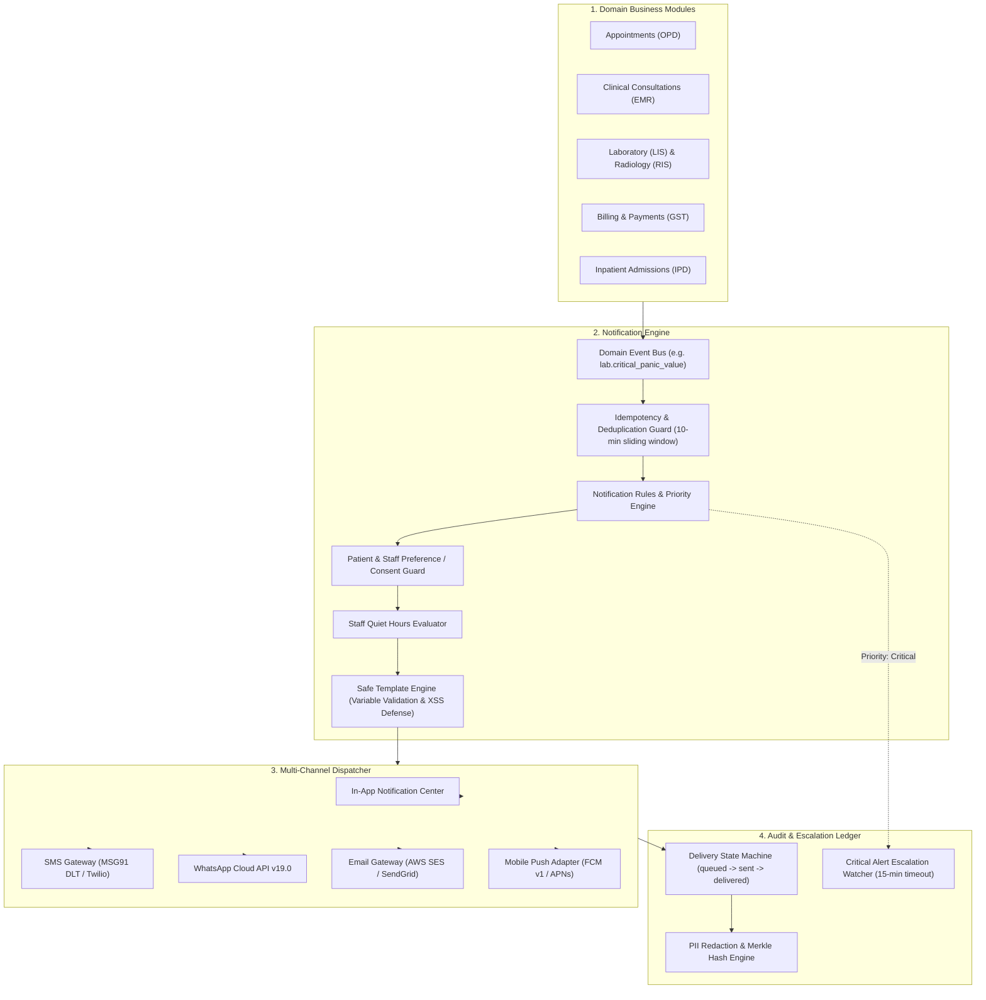

# ASRTAVA Centralized Notification & Communication Architecture

**Document Reference:** `docs/project/NOTIFICATION_ARCHITECTURE.md`  
**Version:** 1.0.0-ENTERPRISE  
**Authority:** ASRTAVA Integration Architect & Backend Lead  
**Pattern:** Domain Event-Driven Outbox with Multi-Channel Fallback & Escalation Matrix

---

## 1. Architectural Overview & Data Flow

The ASRTAVA Notification Platform operates as a centralized communication backbone servicing all 20 backend modules, 13 role-specific portals, and patient mobile applications.

---

## 2. Core Functional Pillars

### 2.1 Multi-Channel Fallback Chain
When transmitting high-priority notifications, the engine initiates automatic fallback across channels:
1. **Primary Channel:** Evaluated based on recipient preferences (e.g., WhatsApp).
2. **First Fallback:** SMS (with India DLT template header).
3. **Second Fallback:** Email (HTML formatted).
4. **Final Fallback:** Persistent In-App notification within the user's dashboard.

### 2.2 Strict Idempotency & Deduplication
To prevent patients or staff from receiving duplicate alerts due to rapid double-clicks or network retries:
- The system generates an idempotency fingerprint: `hash(hospital_id : event_code : recipient_user_id : channel : variables)`.
- If an identical fingerprint is received within the 10-minute deduplication window, the system suppresses duplicate external dispatch and returns the existing notification receipt (`isDuplicate: true`).

### 2.3 Critical Clinical Alert Escalation Engine
Clinical patient safety demands that panic laboratory values (e.g. Serum Potassium > 6.5 mEq/L, Troponin-I > 2.0 ng/mL) or emergency resuscitation orders are never lost in transit:
1. When priority is marked `critical`, a `CriticalAlertRecord` is created with a 15-minute countdown timer.
2. The alert immediately **bypasses any active staff quiet hours** and sounds an urgent audible alert in the Doctor Workspace.
3. If the primary consultant acknowledges the alert via `POST /api/v1/notifications/alerts/:id/acknowledge`, the escalation timer disarms.
4. If 15 minutes elapse without electronic physician acknowledgement, the system automatically escalates the alert to the **Department Head** and **On-Duty RMO**.

