# ASRTAVA — Portal Navigation Map & Route Topology

This document details the navigation architecture, URL routing paths, role selector entries, and authentication redirection mechanisms across the ASRTAVA multi-tenant hospital platform.

---

## 1. Top-Level Public Routes & Landing Navigation

The public application entry point is hosted at `/` (`apps/web-portal/src/pages/PublicHomePage.tsx`).

### Navigation Bar Structure
- **Brand Logo & Name**: "ASRTAVA Healthcare SaaS" (Navigates to `/`)
- **Public Navigation Links**:
  - `Features` (`/#features`): Dynamic modules showcase (OPD, IPD, EMR, Billing, Pharmacy, Diagnostics)
  - `Specialties` (`/#specialties`): Clinical department directory
  - `Technology` (`/#tech`): Multi-tenant architecture, HIPAA & DPDP compliance, zero-trust security
  - `Contact` (`/#contact`): Hospital onboarding inquiry and enterprise demos
- **Action Buttons & Role Selector**:
  - **Emergency Banner**: Quick access to 24/7 casualty dispatch and triage hotline
  - **"Find Doctor & Book OPD"**: Direct route to public doctor directory with live booking slots
  - **"Access Portal" (Navbar Role Selector Dropdown)**:
    - Doctor Portal (`/doctor/login`)
    - Nursing Station (`/nursing/login`)
    - Reception & OPD Registration (`/reception/login`)
    - Laboratory Diagnostics (`/laboratory/login`)
    - Radiology & PACS (`/radiology/login`)
    - Pharmacy & Dispensary (`/pharmacy/login`)
    - Finance & Billing (`/finance/login`)
    - HR & Staff Directory (`/hr/login`)
    - Inventory & Central Stores (`/inventory/login`)
    - Hospital Administrator (`/hospital-admin/login`)
    - Patient Health Records (`/patient/login`)
    - Super Admin Platform Console (`/super-admin/login`)

---

## 2. Authentication & Redirect Routing Rules

### Gateway Redirection Flow
1. **Unauthenticated Access**:
   - Accessing any protected portal route (e.g. `/doctor`, `/nursing`, `/hospital-admin`) redirects immediately to the appropriate role-specific login screen with `?redirect=/requested/path`.
2. **Post-Authentication Verification**:
   - The backend validates username/email + password, checks active account status, verifies multi-tenant hospital membership (`hospital_id`), and generates a signed JWT payload containing:
     ```json
     {
       "userId": "usr_9981",
       "hospitalId": "hosp_alpha",
       "role": "doctor",
       "allowedPermissions": ["doctor:opd:queue", "clinical:soap:write", ...],
       "deniedPermissions": []
     }
     ```
3. **Role-Enforced Routing**:
   - If a user authenticated as `nurse` attempts to navigate to `/doctor` or `/hospital-admin`, the React Router Guard intercepts the route:
     - Dispatches a toast alert: `Unauthorized access: Insufficient privileges for this portal`.
     - Automatically routes the user to their authorized home dashboard (`/nursing`).

---

## 3. Detailed Portal Route & Navigation Matrix

```mermaid
graph TD
    Home["/ (Public Homepage)"] --> RoleSelect["Navbar Role Selector"]
    RoleSelect --> DoctorL["/doctor/login"]
    RoleSelect --> NurseL["/nursing/login"]
    RoleSelect --> RecepL["/reception/login"]
    RoleSelect --> LabL["/laboratory/login"]
    RoleSelect --> RadL["/radiology/login"]
    RoleSelect --> PharmL["/pharmacy/login"]
    RoleSelect --> FinL["/finance/login"]
    RoleSelect --> HRL["/hr/login"]
    RoleSelect --> InvL["/inventory/login"]
    RoleSelect --> AdminL["/hospital-admin/login"]
    RoleSelect --> PatientL["/patient/login"]
    RoleSelect --> SuperL["/super-admin/login"]

    DoctorL --> DoctorD["/doctor (OPD Queue, EMR, IPD Rounds)"]
    NurseL --> NurseD["/nursing (Ward Census, e-MAR, NCP, SBAR)"]
    RecepL --> RecepD["/reception (Patient Lookup, Tokens, OPD Billing)"]
    LabL --> LabD["/laboratory (Accessioning, Rejections, Panic Broadcast)"]
    RadL --> RadD["/radiology (PACS Telemetry, Assignment, Findings)"]
    PharmL --> PharmD["/pharmacy (FEFO Dispensing, Formulary Substitution, POS)"]
    FinL --> FinD["/finance (Billing, Supervisor Refund, TPA Claims)"]
    HRL --> HRD["/hr (Staff Directory, 3-Shift Roster, Reassignment)"]
    InvL --> InvD["/inventory (PO, GRN, Catalog Buffers, Ward Transfer)"]
    AdminL --> AdminD["/hospital-admin (19 Administrative Domains)"]
    PatientL --> PatientD["/patient (Records, Prescriptions, Bill Pay)"]
    SuperL --> SuperD["/super-admin (Tenants, Subscriptions, JIT Support)"]
```



---

## 4. Sub-Navigation Tabs Within Each Role Portal

### Doctor Dashboard (`/doctor`)
- `Active OPD Queue`: Triage status, patient card, start consultation
- `Consultation EMR`: Vitals, Chief Complaint, History, ICD-10 Search, Rx authoring, Diagnostic orders
- `IPD Rounds`: Admitted inpatients, daily clinical progression notes, discharge summaries
- `Diagnostic Results`: Completed lab & radiology reports with critical flags

### Nursing Station (`/nursing`)
- `Inpatient Census`: Bed-wise patient cards, acuity level, primary consultant
- `Vitals Log`: Timestamped charts (BP, Pulse, Resp Rate, Temp, SpO2)
- `e-MAR`: 5-rights medication administration list, dosage verification, administration history
- `Nursing Care Plans (NCP)`: Diagnosis, planned intervention, status
- `Fluid Balance (I/O)`: Cumulative intake (IV, oral) vs. output (urine, drains)
- `SBAR Handover`: Structured Situation, Background, Assessment, Recommendation shift handover

### Reception & Front Desk (`/reception`)
- `OPD Token Queue`: Live token sequence, department queue, calling screen
- `Patient Registration & Search`: UHID search, mobile number lookup, new patient creation
- `Appointment Management`: Slot booking, rescheduling, cancellation with audit reason
- `Quick OPD Billing`: Immediate consultation fee collection and printed slip

### Laboratory Dashboard (`/laboratory`)
- `Order Accessioning`: Specimen receipt, barcode tag generator
- `Result Entry`: Numeric & qualitative input, biological reference intervals, auto-flagging
- `Specimen Rejection`: ISO 15189 pre-analytical failure logging (hemolysis, clotted, insufficient)
- `Panic Alerts`: High-priority real-time broadcast to ordering doctors

### Radiology Dashboard (`/radiology`)
- `Study Worklist`: Modality filter (X-Ray, CT, MRI, Ultrasound), urgency status
- `Technician Assignment`: Radiographer allocation and acquisition tracking
- `PACS Telemetry`: Bridge health status, study DICOM viewer link
- `Radiologist Reporting`: Structured findings editor with critical notification toggle

### Pharmacy Dashboard (`/pharmacy`)
- `Prescription Queue`: Pending e-prescriptions, patient allergy checks
- `FEFO Dispenser`: Batch auto-selection based on earliest expiry date
- `Generic Substitution`: Active molecule lookup and bioequivalent alternatives
- `POS Counter Sale`: Walk-in retail billing with tax computation
- `Stock & Requisitions`: Low stock reorder triggers and central store requests

### Finance & Billing (`/finance`)
- `Invoices & Receipts`: Consolidated billing, itemized tariffs, payment history
- `Payment Collection`: Multi-mode payment terminal (Cash, Card, UPI)
- `Supervisor Refunds`: Dual-control refund authorization with manager PIN
- `TPA Insurance Desk`: Pre-authorization requests, claim status tracking, settlement logs

### HR & Staff Management (`/hr`)
- `Staff Directory`: Employee records, license verification, departmental assignment
- `3-Shift Duty Roster`: Morning (07:00-15:00), Evening (15:00-23:00), Night (23:00-07:00)
- `Shift Reassignment`: Real-time staff reallocation with override reason
- `Leave Management`: Application review, approval/rejection with quota tracking

### Inventory & Procurement (`/inventory`)
- `Item Catalog & Buffers`: Stock thresholds, reorder points, buffer stock levels
- `Purchase Orders (PO)`: Vendor selection, line item pricing, approval flow
- `Goods Received Notes (GRN)`: Physical shipment inspection and warehouse stocking
- `Internal Ward Transfers`: Stock requisition and inter-departmental transfers
