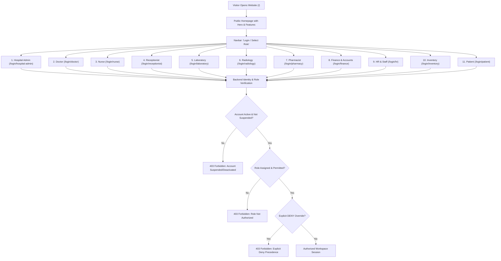

# ASRTAVA Public Homepage, Navbar Role Selector & Login Flow

**Document Reference:** `docs/project/ROLE_SELECTION_AND_LOGIN_FLOW.md`  
**Execution Authority:** ASRTAVA Master Execution Controller  
**Status:** Implemented & Verified in Release Candidate (v1.0.0-RC1)  

---

## 1. Architectural Overview & Design Principle

ASRTAVA features a single public website entry point (`/`). Selecting a role from the public navbar directs the user to the appropriate login experience without granting any premature authorization.

---

## 2. Public Homepage Architecture (`/`)

The public homepage at `/` contains:
1. **ASRTAVA Branding & Identity:** High-contrast logo mark, v1.0.0 Enterprise tag, and system indicators.
2. **Main Navigation Bar:** Clinical Modules, Enterprise Security, Platform Benefits, About ASRTAVA, and 24x7 Contact Support Desk.
3. **Role Dropdown Button:** Prominently styled **Login / Select Role** dropdown displaying all 11 roles with numbers, category badges, and descriptions.
4. **Hero Section:** Clean visual presentation highlighting zero hardcoded data, 12 integrated workspaces, and kernel-level PostgreSQL RLS.
5. **Product Introduction & Architecture:** Explaining Hospital Admin controlled staff access and explicit DENY precedence.
6. **Hospital Management Features:** Interactive directory of all 11 role portals.
7. **Enterprise Benefits:** FEFO drug dispensation, Merkle audit chaining, and HL7/FHIR interoperability.
8. **About Section:** Mission statement and clinical engineering heritage.
9. **Contact & NOC Information:** Emergency 24x7 telephone and email support.
10. **Footer:** Statutory DPDP Act 2023, ISO 27001, and HIPAA compliance attestations.

---

## 3. Navbar Role Selector Options Matrix

The navbar dropdown contains 11 authorized login gateways:

| # | Role Option | Target Route | Portal Identifier | Scope & Clinical Function |
| :-: | :--- | :--- | :--- | :--- |
| **1** | **Hospital Admin** | `/login/hospital-admin` | `hospital-admin` | Master governance, staff access, departments, tariffs & JIT approvals |
| **2** | **Doctor** | `/login/doctor` | `doctor` | OPD patient queues, clinical EMR, SOAP notes & digital e-prescriptions |
| **3** | **Nurse** | `/login/nurse` | `nursing` | Inpatient wards, bed census, vitals charting & MAR medication doses |
| **4** | **Receptionist** | `/login/receptionist` | `reception` | Live token queues, patient registration & OPD doctor appointments |
| **5** | **Laboratory** | `/login/laboratory` | `laboratory` | LIMS specimen collection, analyzer interfaces & pathologist sign-offs |
| **6** | **Radiology** | `/login/radiology` | `radiology` | PACS/DICOM study viewer, imaging worklists & diagnostic reports |
| **7** | **Pharmacist** | `/login/pharmacy` | `pharmacy` | FEFO batch inventory, prescription dispensing & counter POS sales |
| **8** | **Finance & Accounts** | `/login/finance` | `finance` | Consolidated invoicing, payment collections, insurance TPA & GST |
| **9** | **HR & Staff** | `/login/hr` | `hr` | Employee directory, duty shift rosters & attendance management |
| **10** | **Inventory & Procurement** | `/login/inventory` | `inventory` | Central stores, purchase orders (PO) & Goods Receipt Notes (GRN) |
| **11** | **Patient** | `/login/patient` | `patient` | Health history, e-prescriptions, lab downloads & online bills |

*Note: Platform Super Admin (`/super-admin/login`) is deliberately separated from the public staff role selector to enforce strict isolation between tenant hospital operations and platform SaaS infrastructure.*

---

## 4. Role Selection Flow & Authentication Logic

When a visitor clicks any of the 11 role items:
1. Client transitions to `/login/:roleSlug` without granting authorization.
2. The active role badge, title, icon, and description are rendered in [`RoleLoginView.tsx`](file:///c:/Users/madha/Desktop/Medical_Project/apps/web-portal/src/auth/RoleLoginView.tsx).
3. The visitor is provided:
   - Dedicated credentials inputs (Email or Phone + Password).
   - Hospital Code (for Hospital Admin).
   - "Forgot Password?" recovery modal.
   - "← Return to Public Homepage" link.
4. On submission:
   - The payload sends `email`, `password`, and `targetPortal`.
   - The backend validates password hash (`bcrypt`), account active flag (`is_active`), hospital tenant membership, and assigned roles.
   - If the account does not hold the requested role, the request is rejected with `403 Forbidden` and audited.
   - If authorized, the backend issues an access token and user session bound to that portal.
   - If the user has multiple authorized roles, a workspace switcher appears in their authenticated navigation.

