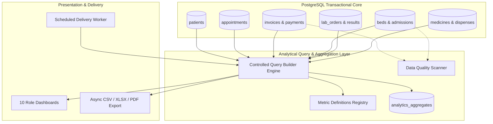

# ASRTAVA Reporting and Analytics Architecture

## 1. Architectural Philosophy
ASRTAVA provides a multi-tenant healthcare business intelligence platform embedded directly within the modular monolith. The architecture decouples analytical aggregations from high-frequency transactional clinical tables, using indexed reporting views, materialized aggregates, and asynchronous export workers.

## 2. Core Architectural Pillars
1. **Zero Raw SQL Injections**: Dynamic queries are compiled through `ReportBuilderService` against a strict whitelist of approved datasets, fields, operators, and aggregations.
2. **Tenant Scoping & PostgreSQL RLS**: Every hospital report query automatically injects `where({ hospital_id: hospitalId })`. Super-Admin SaaS metrics run in a segregated platform scope.
3. **Decoupled Financial Domains**: Patient billings (consultations, beds, medicines) are strictly segregated from SaaS recurring subscription invoices (MRR/ARR).
4. **Data Quality Integrity Audits**: Automated background scans verify financial arithmetic, detect duplicate demographic records, and validate bed census consistency.

