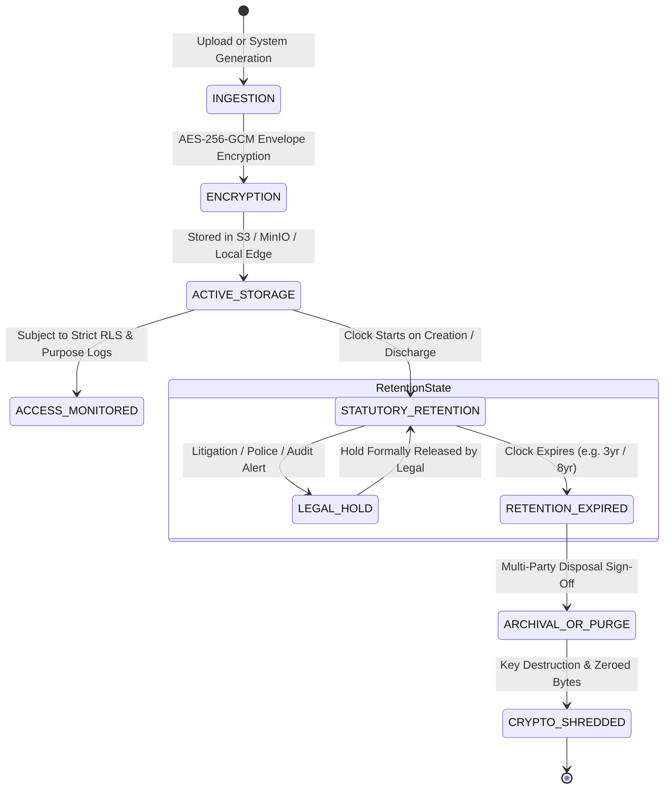

# ASRTAVA Document Security, Access Control & Statutory Retention Policy

**Document Reference:** `DOC-ASRTAVA-SEC-RETENTION-2026-V1`  
**Evaluation Standard:** Zero Unverified Production Claims · Strict Tenant Isolation · Non-Production Pre-Pilot Validation  
**Regulatory Standards:** Digital Personal Data Protection (DPDP) Act 2023 · NMC RMP Regulations 2023 · Information Technology Act 2000 · Clinical Establishments Act  
**Auditor:** Antigravity Autonomous Clinical & Enterprise Architecture Engineering Agent  

---

## 1. Architectural Purpose & Security Invariants

In a paperless healthcare operations platform, digital records possess the same legal evidentiary weight as physical handwritten paper documents. Consequently, document security, access control, cryptographic verification, and retention governance must be enforced systematically across the entire lifecycle:

---

## 2. Document Access Control & Isolation Invariants

1. **Strict Multi-Tenant Scoping**:
   - Every document record in PostgreSQL contains a mandatory, non-nullable `hospital_id UUID` column.
   - Access queries are wrapped in PostgreSQL Row-Level Security (`current_setting('app.current_tenant_id')`).
   - A clinician or staff member authenticated to Hospital Alpha is strictly denied read, write, preview, or metadata discovery of documents belonging to Hospital Beta.
2. **Role-Based and Scoped Purpose Access**:
   - Access to confidential patient documents (e.g. psychiatric evaluation notes, HIV testing results) is restricted by `confidentiality_tier`:
     - `STANDARD`: Accessible to treating clinical team with active encounter context.
     - `RESTRICTED`: Accessible only to primary treating specialist and attending nurse.
     - `HIGHLY_CONFIDENTIAL`: Requires an explicit authorization override with an audited justification.
3. **Zero Standing Privilege for Platform Super Admins**:
   - Platform Super Admins operating the SaaS multi-tenant control plane are strictly prohibited from opening, viewing, downloading, or indexing clinical medical records.
   - For emergency infrastructure troubleshooting, a Super Admin must request a Just-In-Time (JIT) access grant:
     - Must specify an active customer ticket ID and technical justification.
     - Maximum session duration: 60 minutes.
     - Every document access during a JIT session produces a high-priority tamper-evident audit record logged to the customer's security console.
4. **Pre-Signed Ephemeral Download URLs**:
   - The platform never exposes public, static URLs to object storage files.
   - When an authorized clinician or patient requests a document preview or download, the server generates a time-bound HMAC-SHA256 signed URL:
     - URL expiration: 15 minutes.
     - Single-use or short-lived token binding client IP address and user session ID.

---

## 3. Statutory Document Retention Schedules (Indian Healthcare Mandates)

| Document Category | Target Records | Applicable Indian Regulation | Minimum Retention Period | Disposition Action upon Expiry |
| :--- | :--- | :--- | :---: | :--- |
| **Inpatient Medical Charts** | Admission forms, clinical notes, doctor orders, nursing observations, discharge summaries | NMC Registered Medical Practitioner Regulations 2023 (Reg 13) | **3 Years** from date of discharge | Long-term cold archive (Glacier) or authorized cryptographic shredding |
| **Outpatient Records** | OPD consultations, prescriptions, referrals | NMC RMP Regulations 2023 / State Medical Council | **3 Years** from date of visit | Archive or controlled purge |
| **Medico-Legal Records (MLC)** | Police intimation, trauma assault charts, autopsy/post-mortem reports | Code of Criminal Procedure (CrPC) / Indian Evidence Act | **Permanent / Life of Case** | Perpetual legal hold; deletion strictly prohibited |
| **Pediatric Records** | Birth records, pediatric admissions, immunization charts | Indian Medical Council Guidelines | **Until Patient Reaches Age 21** (Age of Majority + 3 Years) | Review upon patient attaining 21 years of age |
| **Diagnostic Laboratory Reports**| Hematology, biochemistry, microbiology, pathology results | NABH 5th Edition / NABL 112 | **5 Years** | Long-term digital storage |
| **Diagnostic Radiology Studies** | Digital DICOM images (X-Ray, CT, MRI, Ultrasound) and reports | Atomic Energy Regulatory Board (AERB) / NABH | **5 Years** (Adults) / **Until Age 21** (Pediatrics) | Tiered migration to deep cold storage |
| **Financial & Tax Records** | Patient billing invoices, receipts, general ledger JVs, tax records | Income Tax Act 1961 (Section 44AA) / GST Act | **8 Years** from end of relevant financial year | Board-approved financial purge |
| **Procurement & Vendor Files** | Purchase orders, vendor contracts, GRN vouchers, invoices | Indian Companies Act 2013 | **8 Years** | Archive or contract disposal |
| **Employee & HR Records** | Staff personal files, credentials, PF/ESI records, payroll registers | Employees' Provident Funds Act / Minimum Wages Act | **5 Years** post-termination / **Permanent** (Pension) | Permanent archive of retirement records |

---

## 4. Legal Hold Implementation Specifications

1. **Triggering Legal Hold**:
   - A document can be placed under Legal Hold by an authorized Hospital Admin, CMO, or Hospital Legal Officer (`enterprise_documents.legal_hold = TRUE`).
   - Triggering requires: `hold_reason` (e.g., "Court Subpoena #CASE-2026-991", "Patient Consumer Forum Dispute"), `issuing_authority`, and `authorized_by_user_id`.
2. **Enforcement Behavior**:
   - When `legal_hold == TRUE`:
     - Automated retention purge scripts are strictly bypassed.
     - Manual deletion attempts by any user (including Super Admin) throw an immutable error: `DOCUMENT_UNDER_LEGAL_HOLD_DELETION_FORBIDDEN`.
     - File storage objects cannot be purged or modified in object storage (Object Lock in Governance/Compliance mode).
3. **Releasing Legal Hold**:
   - Requires dual sign-off from the Hospital Legal Officer and Chief Medical Officer.
   - All hold placement and release actions are recorded in the Merkle-tree cryptographic audit ledger.

---

## 5. Cryptographic Shredding & Secure Destruction

When a document reaches the end of its statutory retention period and is not under legal hold:
1. **Multi-Party Destruction Sign-Off**:
   - The system queues the document in the **"Pending Disposal Review"** queue.
   - Formal electronic sign-off is required from the Medical Records Officer and Department Head.
2. **Cryptographic Erasure**:
   - The Document Data Key (DEK) used to encrypt the payload is permanently purged from Key Management Service (KMS).
   - In accordance with DoD 5220.22-M / NIST SP 800-88, the underlying file chunks in object storage are zeroed out and unlinked.
   - Without the DEK, raw stored ciphertext becomes mathematically unrecoverable.
3. **Disposal Certificate**:
   - A tamper-evident **Document Destruction Certificate** is committed to `enterprise_document_destruction_audit`, recording: Document UUID, Document Title, Category, Creation Date, Destruction Date, Statutory Mandate, Signer IDs, and SHA-256 Digest of the pre-destruction metadata.
