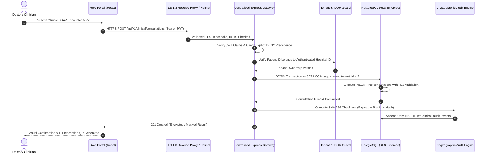
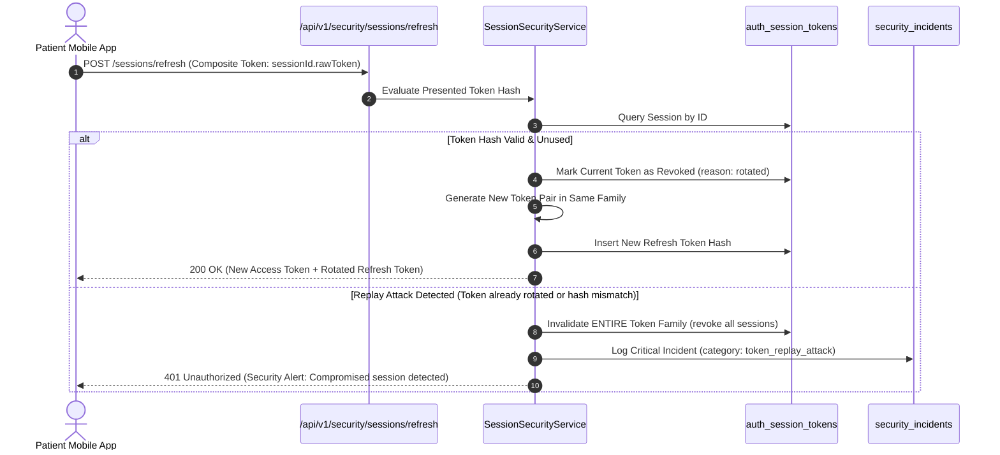

# ASRTAVA End-to-End Data Flow & Network Boundary Diagrams

## 1. Clinical Data Ingress & Persistence Flow



---

## 2. Token Rotation & Replay Reuse Detection Flow



---

## 3. Data Subject Right (DSR) Erasure Request Evaluation Flow

```mermaid
flowchart TD
    Start([Patient Submits Erasure Request under DPDP 2023]) --> VerifyIdentity[Verify Patient Identity & Multi-Factor Auth]
    VerifyIdentity --> FetchHistory[Fetch Patient Clinical & Financial History]
    FetchHistory --> CheckClinicalRetention{Are Clinical Records < 3 yrs (Adult) or < 21 yrs (Minor)?}
    
    CheckClinicalRetention -- Yes --> ApplyClinicalHold[Apply Statutory Medical Legal Hold: NMC RMP Regulations 2023]
    CheckClinicalRetention -- No --> CheckFinancialRetention{Are Financial Ledgers < 8 years old?}
    
    ApplyClinicalHold --> CheckFinancialRetention
    CheckFinancialRetention -- Yes --> ApplyFinancialHold[Apply Statutory Tax Legal Hold: Income Tax Act Sec 44AA]
    CheckFinancialRetention -- No --> CheckHoldsActive{Are Any Statutory Holds Active?}
    
    ApplyFinancialHold --> CheckHoldsActive
    CheckHoldsActive -- Yes --> PseudonymizeIdentifiers[Pseudonymize Non-Essential Identifiers (Phone, Email, Contact)]
    PseudonymizeIdentifiers --> UpdateStatusHold[Update DSR Status: 'legal_hold_retained' with Statutory Citation]
    UpdateStatusHold --> End([Audit Trail Appended & Patient Informed])
    
    CheckHoldsActive -- No --> CryptographicPurge[Cryptographically Erase Patient Direct Identifiers]
    CryptographicPurge --> UpdateStatusComplete[Update DSR Status: 'completed']
    UpdateStatusComplete --> End
```

