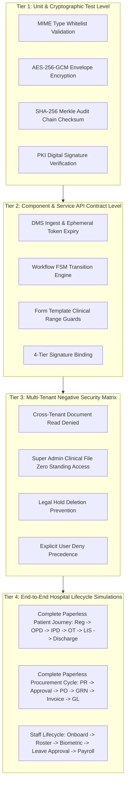

# ASRTAVA Paperless Operations: End-to-End Test Suite & Verification Specifications

**Document Reference:** `DOC-ASRTAVA-TEST-VERIFY-2026-V1`  
**Evaluation Standard:** Zero Unverified Production Claims · Strict Tenant Isolation · Non-Production Pre-Pilot Validation  
**Scope:** Automated Test Specifications across All 19 Operational Domains  
**Auditor:** Antigravity Autonomous Clinical & Enterprise Architecture Engineering Agent  

---

## 1. Test Harness Architecture & Methodology

Verification of the paperless healthcare operations platform is structured across four rigorous validation tiers:

---

## 2. Key Synthetic Test Scenarios

### Scenario 1: Complete Paperless Patient Clinical Inpatient Journey
- **Step 1 (Reception)**: Patient arrives at reception; staff captures demographic data and scans national ID into DMS. Patient signs digital DPDP consent via stylus eSign pad. System issues digital UHID and QR check-in pass.
- **Step 2 (Emergency / OPD)**: Attending physician documents structured clinical encounter using SOAP template. Doctor enters prescription with allergy cross-matching. System publishes digital order to pharmacy and laboratory.
- **Step 3 (Inpatient Admission)**: Inpatient bed allocated in ICU/CCU. Patient admission agreement signed electronically. Bedside nurse charts vitals using NEWS2 flowsheet on tablet.
- **Step 4 (Surgery & Perioperative)**: Surgeon schedules procedure. 3-phase WHO surgical safety checklist completed interactively in OT. Sponge and instrument count reconciled digitally. Patient transferred to PACU; recovery tracked via Modified Aldrete score ($\ge 9$ required for discharge).
- **Step 5 (Laboratory Diagnostics)**: Phlebotomist accessions specimen with barcode label. Analyzer ingests test. Pathologist reviews critical panic flag, completes mandatory telephone read-back, and cryptographically signs report (DSC Tier 4).
- **Step 6 (Multidisciplinary Discharge)**: Attending physician enters digital discharge summary. Pharmacist confirms discharge medication dispensing. Billing officer generates itemized GST tax invoice. Patient settles bill via online payment and receives digital receipt. Bed vacated and queued for terminal sanitization.
- **Expected Outcome**: Entire patient journey completed with zero physical paper forms, zero handwritten charts, and an unbroken SHA-256 audit chain.

---

### Scenario 2: Complete Paperless Supply Chain & Procurement Cycle
- **Step 1 (Requisition)**: OT Nurse In-Charge raises a digital purchase requisition for surgical sutures ($₹65,000$).
- **Step 2 (Workflow Routing)**: Requisition automatically routes to Head of Surgery for clinical vetting, followed by Stores Superintendent for stock availability verification.
- **Step 3 (Financial Clearance)**: Because amount exceeds $₹50,000$, workflow escalates to Chief Financial Officer for budget authorization. CFO signs off using Tier 3 eSign.
- **Step 4 (Purchase Order)**: System generates a tamper-evident Purchase Order PDF with embedded verification QR code and dispatches it electronically to the approved vendor.
- **Step 5 (Goods Receipt & 3-Way Match)**: Vendor delivers stock. Stores inspector generates Goods Receipt Note (GRN) with lot numbers and expiry dates. System performs 3-Way Matching (PO $==$ GRN $==$ Vendor Invoice).
- **Step 6 (General Ledger JV)**: Upon approval, system automatically posts a balanced double-entry Journal Voucher to the General Ledger ($\sum \text{Dr} == \sum \text{Cr}$).
- **Expected Outcome**: Zero paper purchase orders printed, zero paper requisition slips signed, complete audit trail preserved in `procurement_audit`.

---

## 3. Negative Security & Boundary Verification Cases

| Test Case ID | Security Vector | Execution Condition | Expected System Response | Verification Standard |
| :--- | :--- | :--- | :--- | :--- |
| **SEC-DMS-01** | Cross-Tenant Document Access | User authenticated with `Hospital Alpha` JWT requests document ID belonging to `Hospital Beta` | Immediate `403 Forbidden` (`CROSS_TENANT_ACCESS_DENIED`) | Zero data leakage across hospital boundaries |
| **SEC-DMS-02** | Super Admin Document Spying | Platform Super Admin attempts to download patient discharge summary without JIT token | Immediate `403 Forbidden` (`SUPER_ADMIN_CLINICAL_ACCESS_BLOCKED`) | Zero standing privilege for platform operators |
| **SEC-DMS-03** | Tampered Document Detection | Byte 4,096 of a stored PDF is maliciously altered on disk | File retrieval aborted with `500 Data Integrity Error` (`SHA256_CHECKSUM_MISMATCH`) | Automatic quarantine and security incident logged |
| **SEC-DMS-04** | Expired Ephemeral Token | Client presents a pre-signed download token after 15-minute validity window | Immediate `401 Unauthorized` (`PRE_SIGNED_TOKEN_EXPIRED`) | Download strictly rejected |
| **SEC-DMS-05** | Legal Hold Override Attempt | User attempts to delete a medical record flagged with `legal_hold = TRUE` | Immediate `409 Conflict` (`DOCUMENT_UNDER_LEGAL_HOLD_DELETION_FORBIDDEN`) | Deletion strictly prevented |
| **SEC-DMS-06** | Self-Approval Circumvention | Requester attempts to approve their own purchase requisition | Immediate `400 Bad Request` (`WORKFLOW_SELF_APPROVAL_FORBIDDEN`) | Anti-circumvention guard enforced |

---

## 4. Concurrency & Performance Targets

- **Document Ingestion Latency**: $\le 150\text{ ms}$ for documents up to $5\text{ MB}$ (including envelope encryption and SHA-256 computation).
- **Pre-Signed Token Generation**: $\le 15\text{ ms}$ under concurrent load of 500 requests/second.
- **Workflow State Transition**: $\le 25\text{ ms}$ per approval transition including HMAC state hash computation and database commit.
- **Audit Verification Latency**: $\le 5\text{ ms}$ per block validation.
