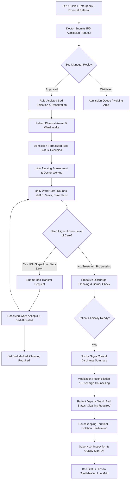

# ASRTAVA End-to-End Inpatient Flow Map

## 1. Acute Inpatient Lifecycle Flowchart

## 2. Invariant Rules
- **No Double-Booking**: Simultaneous active allocation or reservation of the same bed is prevented via database-level row locks (`FOR UPDATE`).
- **No Premature Availability**: A vacated bed cannot become `available` until housekeeping completes sanitization and supervisor logs inspection approval.
- **Financial Decoupling**: Clinical discharge summary and patient education are never gated by cashier payment clearance.

